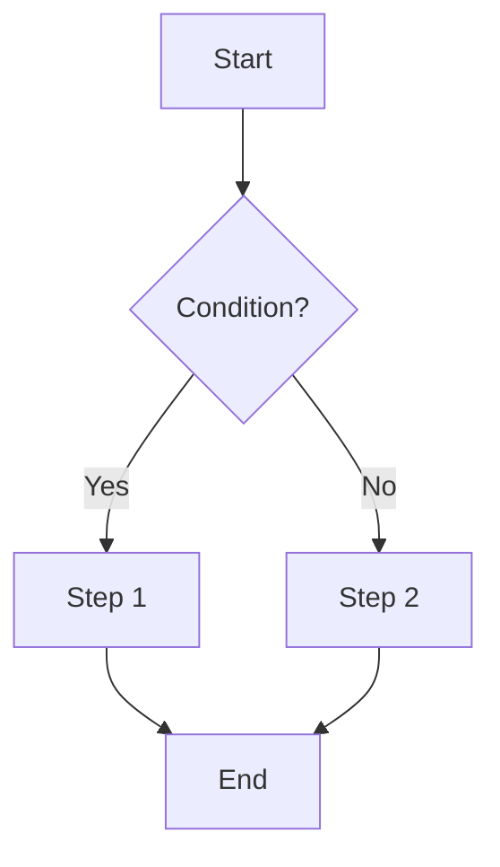

# Workflow: [Tên Workflow]

## Metadata

| Field | Value |
|-------|-------|
| **ID** | WF-XXX |
| **Owner** | |
| **Status** | Draft / Review / Approved |
| **Related Use Cases** | UC-XXX |

## Mô tả

> Mô tả ngắn gọn workflow này làm gì, khi nào được kích hoạt.

## Trigger

- Sự kiện hoặc hành động kích hoạt workflow

## Input

| Tên | Kiểu | Mô tả |
|-----|------|--------|
| | | |

## Output

| Tên | Kiểu | Mô tả |
|-----|------|--------|
| | | |

## Flow Diagram

## Steps

| Step | Mô tả | Actor/System | Error Handling |
|------|--------|--------------|----------------|
| 1 | | | |
| 2 | | | |

## Error Scenarios

| Scenario | Handling | Retry? |
|----------|----------|--------|
| | | |

## Notes
