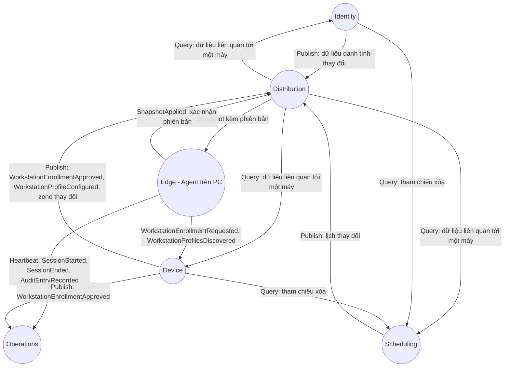

# 🗺️ bounded-contexts.md

> Ranh giới logic của domain. Việc triển khai thành module hay service là quyết định ở 06-Architecture.

## Context Map

## Quan hệ giữa các context

| Từ → Đến | Kiểu | Nội dung |
|----------|------|----------|
| Identity, Device, Scheduling → Distribution | Publish event | Mọi thay đổi có thể ảnh hưởng nội dung snapshot của một hay nhiều máy (gồm cả cấu hình profile và duyệt máy mới) |
| Distribution → Identity, Device, Scheduling | Query (chỉ đọc) | Dựng snapshot của một máy: lịch áp dụng cho máy hoặc zone của máy, nhóm và user liên quan, thẻ của các user đó, allowlist profile |
| Distribution → Edge | Snapshot / Lease | Bản snapshot có phiên bản hoặc xác nhận gia hạn thời hạn tin cậy, kèm tham số vận hành |
| Edge → Device | Request / Report | Yêu cầu đăng ký máy (`WorkstationEnrollmentRequested`), báo cáo profile phát hiện (`WorkstationProfilesDiscovered`) |
| Edge → Distribution | Event | `SnapshotApplied`: phiên bản PC đang dùng |
| Edge → Operations | Event | Heartbeat, mở/đóng phiên, bản ghi nhật ký quẹt thẻ |
| Device → Operations | Publish event | `WorkstationEnrollmentApproved` để khởi tạo trạng thái máy |
| Identity, Device → Scheduling | Query (chỉ đọc) | Kiểm tra còn Schedule tham chiếu trước khi xóa |

## Context Details

### Identity
Quản lý danh tính người dùng, nhóm, liên kết thẻ và tài khoản quản trị. Dữ liệu là nguồn nhập của hệ thống (dashboard); không sở hữu thẻ vật lý.
- Entities: User, Group, Card, AdminAccount.
- Events phát: `UserDeactivated`, `UserActivated`, `UserUpdated`, `GroupMembershipChanged`, `CardBound`, `CardUnbound`, `CardDisabled`, `CardEnabled`.

### Device
Cấu hình tĩnh của máy trạm, phân nhóm theo zone, đăng ký agent, danh mục allowlist profile tài khoản Linux dùng chung.
- Entities: EnrollmentRequest, Workstation, WorkstationProfile, Zone.
- Events phát: `WorkstationEnrollmentRequested`, `WorkstationEnrollmentApproved`, `WorkstationZoneChanged`, `ZoneDeleted`, `WorkstationProfileConfigured`.

### Scheduling
Định nghĩa lịch: ai được dùng máy nào, khi nào, vào profile nào.
- Entities: Schedule (gồm Subject, Target, RecurrenceRule, TargetProfile).
- Events phát: `ScheduleCreated`, `ScheduleUpdated`, `ScheduleEnabled`, `ScheduleDisabled`, `ScheduleDeleted`.

### Distribution (Sync)
Dựng và phát dữ liệu cho từng máy; theo dõi máy đang dùng phiên bản nào. Không sở hữu dữ liệu gốc, chỉ sở hữu bản dẫn xuất (Snapshot) và trạng thái đồng bộ.
- Entities: Snapshot, SyncState.
- Events phát: `SnapshotPublished`.
- Lắng nghe: mọi event thay đổi của Identity, Device, Scheduling; `SnapshotApplied` từ Edge.

### Operations (phía server)
Ghi nhận những gì xảy ra ở các máy: trạng thái online/offline, phiên, nhật ký quẹt thẻ.
- Entities: WorkstationStatus, Session (bản server nhận qua báo cáo), AuditLog.
- Events phát: `WorkstationWentOnline`, `WorkstationWentOffline`, `WorkstationRebooted`.

### Edge (Agent trên PC)
Context chạy trên máy, giữ phần domain ra quyết định và ánh xạ profile. Hoạt động độc lập với server trong thời hạn tin cậy.
- Entities: LocalSnapshot, LocalWorkstationProfile, LocalSession, AuditOutbox.
- Events phát: `LoginDecided`, `SessionStarted`, `SessionEnded`, `SnapshotApplied`, `AuditEntryRecorded`.