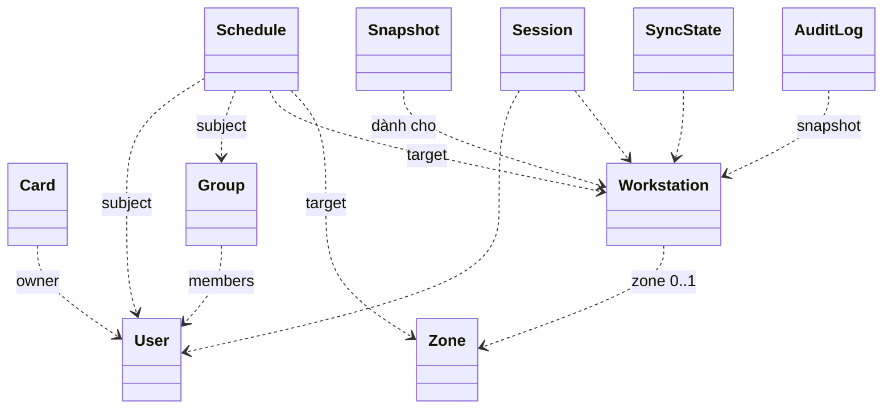

# 🏗️ domain-model.md

## Overview
> Domain Model độc lập công nghệ lưu trữ. Bảng, khóa, index thuộc 07-Data.

Nguyên tắc:
- Mỗi aggregate tham chiếu aggregate khác chỉ bằng Typed ID.
- **Snapshot là bản dẫn xuất**, không phải nguồn sự thật. Nguồn sự thật nằm ở Identity, Device, Scheduling.
- Quyết định đăng nhập được thực hiện ở Edge từ LocalSnapshot (BR-005).
- Khung giờ theo múi giờ của triển khai (BR-012).

## Quan hệ chính

## Entities

### Identity
**User**: id, external_id (duy nhất, không rỗng), full_name, email (tùy chọn), status (`active`, `inactive`). Không xóa cứng.

**Card**: id, uid (CardUid, duy nhất kể cả `unbound`), owner_id (rỗng khi `unbound`), status (`unbound`, `active`, `disabled`). Là liên kết giữa UID và user, không phải bản ghi thẻ vật lý.

**Group**: id, name (duy nhất, không phân biệt hoa thường sau trim), members (tập UserId, có thể rỗng; user `inactive` vẫn có thể là thành viên).

**AdminAccount**: id, username (duy nhất), display_name, status (`active`, `disabled`). Tách biệt với User quẹt thẻ.

### Device
**Workstation**: id, hostname, mac_address (duy nhất), zone_id (tùy chọn), enrolled (đã đăng ký agent hay chưa), default_profile_id (profile mặc định của máy).

**WorkstationProfile**: id, workstation_id, os_username, display_name, profile_type (`shared`), is_default (boolean), status (`enabled`, `disabled`), description. Danh sách profile tài khoản Linux được phép dùng trên máy trạm (Allowlist).

**Zone**: id, name (duy nhất, không rỗng), location (không rỗng), description (tùy chọn). Danh sách phẳng.

**EnrollmentToken**: id, note, max_uses (≥ 1, mặc định 1), uses (danh sách máy và thời điểm đã dùng), expires_at, status (`active`, `revoked`), created_by.

### Scheduling
**Schedule**: id, name, subject (Subject), target (Target), recurrence (RecurrenceRule), target_profile_id (tùy chọn, trỏ tới WorkstationProfile; nếu rỗng thì nhận default profile của máy), status (`enabled`, `disabled`). Một Schedule là một dòng "ai, ở đâu, khi nào, profile nào".

### Distribution
**Snapshot** (bản dẫn xuất, theo từng máy): workstation_id, version (tăng dần theo máy), generated_at, content (SnapshotContent gồm: thẻ, lịch, allowlist profile của máy), parameters (thời hạn tin cậy, thời gian cảnh báo trước hạn phiên).

**SyncState**: workstation_id, desired_version, acked_version, acked_at. Trạng thái đồng bộ (`InSync`, `PendingSync`, và `Stuck` khi pending quá lâu lúc online) là hàm tính ra từ so sánh `acked_version` với `desired_version`, không lưu cờ riêng.

### Operations
**WorkstationStatus**: workstation_id, connectivity (`online`, `offline`), last_heartbeat, boot_id; kèm trạng thái đối soát sau reboot theo từng máy (`Idle`, `Draining`). "Đang dùng" suy ra từ Session `active`, không lưu.

**Session** (bản server nhận từ báo cáo của Edge): id, decision_id (bắt buộc, khớp entry_id của lần quẹt), user_id, card_id, workstation_id, target_profile_id, os_username, started_at, expires_at, status (`active`, `completed`, `forced_logout`, `abandoned`), ended_at, end_reason, end_source (`reported`, `reconstructed`, `inferred`).

**AuditLog**: id, entry_id (do Edge sinh, dùng để loại trùng), occurred_at, received_at, outcome (`granted`, `denied`, `error`), reason, detail (chi tiết bổ sung, ví dụ: `no_data`, `lease_expired`, `clock_suspect`, `ambiguous_profile`), card_uid, reader_raw (hex cắt ngắn, chỉ khi lỗi đọc), user (UserSnapshot), card (CardSnapshot), workstation (WorkstationSnapshot), target_os_username, data_version (phiên bản snapshot đã dùng). Bất biến.

### Edge
> Toàn bộ thực thể và kho lưu trữ của Edge được hợp nhất trong một cơ sở dữ liệu SQLite duy nhất (`edge.db`, chế độ WAL). Mọi thao tác cập nhật dữ liệu, ghi nhật ký và đối soát phiên đều thực thi trong các giao dịch nguyên tử.

**LocalSnapshot**: snapshot đang dùng (version, content, parameters), received_at, trusted_until (UTC), lease_duration, verified_floor (tính từ `server_time + CLOCK_BOOTTIME`). Lưu trữ trong bảng `local_snapshot`. Thay thế nguyên tử; chỉ nhận bản có version lớn hơn.

**LocalWorkstationProfile**: danh sách profile được phép dùng cục bộ theo allowlist đã được Server đồng bộ: profile_id, workstation_id, os_username, is_default, status (`enabled`, `disabled`). Lưu trong bảng `workstation_profile`. Agent và PAM chỉ mở phiên cho profile nằm trong bảng này và có status `enabled`.

**LocalSession**: session_id, decision_id (bắt buộc, khớp entry_id), user_id, card_id, target_profile_id, os_username, started_at, expires_at (UTC), boottime_limit (hạn đo theo `CLOCK_BOOTTIME`), boot_id, status (`pending`, `active`, `discarded`). Lưu trong bảng `local_session`. Tối đa một phiên active và một pending.

**LocalLiveness**: `last_alive_at` ghi định kỳ xuống đĩa; dùng làm cận dưới `ended_at` khi dựng lại phiên sau crash đột ngột.

**AuditOutbox**: danh sách bản ghi quẹt thẻ và sự kiện phiên được đánh số thứ tự đơn điệu cục bộ `outbox_seq`; lưu trong bảng `audit_outbox`; giữ qua mất mạng và khởi động lại; xác nhận từ server theo `outbox_seq`.

## Value Objects
| Value Object | Mô tả |
|---|---|
| Typed ID | Mỗi loại ID một kiểu riêng (UserId, CardId, GroupId, WorkstationId, ZoneId, ScheduleId, SessionId, EntryId...) |
| CardUid | Hex chuẩn hóa (chữ hoa, bỏ `:`, khoảng trắng, gạch ngang); 4, 7 hoặc 10 byte |
| MacAddress | Địa chỉ MAC chuẩn hóa |
| TimeOfDay | Phút kể từ nửa đêm, từ 0 đến 1440; chỉ giờ kết thúc được bằng 1440 (24:00) |
| Subject | Đúng một: UserId hoặc GroupId |
| Target | Đúng một: WorkstationId hoặc ZoneId |
| RecurrenceRule | valid_from, valid_to (tùy chọn), days_of_week, start_time, end_time; khoảng `[start_time, end_time)` |
| SnapshotContent | Các mục thẻ (CardMatchKey, trạng thái, chủ thẻ), mục user (id, tên, trạng thái, nhóm), mục Schedule áp dụng cho máy. Chỉ chứa dữ liệu liên quan tới máy (INV-012); **gồm cả thẻ `disabled` và user `inactive`** để hiển thị đúng lý do từ chối. Snapshot không chứa UID gốc (ADR-007) |
| LoginDecision | id (do Edge sinh), outcome, reason, card_uid, user, expires_at, decided_at, data_version |
| BootId | Định danh một lần khởi động máy |
| EnrollmentUse | workstation_id, used_at |
| CardMatchKey | Khóa so khớp thẻ trong snapshot: HMAC của UID bằng khóa riêng theo máy. Domain dùng trừu tượng; thuật toán cụ thể ở ADR-007 |
| UserSnapshot, CardSnapshot, WorkstationSnapshot | Ảnh chụp tại thời điểm sự kiện (mã, tên, hostname, zone) |

## Enumerations
| Enum | Giá trị |
|---|---|
| UserStatus | `active`, `inactive` |
| CardStatus | `unbound`, `active`, `disabled` |
| AdminAccountStatus | `active`, `disabled` |
| EnrollmentTokenStatus | `active`, `revoked` |
| ScheduleStatus | `enabled`, `disabled` |
| DayOfWeek | `MONDAY` … `SUNDAY` |
| Outcome | `granted`, `denied`, `error` |
| DenyReason | `unknown_card`, `card_disabled`, `user_inactive`, `no_schedule`, `out_of_schedule`, `data_stale`, `workstation_busy`, `ambiguous_profile`, `profile_disabled`, `profile_not_found` |
| ErrorReason | `invalid_uid`, `reader_error` |
| Connectivity | `online`, `offline` |
| SessionStatus | `active`, `completed`, `forced_logout`, `abandoned` (LocalSession có thêm `pending`, `discarded`) |
| EndReason | `user_logout` (completed); `schedule_expired` (forced_logout); `workstation_rebooted`, `superseded`, `os_session_lost` (abandoned) |

## Aggregates
| Aggregate Root | Context | Scope | Bảo vệ |
|---|---|---|---|
| User | Identity | MVP | INV-002 |
| Card | Identity | MVP | INV-001, INV-006 |
| Group | Identity | MVP | INV-003 |
| AdminAccount | Identity | MVP | INV-016 |
| Workstation | Device | MVP | INV-009 |
| WorkstationProfile | Device | MVP | INV-018 |
| Zone | Device | MVP | INV-003 |
| EnrollmentToken | Device | MVP | INV-010 |
| Schedule | Scheduling | MVP | INV-004, INV-005 |
| Snapshot | Distribution | MVP | INV-011, INV-012 |
| SyncState | Distribution | MVP | |
| WorkstationStatus | Operations | MVP | |
| Session | Operations | MVP | INV-007 |
| AuditLog | Operations | MVP | INV-008 |
| LocalSnapshot | Edge | MVP | INV-011 |
| LocalWorkstationProfile | Edge | MVP | INV-018 |
| LocalSession | Edge | MVP | INV-014, INV-015 |
| AuditOutbox | Edge | MVP | INV-013 |

## Domain Services

### LoginEvaluationService (Edge)
Đầu vào: `card_uid`, `now` (lấy đúng một lần cả giờ hệ thống UTC và `CLOCK_BOOTTIME`), `LocalSnapshot`, trạng thái phiên hiện tại. Thực hiện CR-001:
1. Đánh giá hàm tin cậy `trust_state(now, LocalSnapshot)`. Nếu là `NoData`, `Expired`, hoặc `ClockSuspect` → `denied(data_stale)` kèm chi tiết tương ứng (`no_data`, `lease_expired`, `clock_suspect`).
2. Kiểm tra xung đột phiên đang active (BR-008):
   - Nếu thẻ thuộc về chính user đang active: không tạo phiên mới, phát thông báo D-Bus thời lượng còn lại lên màn hình, không sinh quyết định từ chối.
   - Nếu thẻ của user khác khi Desktop đang active và phiên còn hạn: từ chối `denied(workstation_busy)`.
   - Nếu thẻ của user khác khi màn hình đã chuyển về Greeter hoặc phiên cũ đã hết hạn: tiếp tục đánh giá để thay thế phiên (`superseded`).
3. Tính `CardMatchKey` từ UID vừa quẹt (ADR-007). Tra thẻ trong snapshot theo `CardMatchKey`: không có hoặc `unbound` → `unknown_card`; `disabled` → `card_disabled`.
4. Chủ thẻ `inactive` → `user_inactive`.
5. Lấy Schedule `enabled` khớp user hoặc nhóm của user và máy hoặc zone của máy. Rỗng → `no_schedule`.
6. Lọc theo khung giờ chứa thời điểm hiện tại `now`. Rỗng → `out_of_schedule`.
7. Xác định Profile đích (D-009):
   - Gom các `target_profile_id` từ các Schedule khớp ở bước 6 (Schedule nào rỗng thì lấy `default_profile_id` của máy trạm).
   - Nếu gom được nhiều hơn 1 profile khác nhau → từ chối `denied(ambiguous_profile)` (cấm mơ hồ profile, BR-016).
   - Tra cứu profile được chọn trong bảng allowlist `workstation_profile`: không có → `denied(profile_not_found)`; `status = disabled` → `denied(profile_disabled)`.
8. Còn lại → `granted`, xác định duy nhất `target_profile` (`os_username`). Hạn phiên là điểm kết thúc của chuỗi khung giờ liên tục (nối nhau không hở, kể cả qua đêm) từ các Schedule khớp và cùng profile, nhưng không vượt quá hạn phiên tối đa (tham số). Hạn phiên gắn với cả UTC tuyệt đối (`expires_at`) và hạn đo `CLOCK_BOOTTIME`.

Kết quả là LoginDecision, luôn kèm phát `LoginDecided`. Ghi bền vững một lần: bản ghi nhật ký (entry_id, kết quả, lý do, chi tiết, version dữ liệu, target_os_username) và, nếu granted, LocalSession pending (target_profile_id, os_username, expires_at, boottime_limit) vào kho SQLite cục bộ trước khi trả LoginDecision.

### SessionLifecycleService (Edge)
- Sau khi PAM thành công và `expires_at` còn hạn: chuyển LocalSession `pending` thành `active`; đóng phiên cũ nếu còn (`abandoned` kèm lý do `superseded`), phát `SessionEnded(superseded)` và `SessionStarted` vào outbox. Nếu `expires_at` đã qua: kết thúc phiên OS ngay, chuyển `pending` thành `discarded`.
- Cảnh báo trước hạn W (phút) và tự đăng xuất khi chạm hạn (`schedule_expired`), không phụ thuộc server. Dọn sạch toàn bộ tiến trình của phiên OS (`loginctl terminate-session` / `terminate-user`, cưỡng chế `SIGKILL` cgroup slice). **Tuyệt đối không xóa thư mục home hay file dữ liệu cục bộ** sau phiên (BR-009, D-006).
- LocalSession chỉ chuyển sang trạng thái kết thúc khi phiên OS tương ứng đã thật sự kết thúc hoặc không còn (INV-017).
- Khi người dùng đăng xuất, phát `SessionEnded` (`user_logout`, `end_source = reported`).
- Tắt máy có kế hoạch: đóng `LocalSession active` với `abandoned(workstation_rebooted, end_source = reported, ended_at = now)`.
- Khởi động Agent & Recovery sau reboot/sập: nạp `boot_id` cũ, `last_alive_at`, `LocalSession`, `AuditOutbox`.
  * Khác `boot_id` (máy reboot): `LocalSession active` chuyển thành `abandoned(workstation_rebooted, end_source = reconstructed, ended_at = last_alive_at)`; `pending` chuyển `discarded`. Phát `SessionEnded` đưa vào outbox TRƯỚC khi gửi `Hello`.
  * Trùng `boot_id` (Agent restart): đối chiếu LocalSession (`active`, `pending`) với phiên OS thực tế:
    + `active` còn hạn & còn phiên OS: giữ; hết hạn: kết thúc OS, đóng `forced_logout(schedule_expired)`; không còn phiên OS: đóng `abandoned(os_session_lost)`.
    + `pending` còn hạn & còn phiên OS: chuyển `active`; hết hạn: kết thúc OS, chuyển `discarded`; không còn phiên OS: chuyển `discarded`.

### SnapshotBuilder (Distribution)
Dựng Snapshot cho một máy: lấy Schedule áp dụng (đích là máy hoặc zone của máy), gom user và nhóm liên quan, thẻ của các user đó (kể cả thẻ `disabled`, user `inactive`). Mục thẻ chứa `CardMatchKey` tính bằng khóa riêng của máy (ADR-007), không chứa UID gốc. Tăng version khi nội dung đổi. Ghi `desired_version` vào SyncState rồi phát `SnapshotPublished`.

### LeaseRenewalService (Distribution)
Nhận thông điệp Hello / heartbeat từ máy: nếu `acked_version == desired_version`, phản hồi xác nhận gia hạn thời hạn tin cậy; nếu máy tụt lại (`acked_version < desired_version`), gửi Snapshot mới nhất (đầy đủ).

### SnapshotApplier (Edge)
Nhận snapshot: kiểm tra hợp lệ, version lớn hơn bản đang dùng; thay thế nguyên tử; làm mới thời hạn tin cậy; phát `SnapshotApplied`. Không hợp lệ thì giữ bản cũ.

### AuditIngestService (Operations)
Nhận bản ghi từ Edge; loại trùng theo `entry_id`; lưu `received_at`. Xử lý lặp lại an toàn.

### WorkstationLivenessService (Operations)
- Quá số lần heartbeat bị bỏ lỡ → `WorkstationWentOffline`.
- `boot_id` đổi → `WorkstationRebooted`: suy luận chuyển các Session `active` của máy sang `abandoned` (`workstation_rebooted`) **chỉ áp dụng sau khi outbox của máy đã hết** (hoặc quá thời gian chờ). Báo cáo thật từ Agent thắng suy luận.
- Online lại với cùng `boot_id` thì giữ Session.

### CardRegistrationService (Identity)
Chuẩn hóa UID; chưa có → tạo thẻ `active` với chủ; đã có và `unbound` → gắn lại; đã có chủ → từ chối.

### AgentEnrollmentService (Device)
Kiểm tra token dùng được; tìm máy theo MAC (có thì gắn vào bản ghi đó, chưa có thì tạo máy mới); ghi một lượt dùng token và cấp định danh trong cùng một thao tác.

### DeletionGuard (cross-context)
Không xóa User, Group, Workstation, Zone nếu còn Schedule tham chiếu.

## Domain Events
| Event | Context phát | Trigger | Consumers |
|---|---|---|---|
| UserDeactivated, UserActivated, UserUpdated | Identity | Đổi trạng thái hoặc thông tin user | Distribution |
| GroupMembershipChanged | Identity | Thêm hoặc bớt thành viên | Distribution |
| CardBound, CardUnbound, CardDisabled, CardEnabled | Identity | Thao tác thẻ | Distribution |
| WorkstationRegistered | Device | Tạo hoặc đăng ký máy | Operations, Distribution |
| AgentEnrolled | Device | Agent đăng ký thành công | Distribution |
| WorkstationZoneChanged, ZoneDeleted | Device | Đổi zone của máy, xóa zone | Distribution |
| ScheduleCreated, ScheduleUpdated, ScheduleEnabled, ScheduleDisabled, ScheduleDeleted | Scheduling | Thao tác lịch | Distribution |
| SnapshotPublished | Distribution | Dựng xong snapshot mới | Edge (qua MQTT) |
| SnapshotApplied | Edge | PC dùng bản mới | Distribution (cập nhật SyncState) |
| LoginDecided | Edge | Mỗi lần quẹt thẻ | Edge (AuditOutbox) |
| AuditEntryRecorded | Edge | Đẩy nhật ký lên | Operations |
| SessionStarted, SessionEnded | Edge | Mở, đóng phiên | Operations |
| WorkstationWentOnline, WorkstationWentOffline, WorkstationRebooted | Operations | Heartbeat, mất heartbeat, đổi boot_id | Dashboard, Operations |

## Ghi chú
- Cách lưu Snapshot và SyncState, định dạng gói dữ liệu, topic MQTT thuộc 06/07/08.
- Khóa dùng để so khớp UID trên máy: xem ADR-007. Cách bảo vệ dữ liệu cục bộ thuộc 06/09.