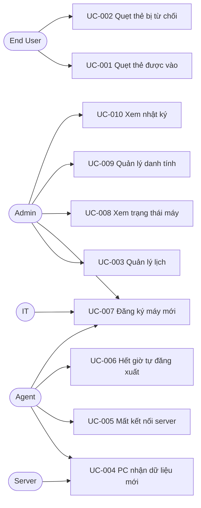

# 📋 Use Cases

> 10 use case ở mức tóm tắt. Tương tác chi tiết giữa Actor và hệ thống nằm ở 05-behavior.

## Use Case Index

| ID | Tên | Actor | Context chính | Priority | Status |
|----|-----|-------|---------------|----------|--------|
| UC-001 | Quẹt thẻ được vào | End User | Edge | High | Draft |
| UC-002 | Quẹt thẻ bị từ chối | End User | Edge | High | Draft |
| UC-003 | Admin quản lý lịch | Admin | Scheduling | High | Draft |
| UC-004 | PC nhận dữ liệu mới | Server, Agent | Distribution → Edge | High | Draft |
| UC-005 | Mất kết nối server | Agent | Edge | High | Draft |
| UC-006 | Hết giờ, tự đăng xuất | Agent | Edge | High | Draft |
| UC-007 | Đăng ký máy mới | Admin, IT, Agent | Device → Edge | High | Draft |
| UC-008 | Xem trạng thái máy | Admin | Operations | High | Draft |
| UC-009 | Admin quản lý danh tính | Admin | Identity | High | Draft |
| UC-010 | Admin xem nhật ký | Admin | Operations | High | Draft |

## Use Case Diagram

---

## UC-001: Quẹt thẻ được vào
**Mô tả:** User quẹt thẻ hợp lệ trong khung giờ được phép và vào được máy.

**Tiền điều kiện:** PC đã đăng ký; snapshot còn trong thời hạn tin cậy, đồng hồ không lệch; màn hình login đang chờ quẹt.

**Luồng chính:**
1. User quẹt thẻ; Agent đọc và chuẩn hóa UID.
2. Agent đánh giá cục bộ theo CR-001 → `granted`, xác định duy nhất target profile (`os_username`) kèm hạn phiên.
3. Màn hình login báo thành công.
4. Agent hoàn tất đăng nhập hệ điều hành vào profile dùng chung (`os_username`) qua PAM (cách ánh xạ: 06).
5. Agent mở LocalSession (gắn với `user_id` và `os_username`), phát `SessionStarted`, ghi một bản ghi vào AuditOutbox.

**Nhánh:**
- AF-1 Máy còn phiên cũ: nếu máy đang ở Greeter hoặc phiên cũ đã hết hạn ca học, phiên cũ đóng `abandoned(superseded)` trước khi mở phiên mới; nếu Desktop đang active và còn hạn, từ chối với lý do `workstation_busy` (BR-008).
- AF-2 Mất kết nối server: vẫn chạy bình thường, sự kiện nằm trong outbox.
- EF-1 Đăng nhập OS không hoàn tất sau `granted`: không mở phiên, màn hình báo lỗi. Bản ghi vẫn ghi `granted` (kết quả quyết định), liên kết phiên qua `entry_id`.

**Hậu điều kiện:** đúng một bản ghi nhật ký cho lần quẹt; tối đa một phiên active trên máy.

**Truy vết:** FR-001, 002, 007, 010, 063, 070; BR-001, 005, 007, 008, 009, 020; CR-001.

## UC-002: Quẹt thẻ bị từ chối
**Mô tả:** User quẹt thẻ nhưng không đủ điều kiện vào, và thấy lý do cụ thể.

**Tiền điều kiện:** như UC-001.

**Luồng chính:**
1. User quẹt thẻ; Agent đánh giá cục bộ → `denied` với một trong các lý do: `unknown_card`, `card_disabled`, `user_inactive`, `no_schedule`, `out_of_schedule`, `data_stale`, `workstation_busy`, `ambiguous_profile`, `profile_disabled`, `profile_not_found`.
2. Màn hình hiển thị lý do.
3. Agent ghi một bản ghi nhật ký; không mở phiên.

**Nhánh:**
- AF-1 `data_stale`: màn hình hướng dẫn dùng đường dự phòng (FR-011).
- EF-1 Đọc thẻ lỗi (lỗi đầu đọc, UID không hợp lệ): outcome `error`, vẫn ghi nhật ký.

**Hậu điều kiện:** đúng một bản ghi nhật ký; không có phiên mới.

**Notes:** `unknown_card` dùng chung cho thẻ lạ thật và thẻ mới đăng ký chưa đồng bộ, vì PC không phân biệt được. Màn hình có thể thêm gợi ý chung kiểu "thẻ chưa có trong dữ liệu máy này"; đó là quyết định UI.

**Truy vết:** FR-003, 010, 011, 070; BR-002, 003, 006; CR-001.

## UC-003: Admin quản lý lịch
**Mô tả:** Admin tạo, sửa, bật/tắt, xóa Schedule (ai, ở đâu, khi nào) và thay đổi được phân phối xuống các máy bị ảnh hưởng.

**Tiền điều kiện:** Admin đã đăng nhập dashboard.

**Luồng chính:**
1. Admin thao tác trên Schedule.
2. Server kiểm tra hợp lệ (VR-003 đến 005) và lưu.
3. Distribution xác định các máy bị ảnh hưởng, dựng snapshot phiên bản mới cho từng máy, ghi `desired_version`, phát `SnapshotPublished`.

**Nhánh:**
- EF-1 Dữ liệu không hợp lệ: báo lỗi, không lưu.
- AF-1 Máy đang offline: nhận khi kết nối lại (UC-004).

**Hậu điều kiện:** admin thấy máy nào chưa nhận bản mới (FR-054).

**Truy vết:** FR-020 đến 023, 050, 051, 054; BR-010, 011, 016; XINV-005.

## UC-004: PC nhận dữ liệu mới
**Mô tả:** Agent nhận snapshot từ server, chuyển sang bản mới và báo lại phiên bản đang dùng.

**Kích hoạt:** server phát snapshot mới, hoặc máy online/kết nối lại (FR-053).

**Luồng chính:**
1. Agent nhận snapshot qua MQTT.
2. Kiểm tra hợp lệ và phiên bản lớn hơn bản đang dùng.
3. Lưu và chuyển sang bản mới nguyên tử; làm mới thời hạn tin cậy.
4. Gửi `SnapshotApplied`; server cập nhật `acked_version`.

**Nhánh:**
- EF-1 Bản hỏng hoặc cũ hơn: giữ bản đang dùng.
- AF-1 Đang có phiên chạy: phiên không bị ảnh hưởng, thay đổi chỉ áp dụng cho lần quẹt sau (BR-010).

**Truy vết:** FR-052 đến 054; BR-006, 010, 011; INV-011.

## UC-005: Mất kết nối server
**Mô tả:** PC tiếp tục hoạt động theo dữ liệu cục bộ khi mất server, và đồng bộ lại khi có mạng.

**Kích hoạt:** Agent mất kênh MQTT.

**Luồng chính:**
1. Agent tự kết nối lại liên tục (FR-057).
2. Trong thời hạn tin cậy: quẹt thẻ vẫn quyết định bình thường (UC-001/002); nhật ký và sự kiện phiên dồn vào outbox.
3. Khi kết nối lại: gửi Hello (`boot_id`, `snapshot_version`, số mục outbox chờ); server xác nhận gia hạn thời hạn tin cậy (nếu máy cập nhật) hoặc gửi snapshot mới nhất (nếu máy tụt lại); sau đó đẩy outbox theo lô (server loại trùng theo `entry_id`).
4. Phía server: bỏ lỡ quá số heartbeat quy định thì đánh dấu offline; có heartbeat lại thì online.

**Nhánh:**
- AF-1 Quá thời hạn tin cậy: mọi lần quẹt bị `data_stale`, màn hình hướng dẫn dùng đường dự phòng.
- AF-2 Máy khởi động lại trong lúc mất kết nối: khi kết nối lại, `boot_id` khác → server chuyển các Session `active` của máy sang `abandoned` (XINV-008).

**Truy vết:** FR-055, 057, 060, 061, 071; BR-006, 007, 019; XINV-008; NFR-A01 đến A04.

## UC-006: Hết giờ, tự đăng xuất
**Mô tả:** Agent kết thúc phiên đúng hạn mà không cần server.

**Tiền điều kiện:** có LocalSession `active` với `expires_at`.

**Luồng chính:**
1. Agent cảnh báo trước hạn.
2. Chạm `expires_at`: đăng xuất OS, đóng phiên `schedule_expired`.
3. Phát `SessionEnded` (nằm trong outbox nếu đang offline).

**Nhánh:**
- AF-1 User tự đăng xuất trước hạn: đóng phiên `user_logout`.
- AF-2 Muốn tiếp tục sau khi hết chuỗi hoặc chạm hạn phiên tối đa: quẹt lại (BR-009).
- AF-3 Lịch bị sửa hoặc tắt giữa chừng: không đổi hạn phiên đang chạy (BR-010).
- AF-4 Thời hạn tin cậy hết trong lúc có phiên: phiên vẫn chạy đến hạn phiên (BR-006).
- AF-5 Khung giờ liền kề trong ngày: các khung giờ của các Schedule khớp nối nhau không hở trong cùng một ngày được gộp thành chuỗi liên tục, phiên kéo dài hết chuỗi nhưng không vượt thời điểm quẹt cộng hạn phiên tối đa. Không hỗ trợ ca qua nửa đêm (D-011).

**Truy vết:** FR-005, 063; BR-006, 009, 010; INV-015; D-011.

## UC-007: Đăng ký máy mới
**Mô tả:** Một PC cài Agent được đăng ký vào hệ thống và nhận cấu hình/snapshot đầu tiên. Hỗ trợ 2 phương thức: Tự động (Zero-Touch via Master Image) và Token (Enrollment Token).

**Luồng chính (Phương thức Zero-Touch Auto-Enrollment - D-010):**
1. Kỹ thuật viên bung Master Image sạch (đã xóa `/etc/machine-id` và file credential của Agent) ra các máy phòng lab.
2. Bật nguồn máy trạm lần đầu: systemd tự sinh `machine-id` mới; Agent tự sinh Ed25519 Keypair và gửi yêu cầu đăng ký (`hostname`, `mac_address`, `machine_id`, `public_key`) lên Server.
3. Server lưu bản ghi Workstation ở trạng thái `pending_approval`.
4. Admin mở Web Dashboard, thấy danh sách máy trạm chờ duyệt (kèm hostname/MAC để nhận diện), chọn phòng máy (Zone) và bấm **Phê duyệt**.
5. Server cấp `agent_token` / chứng chỉ chính thức và khóa so khớp `K_m` (ADR-007). Agent lưu bền vững vào `/var/lib/nfc-agent/` (`0600 root:root`), kết nối MQTT và nhận snapshot đầu tiên.

**Nhánh:**
- AF-1 Đăng ký bằng Enrollment Token: Kỹ thuật viên cấu hình token theo lô (`batch_token`) trong file cấu hình local; server xác thực token và tự động duyệt cấp credential mà không cần Admin bấm tay.
- EF-1 Token hết hạn, hết lượt hoặc đã thu hồi: từ chối.
- AF-2 MAC đã có trong hệ thống (cài lại máy / clone lại): gắn vào bản ghi cũ, giữ lịch sử, vô hiệu hóa credential cũ và cấp credential mới (kèm tăng `key_version` của máy để quay vòng `K_m` theo ADR-007).
- AF-3 Chưa nhận snapshot đầu: quẹt thẻ bị `data_stale` đến khi nhận.

**Truy vết:** FR-040 đến 043, 053; BR-018; XINV-009; NFR-SEC02, D01; D-010.

## UC-008: Xem trạng thái máy
**Mô tả:** Admin xem máy nào online/offline, ai đang dùng và máy nào chưa cập nhật dữ liệu.

**Luồng chính:** Admin mở dashboard, lọc theo zone hoặc trạng thái; thấy mỗi máy: online/offline, người đang dùng, phiên bản dữ liệu đang dùng so với mong muốn.

**Nhánh:**
- AF-1 Máy offline: "đang dùng" hiển thị là phiên theo báo cáo gần nhất kèm thời điểm, không khẳng định là hiện tại.
- AF-2 Quá hạn chưa kết thúc: máy online mà `expires_at` của phiên active đã qua một khoảng thời gian chờ mà chưa có `SessionEnded`, dashboard gắn cờ cảnh báo "quá hạn chưa kết thúc".

**Truy vết:** FR-042, 054, 060 đến 063; BR-019.

## UC-009: Admin quản lý danh tính
**Mô tả:** Admin quản lý user, nhóm, thẻ; thay đổi được phân phối xuống các máy bị ảnh hưởng.

**Luồng chính:**
1. Admin tạo/sửa/vô hiệu hóa user, quản lý nhóm và thành viên, gắn/gỡ/khóa/bật thẻ; tìm thẻ theo UID (server tra chỉ mục mù, ADR-007).
2. Server kiểm tra hợp lệ (VR-001, 002, 006, 007) và lưu.
3. Distribution dựng snapshot cho các máy bị ảnh hưởng và phát `SnapshotPublished` (như UC-003 bước 3).

**Nhánh:**
- EF-1 Xóa user/nhóm còn Schedule tham chiếu: bị chặn (XINV-003).
- EF-2 UID đã có chủ: báo lỗi (VR-002).
- AF-1 Khóa thẻ hoặc vô hiệu hóa user: chỉ có hiệu lực tại PC sau khi nhận snapshot mới (BR-010); admin thấy máy nào chưa nhận (FR-054).

**Truy vết:** FR-030 đến 033; BR-002, 003, 010, 013, 014; INV-001, 006; XINV-001, 003, 005.

## UC-010: Admin xem nhật ký
**Mô tả:** Admin tra cứu các lần quẹt thẻ theo user, máy, zone, thời gian, kết quả.

**Luồng chính:** Admin mở trang nhật ký, lọc, xem kết quả phân trang.

**Nhánh:**
- AF-1 Máy offline: nhật ký của máy đó có thể chưa đầy đủ vì còn trong outbox; bản ghi có thể đến muộn và không theo thứ tự (XINV-006). Bản ghi `granted` chưa có phiên được gắn nhãn *chưa nhận phiên*.

**Truy vết:** FR-072; BR-007.

---

## Notes

- **Khóa so khớp UID:** chốt bởi ADR-007. Xem [decisions.md](../decisions.md) PD-002.
