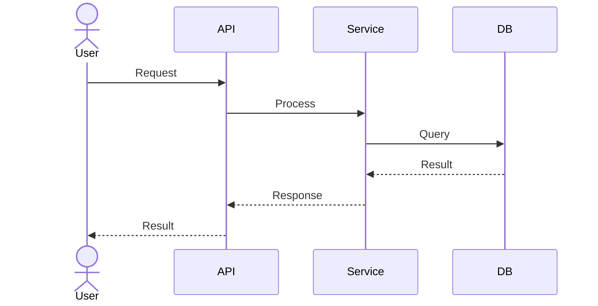

# 🔀 Sequence Diagrams

> Mô tả tương tác giữa các components theo trình tự thời gian.

## Quy ước

- Đặt tên file: `SEQ-XXX-ten-sequence.md`
- Sử dụng Mermaid `sequenceDiagram` syntax
- Mỗi file chứa 1 sequence diagram kèm mô tả

## Template

## Sequence Index

| ID | Tên | Components | Link |
|----|-----|-----------|------|
| SEQ-001 | Quẹt thẻ tại PC | User, Reader, Agent, LocalStore, Greeter/PAM, Server | [→](swipe-login.md) |
| SEQ-002 | Thay đổi lịch → Snapshot → PC nhận | Admin, API, Scheduling, Distribution, MQTT Broker, Agent, LocalStore | [→](schedule-sync.md) |
| SEQ-003 | Mất rồi nối lại kết nối | Agent, LocalStore, MQTT Broker, Operations, Distribution | [→](reconnect.md) |
| SEQ-004 | Hết hạn tin cậy & Kiểm tra đồng hồ | User, Agent, LocalStore, Greeter/PAM, Distribution | [→](lease-expiration.md) |
| SEQ-005 | Hết giờ phiên & Đăng xuất | User, Agent, LocalStore, OS Session (logind), Server | [→](session-expiry.md) |
| SEQ-006 | Khởi động lại máy (Reboot & Recovery) | OS, Agent, LocalStore, Greeter/PAM, Server | [→](reboot.md) |
