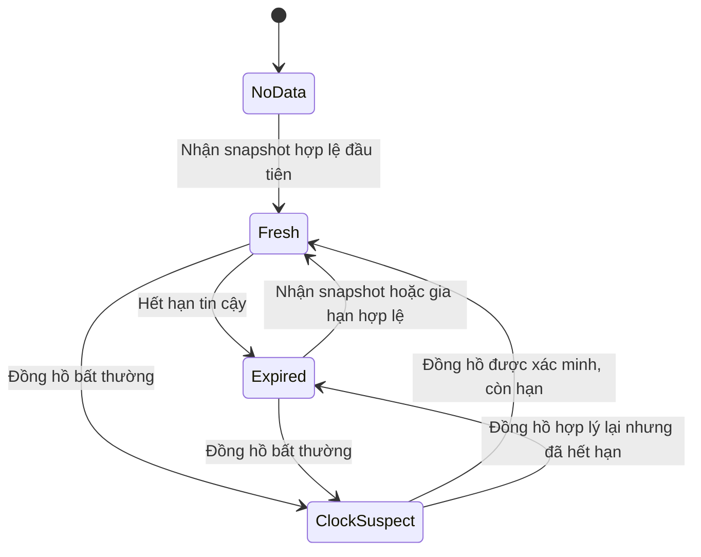
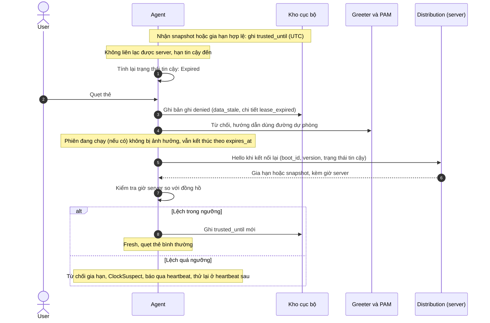

# Sequence: Hết hạn tin cậy & Kiểm tra đồng hồ

## Mục đích
Mô tả cách Agent xác định tính đáng tin cậy của dữ liệu cục bộ (lease), hành vi khi quá hạn hoặc khi đồng hồ bất thường, và quy trình khôi phục lại trạng thái tin cậy khi có kết nối lại.

## Máy trạng thái tin cậy của Agent

Trạng thái này là **hàm thuần túy (pure function) tính lại mỗi lần cần**, không phải biến lưu:

`đáng_tin = có_snapshot AND còn_hạn AND đồng_hồ_hợp_lý`

Nhận snapshot, nhận gia hạn, khởi động lại hay đổi giờ chỉ cập nhật các biến đầu vào của hàm; Agent không bao giờ bị kẹt trạng thái.

| Trạng thái | Quẹt thẻ |
|---|---|
| `Fresh` | Đủ điều kiện tin cậy, tiến hành đánh giá CR-001 từ bước 2 |
| `NoData`, `Expired`, `ClockSuspect` | Trả về `denied(data_stale)`. Greeter hiển thị lý do chung kèm hướng dẫn dùng đường dự phòng (FR-011). Bản ghi nhật ký ghi chi tiết nguyên nhân: `no_data`, `lease_expired`, hoặc `clock_suspect` |

## Sequence

## Nguyên tắc

1. **Còn hạn** nghĩa là chưa tới `trusted_until` (mốc tuyệt đối UTC, ghi bền vững trong SQLite, sống qua khởi động lại). Hạn tính từ lúc Agent nhận, thời lượng D do server cấp (D-012, BR-006). Bộ đếm thời lượng phiên (Session Timer) sử dụng riêng đồng hồ đơn điệu `CLOCK_BOOTTIME` để đo thời gian phiên kể từ lúc mở.
2. **Hạn tính từ lúc Agent nhận**, thời lượng D do server cấp (cấu hình tập trung, NFR-M02). Mọi snapshot và phản hồi gia hạn đều kèm `server_time`.
3. **Đồng hồ hợp lý (D-012):** Loại bỏ cơ chế mốc sàn xác minh ghi đĩa liên tục gây hao mòn ổ cứng. Thay bằng quy tắc thực tế:
   - **(a) Giờ hệ thống không lùi về quá khứ:** `local_time >= snapshot.created_at`. Nếu nhỏ hơn, xác định pin CMOS kiệt khiến đồng hồ quay về 1970/2020 → từ chối `data_stale (clock_invalid)`.
   - **(b) Khi kết nối server:** Agent đối chiếu với `server_time` trong Heartbeat. Nếu `|local_time - server_time| > 60s`, Agent gửi cờ cảnh báo `clock_skew_detected` lên dashboard để kỹ thuật viên can thiệp. Cờ NTP của OS chỉ để báo cáo, không làm điều kiện cổng. Agent không tự chỉnh giờ OS.
4. **Khởi động lại khi offline:** Đồng hồ được tin nếu `local_time >= snapshot.created_at` và `local_time <= trusted_until`. Cho phép quẹt thẻ bình thường theo lịch đã cache (D-012).
5. **Agent không tự chỉnh giờ OS.** Khi giờ sai do pin RTC chết, Agent từ chối quẹt thẻ cho đến khi OS (hoặc NTP) sửa được giờ, rồi heartbeat kế tiếp sẽ xác minh lại.
6. **Một lần đánh giá chỉ lấy `now` đúng một lần** (cả giờ hệ thống lẫn đồng hồ đo) cho cả việc kiểm tra độ tin cậy và khớp khung giờ Schedule, tránh tình trạng quẹt thẻ ở biên thời gian mà hai bước thấy hai giá trị khác nhau.
7. **Phiên đang chạy không bị ảnh hưởng** (BR-006). Hết hạn lease chỉ chặn các lần quẹt thẻ mới.
8. **Agent báo `trust_state` và lỗi áp snapshot gần nhất qua heartbeat.** Máy online mà bị `Expired` (ví dụ do lỗi áp snapshot liên tục) sẽ hiển thị cảnh báo ngay trên dashboard mà không cần thêm thông điệp báo lỗi riêng.

## Ngoại lệ
| ID | Tình huống | Hành vi |
|----|-----------|---------|
| EF-1 | Máy khởi động lại khi offline, pin RTC tốt | `local_time >= snapshot.created_at`, chưa tới `trusted_until`: Agent vẫn ở `Fresh` (nguyên tắc 4). |
| EF-2 | Pin RTC chết, máy mất điện bật lại giờ về 1970/2000 | `local_time < snapshot.created_at`: từ chối quẹt thẻ với `data_stale(clock_invalid)` cho đến khi OS sửa giờ và heartbeat xác minh thành công. |
| EF-3 | Giờ hệ thống bị đổi đột ngột giữa chừng lúc offline | Đồng hồ đơn điệu `CLOCK_BOOTTIME` bảo vệ timer phiên không bị kéo dài; khi có mạng lại, heartbeat phát hiện lệch > 60s và cảnh báo dashboard. |
| EF-4 | Phản hồi gia hạn từ server đến muộn | Vẫn được áp dụng bình thường nếu thông điệp hợp lệ và khớp phiên bản dữ liệu. |
| EF-5 | Máy mới đăng ký, chưa có snapshot | Trạng thái `NoData`, quẹt thẻ bị từ chối; thoát khỏi `NoData` ngay khi nhận snapshot đầu tiên (UC-007). |
| EF-6 | Gia hạn bị từ chối do máy tụt phiên bản nhưng snapshot mới tải về bị lỗi | Dữ liệu cũ hết hạn dần và chuyển sang `Expired`; dashboard nhận biết qua heartbeat theo nguyên tắc 8. |

## Tham số chốt sau (06)
- Thời lượng lease D (gợi ý mặc định 24h).
- Ngưỡng lệch đồng hồ tối đa cho phép (ví dụ 60 giây).

## Câu hỏi cho 06
| ADR | Câu hỏi |
|-----|---------|
| Lưu trữ cục bộ | Vị trí và cơ chế ghi bền vững cho `trusted_until` và `lease_duration`. |
| Đồng hồ | Cách đọc `CLOCK_BOOTTIME` trên Linux; xử lý bước nhảy NTP hợp lệ mà không gây hiểu nhầm thành `ClockSuspect`. |
| Giao thức MQTT | Cấu trúc trường `server_time` trong envelope của snapshot / phản hồi gia hạn; các trường `trust_state` và `last_apply_error` trong heartbeat. |
