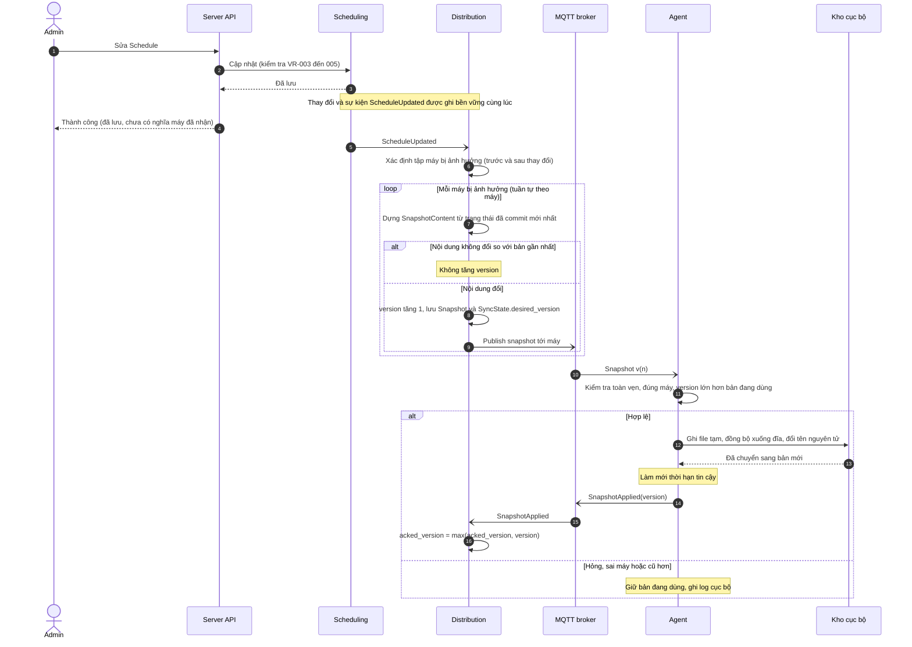

# Sequence: Thay đổi lịch → Snapshot → PC nhận

> Sequence này dùng `ScheduleUpdated` làm ví dụ đại diện. Mọi event trong bảng Domain Events (`domain-model.md`) có Consumer là Distribution đều kích hoạt cùng luồng, chỉ khác tập máy cần reconcile (hoặc ở MVP, reconcile mọi máy).

## Mục đích
Admin sửa lịch, server dựng snapshot cho các máy bị ảnh hưởng, PC nhận, kiểm tra, thay nguyên tử và xác nhận. Đây là nơi XINV-005 ("thay đổi cuối cùng phải đến máy") được hiện thực.

## Sequence

## Nguyên tắc
1. **Snapshot đầy đủ cho từng máy, bản mới nhất thắng, không dùng delta.** Mỗi snapshot tự đủ, nên trùng lặp, đến muộn hay sai thứ tự đều an toàn: v13 đến trước v12 thì v12 bị bỏ vì cũ hơn. Delta sẽ đòi thứ tự, phát hiện lỗ hổng và cơ chế vá.
2. **Dựng tuần tự theo từng máy, luôn đọc trạng thái đã commit mới nhất.** Nếu hai lần dựng chạy song song, version có thể gán ngược với độ mới của nội dung.
3. **Tập máy bị ảnh hưởng tính trên cả trước và sau thay đổi.** Đổi đích của Schedule từ zone A sang zone B thì máy ở A phải nhận bản không còn lịch này, không chỉ máy ở B nhận thêm. Tương tự khi đổi thành viên nhóm, khóa thẻ, vô hiệu hóa user.
4. **Thay đổi và sự kiện ghi cùng lúc.** Nếu server sập giữa lúc commit và lúc phát sự kiện thì máy sẽ không bao giờ nhận được, vi phạm XINV-005.
5. **API thành công không nghĩa là máy đã nhận.** Admin theo dõi qua SyncState (FR-054).
6. **Nhiều thay đổi liên tiếp có thể gộp** (chờ một cửa sổ ngắn rồi dựng một lần). Chỉ là tối ưu, tính đúng đã được nguyên tắc 1 và 2 bảo đảm.
7. **Reconcile theo mức, không xử lý theo từng sự kiện.** Đơn vị công việc là `Reconcile(máy)`: đọc trạng thái đã commit mới nhất → dựng nội dung chuẩn tắc → so với Snapshot gần nhất → khác thì tăng version, lưu, publish. Sự kiện chỉ là gợi ý "máy nào có thể cần reconcile"; tính đúng đến từ việc tập đã reconcile chứa mọi máy có nội dung đổi. MVP: reconcile **mọi máy đã đăng ký** khi có sự kiện (qua cửa sổ gộp), khi server khởi động, và định kỳ. Hai điều kiện: nội dung dựng phải **chuẩn tắc** (thứ tự ổn định, loại trường biến động như `generated_at` khỏi phép so sánh), và mỗi máy là một đơn vị dựng độc lập.

## Ngoại lệ
| ID | Tình huống | Hành vi |
|----|-----------|---------|
| EF-1 | Máy offline | Không nhận ngay. Khi kết nối lại, heartbeat báo version; server thấy `acked_version < desired_version` thì gửi bản mới nhất (FR-053, UC-004). |
| EF-2 | Snapshot hỏng, sai máy hoặc cũ hơn | Agent giữ bản cũ, ghi log cục bộ. Server chỉ thấy máy chưa cập nhật qua SyncState. |
| EF-3 | Trùng, đến muộn, sai thứ tự | Quy tắc "chỉ nhận version lớn hơn" xử lý. |
| EF-4 | Server sập giữa commit và publish | Khi khởi động, reconcile mọi máy: dựng lại nội dung từ dữ liệu hiện tại và so với Snapshot gần nhất. Không dựa vào `desired_version` vì nó có thể chưa kịp cập nhật. |
| EF-5 | Mất ack | Heartbeat kế tiếp báo version nên SyncState tự sửa; ack là idempotent. |
| EF-6 | Máy đổi zone, máy mới đăng ký | Cùng luồng, kích hoạt bởi `WorkstationZoneChanged`, `AgentEnrolled`. |

## Phát hiện: BR-006 đang hở
BR-006 nói thời hạn tin cậy được làm mới "mỗi lần nhận snapshot hợp lệ". Nhưng server chỉ phát snapshot khi **nội dung đổi**. Nếu lịch không đổi trong vài ngày thì một máy online hoàn toàn bình thường vẫn hết thời hạn tin cậy và bị `data_stale`. Cơ chế gia hạn đã chốt: heartbeat báo version, server trả lời **xác nhận gia hạn** khi version của máy bằng `desired_version`, còn nếu máy tụt lại thì gửi snapshot. Thời hạn chỉ được gia hạn khi máy đang cập nhật, và gắn với một vòng liên lạc thật. BR-006 và FR-055 đã sửa thành "nhận snapshot hợp lệ **hoặc xác nhận gia hạn từ server cho cùng phiên bản**".

## Ghi chú dashboard
Trạng thái "đã đồng bộ" chỉ đáng tin khi không còn sự kiện thay đổi nào chưa được xử lý (cửa sổ giữa commit và reconcile).

## Câu hỏi cho 06
| ADR | Câu hỏi |
|-----|---------|
| Giao thức MQTT | Gửi cả nội dung qua MQTT hay chỉ thông báo rồi PC tải (snapshot lớn phụ thuộc giới hạn broker, cấu hình được nếu tự dựng); retained message hay PC chủ động hỏi khi kết nối; QoS; cấu trúc topic và ACL theo máy |
| Xác thực snapshot | Broker là trung gian: snapshot có cần ký bằng khóa server để PC từ chối bản giả, hay TLS và ACL là đủ |
| Dựng snapshot | Cửa sổ gộp thay đổi; tối ưu tính tập máy bị ảnh hưởng thay vì reconcile tất cả (bảng event → tập máy hữu ích làm test, đặt ở 06); cách đảm bảo nội dung chuẩn tắc |
| Lưu trữ cục bộ | Định dạng file snapshot, kiểm tra toàn vẹn, quy trình đổi nguyên tử |

## Tham số chốt sau
Kích thước tối đa snapshot cho một máy; cửa sổ gộp thay đổi; chu kỳ reconcile định kỳ.
