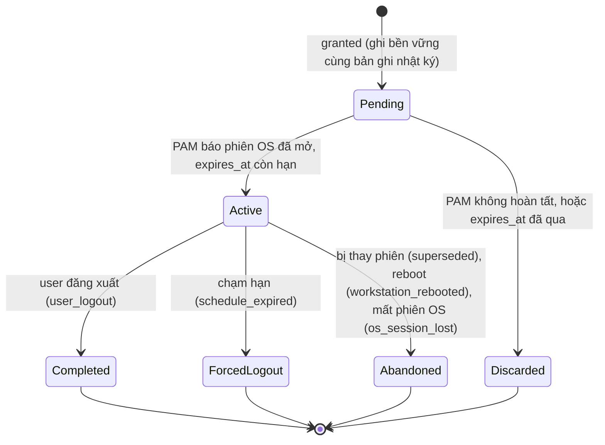
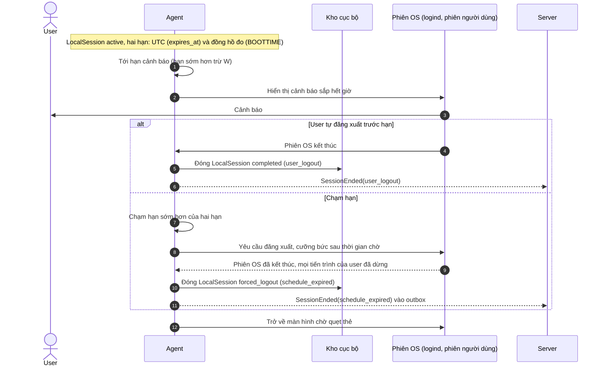

# Sequence: Hết giờ phiên & Đăng xuất

## Mục đích
Mô tả cách một phiên `active` kết thúc: cảnh báo trước hạn, tự động đăng xuất đúng hạn không phụ thuộc server, dọn dẹp tiến trình người dùng, và các cách phiên kết thúc khác. Kèm máy trạng thái `LocalSession`.

## Máy trạng thái LocalSession

`Discarded` là trạng thái nội bộ của Agent: phiên chưa từng bắt đầu trên OS nên không gửi `SessionStarted` lên server. Server chỉ quản lý các trạng thái `active`, `completed`, `forced_logout`, `abandoned` (sinh từ `SessionStarted`). Các trạng thái kết thúc là bất biến, không đảo ngược (INV-007).

## Sequence

## Nguyên tắc
1. **Hai hạn, cái nào đến trước thắng.** Hạn UTC tuyệt đối (`expires_at`) và hạn theo đồng hồ đo (`CLOCK_BOOTTIME`) tính từ thời điểm mở phiên. Hạn đo ngăn chặn việc lùi giờ hệ thống để kéo dài phiên (đồng bộ cơ chế với lease). Khi Agent restart (không reboot máy), Agent đọc lại cả hai hạn từ kho; sau reboot máy thì phiên OS cũng đã mất.
2. **Phiên không phụ thuộc server và không phụ thuộc trạng thái tin cậy** (BR-009, BR-006). Trạng thái `ClockSuspect` hay `Expired` của lease không ép đăng xuất phiên đang chạy; chỉ có hai hạn trên mới quyết định.
3. **Cảnh báo một lần trước hạn W phút.** Nếu phiên mở ra khi thời gian còn lại ít hơn W thì Agent hiển thị cảnh báo ngay lập tức.
4. **Trạng thái phản ánh thực tế (INV-017).** `LocalSession` chỉ chuyển sang trạng thái kết thúc khi phiên OS tương ứng đã thật sự kết thúc. Nếu đăng xuất thất bại, Agent thực hiện cưỡng bức (kill process), ghi log lỗi và thử lại; không bao giờ đánh dấu "đã kết thúc" khi người dùng vẫn còn trong phiên OS.
5. **Dọn sạch tiến trình của phiên khi đăng xuất, KHÔNG xóa dữ liệu cục bộ (BR-009, D-006).** Đăng xuất phải tiêu diệt toàn bộ tiến trình GUI và nền (tmux, script ngầm, systemd user service) của phiên làm việc bằng `loginctl terminate-session` (hoặc `terminate-user`) và `kill-session -s SIGKILL`, tránh việc người vào sau kế thừa quyền hoặc tài nguyên bị chiếm dụng ngầm. **Tuyệt đối không xóa thư mục home hay file dữ liệu cục bộ của profile dùng chung.**
6. **Thời điểm kết thúc `ended_at` là lúc Agent xác nhận phiên OS đã kết thúc**, nhãn nguồn `end_source` là `reported`.
7. **Hạn phiên tính theo chuỗi khung giờ liên tục (CR-001 bước 7).** Hạn phiên là điểm kết thúc của chuỗi các khung giờ nối tiếp nhau không hở (kể cả qua nửa đêm sang hôm sau) từ các Schedule khớp và cùng target profile, nhưng không vượt quá `hạn phiên tối đa` (tham số).

## Ngoại lệ
| ID | Tình huống | Hành vi |
|----|-----------|---------|
| EF-1 | Mất kết nối server | Không ảnh hưởng; `SessionEnded` được lưu vào outbox để đẩy sau (UC-005). |
| EF-2 | Agent khởi động lại giữa phiên | Áp dụng bảng recovery của `swipe-login`: nếu phiên OS còn thì đặt lại bộ đếm cảnh báo/hết giờ; nếu đã quá hạn thì ép đăng xuất ngay. |
| EF-3 | Đăng xuất bị kẹt (tiến trình không chịu thoát) | Cưỡng bức (`SIGKILL` theo user slice) sau thời gian chờ; nếu vẫn không thoát được thì ghi log lỗi và tiếp tục thử lại, phiên vẫn giữ `active`. |
| EF-4 | User đang khóa màn hình | Đến giờ hết hạn, Agent vẫn gửi lệnh đăng xuất phiên OS bình thường. |
| EF-5 | Phiên mở ra khi khung giờ chỉ còn vài giây | Cảnh báo ngay lập tức và tự động đăng xuất đúng hạn. Không đặt quy tắc "thời lượng tối thiểu" ở MVP. |
| EF-6 | Schedule bị sửa hoặc tắt giữa phiên | Hạn phiên đã cố định tại thời điểm quyết định (BR-010); thay đổi lịch chỉ áp dụng cho các lần quẹt thẻ sau. |
| EF-7 | Agent bị treo/sập không đăng xuất được và không báo gì | Server không thể ép máy từ xa, nhưng nếu thấy máy online mà `expires_at` đã qua một khoảng thời gian chờ thì dashboard gắn cờ "quá hạn chưa kết thúc" (UC-008). |

## Tham số chốt sau (06)
- Thời gian cảnh báo trước hạn W (mặc định ví dụ 5 phút).
- Thời gian chờ trước khi cưỡng bức đăng xuất (ví dụ 15 giây).
- Hạn phiên tối đa (Max Session Duration, ví dụ 8 giờ hoặc 12 giờ) để chặn lịch 24/7 sinh phiên vô hạn.
- Thời gian chờ để server gắn cờ "quá hạn chưa kết thúc" trên dashboard.

## Câu hỏi cho 06
| ADR | Câu hỏi |
|-----|---------|
| PAM và greeter | Cơ chế đẩy thông báo cảnh báo vào phiên desktop của user (Agent chạy root, giao tiếp qua D-Bus user bus: `unix:path=/run/user/<UID>/bus`). |
| Ánh xạ tài khoản OS | Quy chuẩn dọn dẹp tiến trình phiên triệt để (`loginctl terminate-session` và `SIGKILL` cgroup slice) đảm bảo tiêu diệt toàn bộ ứng dụng GNOME, tmux và tiến trình nền mà không xóa file home |
| Lưu trữ cục bộ | Hợp nhất lưu trữ hạn đo (`CLOCK_BOOTTIME`), `boot_id`, lease và snapshot vào một CSDL SQLite WAL duy nhất. |
