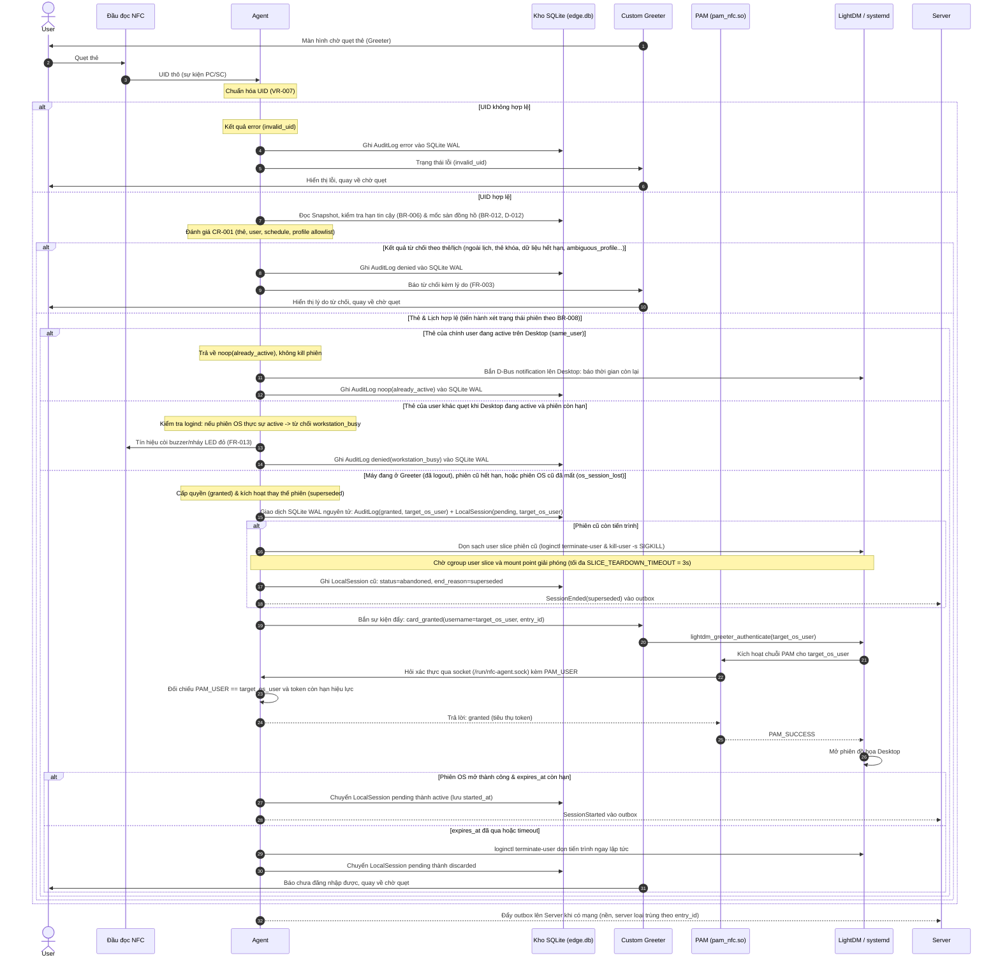
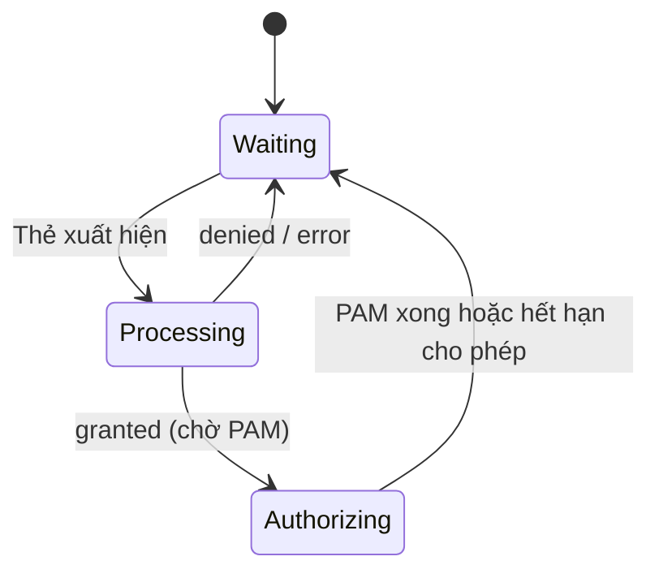

# Sequence: Quẹt thẻ tại PC

## Mục đích
Một lần quẹt thẻ tại PC, từ lúc thẻ xuất hiện trên đầu đọc đến lúc mở phiên hoặc từ chối. Mọi quyết định nằm ở Agent (BR-005); server chỉ nhận báo cáo bất đồng bộ.

## Sequence

## Máy trạng thái Agent khi quẹt thẻ

Chỉ lần quẹt ở `Waiting` mới tính là "lần quẹt" theo BR-007c. EF-7 (thẻ đến khi đang xử lý) và EF-8 (quẹt khi hiển thị kết quả) là hệ quả: `Processing` và `Authorizing` không phải `Waiting`, còn màn hình kết quả tương đương `Waiting`. Khóa nằm ở Agent, không ở greeter.

## Nguyên tắc
1. **Ghi bền vững trước, trả quyết định sau.** Một lần ghi chứa cả bản ghi nhật ký và LocalSession `pending` (nếu granted), trong cùng một giao dịch. Agent sập ở bất kỳ điểm nào sau đó đều để lại dấu vết để đối chiếu.
2. **Bản ghi là kết quả của quyết định, không phải của đăng nhập OS.** Bất biến, nên không sửa được sau khi biết kết quả PAM. "Granted mà chưa nhận phiên" suy ra bằng join `entry_id`.
3. **Phiên chỉ `active` khi PAM báo phiên OS đã mở**, và chỉ khi `expires_at` còn hạn. `expires_at` tuyệt đối, tính tại lúc quyết định.
4. **"Cho phép một lần" gắn `entry_id`, hạn hiệu lực rất ngắn**, chống dùng lại quyết định cũ.
5. **Agent khởi động lại thì đối chiếu LocalSession với phiên OS thực tế** (bảng recovery bên dưới).

## Recovery khi Agent khởi động lại

Mỗi LocalSession đánh giá độc lập; tổ hợp có cả `active` cũ và `pending` mới tự nhất quán.

| LocalSession | Phiên OS tương ứng trên `seat0` | Hành động |
|---|---|---|
| `active` | còn, `expires_at` còn hạn | giữ, đặt lại bộ đếm cảnh báo và hết giờ |
| `active` | còn, `expires_at` đã qua | kết thúc phiên OS ngay, đóng `forced_logout` (`schedule_expired`) |
| `active` | không còn | đóng `abandoned`; `workstation_rebooted` nếu `boot_id` đổi, ngược lại `os_session_lost` |
| `pending` | có phiên OS tạo SAU `decided_at`, `expires_at` còn hạn | chuyển thành `active` (ghi nhận `os_session_id`, `started_at`); phiên cũ (nếu có) đóng `superseded` |
| `pending` | có phiên OS tạo SAU `decided_at`, `expires_at` đã qua | kết thúc phiên OS, chuyển `pending` thành `discarded` |
| `pending` | không có phiên OS mới (chỉ có phiên OS tạo trước `decided_at` hoặc không còn) | dọn phiên OS cũ (nếu có), chuyển `pending` thành `discarded` (phiên chưa từng bắt đầu hợp lệ) |
| (không có LocalSession nào) | còn phiên OS của một profile `labstudent` | kết thúc phiên OS (Two-Phase Teardown): phiên không rõ nguồn gốc thì không có hạn để giám sát, không được để chạy tiếp. Xảy ra khi `edge.db` vừa được dựng lại (D-017) |

Cách nhận biết "phiên OS tương ứng": Agent truy vấn logind lấy thời điểm tạo của GUI session trên `seat0` (`MonotonicTimestamp` hoặc `RealtimeTimestamp`), đối chiếu với `decided_at` của `LocalSession pending`. Nếu phiên OS được tạo trước `decided_at`, đó là phiên cũ của profile dùng chung chưa kịp dọn dẹp xong, tuyệt đối không promote lên `active` (P1-2).

## Ngoại lệ
| ID | Tình huống | Hành vi |
|----|-----------|---------|
| EF-1 | Agent không chạy / PAM không liên lạc được | PAM bỏ qua, chuỗi PAM sang đường dự phòng (NFR-M01, BR-004). Không có bản ghi AuditLog; dấu vết ở log hệ thống. Ngoại lệ có chủ đích của BR-007. |
| EF-2 | UID không hợp lệ hoặc lỗi đầu đọc | Outcome `error`, reason `invalid_uid` hoặc `reader_error`; `card_uid` để trống; ghi thêm `reader_raw` (hex, cắt tối đa số byte cố định) để admin gỡ lỗi đầu đọc qua nhật ký. |
| EF-3 | Không ghi được kho cục bộ (đĩa đầy, lỗi file) | Không cho vào, màn hình báo lỗi; vẫn có đường dự phòng. Không có bản ghi AuditLog; dấu vết ở log hệ thống. Ngoại lệ thứ hai của BR-007. |
| EF-4 | Agent sập sau khi cho phép | LocalSession `pending` và bản ghi còn trong kho; khi Agent lên lại, đối chiếu với phiên OS (bảng recovery). |
| EF-5 | Mất kết nối server | Không ảnh hưởng luồng; outbox giữ bản ghi và sự kiện phiên (UC-005). |
| EF-6 | Chưa có snapshot, snapshot không đọc được, quá thời hạn tin cậy, đồng hồ lệch | `denied(data_stale)` theo CR-001 bước 1, vẫn ghi bản ghi. |
| EF-7 | Thẻ xuất hiện khi Agent đang xử lý lần quẹt khác | Bỏ qua, không sinh lần quẹt (Agent ở trạng thái `Processing` hoặc `Authorizing`, không phải `Waiting`). |
| EF-8 | Quẹt khi đang hiển thị kết quả từ chối | Màn hình kết quả tương đương trạng thái `Waiting`: lần quẹt mới được xử lý ngay, thay kết quả cũ. |
| EF-9 | Quẹt thẻ khi máy đang có phiên hoạt động | Chỉ đánh giá sau khi thẻ và lịch đã hợp lệ theo CR-001: (a) Cùng user -> bắn D-Bus báo thời gian còn lại, ghi AuditLog `noop(already_active)`; (b) Khác user khi Desktop đang active -> kiểm tra logind: nếu phiên đồ họa thực sự còn chạy thì từ chối `workstation_busy` (báo LED/còi đầu đọc, ghi AuditLog `denied`); nếu logind báo mất phiên OS -> đóng `abandoned(os_session_lost)` và mở phiên mới cho người quẹt; (c) Khác user khi đã chuyển Greeter hoặc phiên cũ đã hết hạn -> ghi nhận `granted` trước khi dọn tiến trình phiên cũ triệt để (`loginctl terminate-user`, chờ 2s, cưỡng chế `kill-user -s SIGKILL`, đợi sạch cgroup tối đa `SLICE_TEARDOWN_TIMEOUT = 3.0s`) và mở phiên mới (`superseded`). |
| EF-10 | Custom Greeter bị lỗi khởi động hoặc crash lặp | Hỗ trợ khôi phục về `lightdm-gtk-greeter` chuẩn qua launcher wrapper hoặc kênh can thiệp bảo trì TTY/SSH để bảo đảm đường dự phòng cục bộ không bị khóa chết (BR-004, NFR-A02). |

## Quyết định đã chốt
- **Không thêm outcome `login_failed`.** Bản ghi ghi kết quả quyết định, không phải kết quả PAM. "Granted mà chưa nhận phiên" suy ra qua `entry_id`. (giải quyết PD-001)
- **Chính sách quẹt đè phiên (BR-008):** Không cho phép đá phiên tức thì khi Desktop của người khác đang active nhằm tránh mất bài thi/dữ liệu chưa lưu; chỉ cho phép thay thế phiên khi đã chuyển về Greeter hoặc phiên cũ đã hết hạn ca học. Cùng user quẹt lại thì giữ nguyên và báo thời gian còn lại qua D-Bus.
- **Dọn sạch tiến trình phiên, KHÔNG xóa dữ liệu cục bộ (BR-009, D-006, A6):** Khi thu hồi hoặc thay thế phiên, Agent tiêu diệt toàn bộ tiến trình thuộc phiên làm việc trước đó (`loginctl terminate-user` theo user slice, chờ 2s, cưỡng chế `kill-user -s SIGKILL`) để dọn sạch 100% tiến trình chạy ngầm. Tuyệt đối không xóa thư mục home hay file dữ liệu cục bộ của profile dùng chung. Master Image cấu hình SSHD `DenyGroups labstudent` và tắt linger (`loginctl disable-linger`).
- **Kiến trúc đăng nhập 0-chạm vào Workstation Profile dùng chung (D-009):** Greeter nhận sự kiện đẩy từ Agent qua IPC cục bộ để gọi `lightdm_greeter_authenticate(os_username)`, PAM C module (`pam_nfc.so`) kiểm tra và tiêu thụ token của đúng `PAM_USER` thuộc profile được chỉ định từ Agent socket.
- **Thời gian chờ đăng nhập và dọn dẹp cgroup (P1-2):** Hạn chờ tiêu thụ token `staged_auth` chốt `PENDING_TIMEOUT = 12.0s` tính từ lúc `staged_auth` sẵn sàng bàn giao cho Greeter/PAM. Trần thời gian chờ cgroup user slice và mount point `/run/user/<UID>` giải phóng khi thay thế phiên trên cùng UID chốt `SLICE_TEARDOWN_TIMEOUT = 3.0s`.
- **Hợp nhất kho lưu trữ cục bộ:** Toàn bộ Snapshot, Lease, LocalSession, Profile Allowlist và AuditOutbox được quản lý tập trung trong một cơ sở dữ liệu SQLite WAL duy nhất (`edge.db`) bảo đảm tính nguyên tử ACID.

## Câu hỏi cho 06
| ADR | Câu hỏi |
|-----|---------|
| PAM và greeter | Đặc tả IPC Agent ↔ Custom Greeter (Push Event); giao thức socket Agent ↔ PAM C (`pam_nfc.so`); cơ chế khôi phục `lightdm-gtk-greeter` |
| Ánh xạ tài khoản OS & Dọn phiên | Quản lý danh mục Workstation Profile dùng chung theo allowlist (BR-020, D-009); thuật toán dọn dẹp tiến trình phiên không xóa file home |
| Lưu trữ cục bộ | Cấu trúc bảng SQLite WAL (`edge.db`), hợp nhất snapshot, lease, outbox và session; chiến lược fsync và phục hồi crash-safe |
| MQTT & Phân quyền | Cấu trúc topic MQTT tách bạch đọc/ghi, phân quyền Mosquitto ACL, QoS 1 cho Snapshot/Outbox và mTLS |
