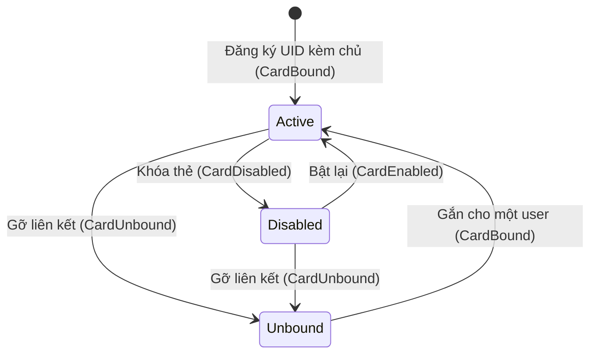
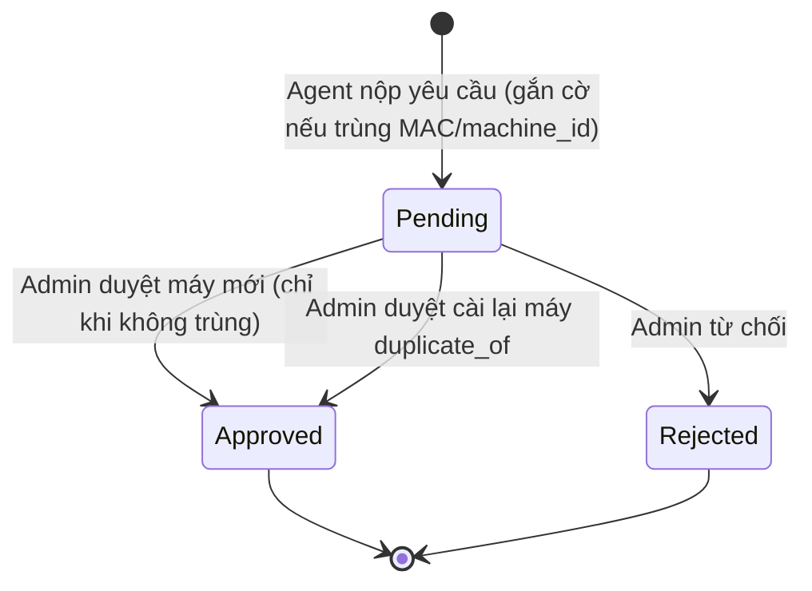
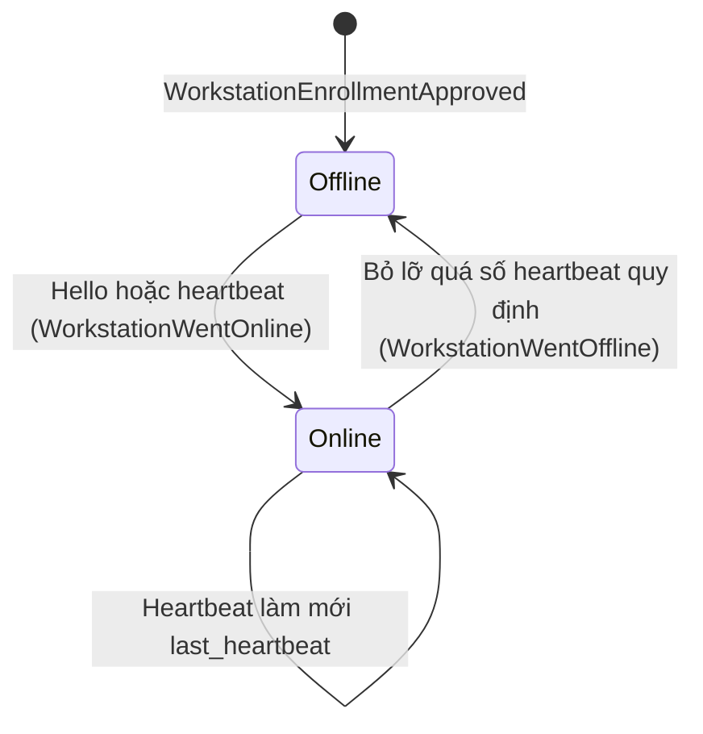
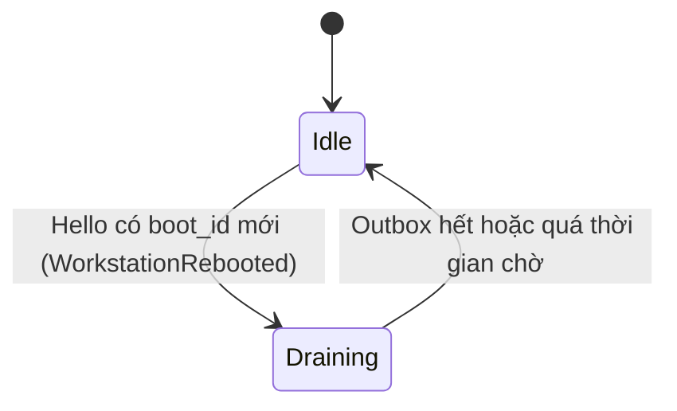
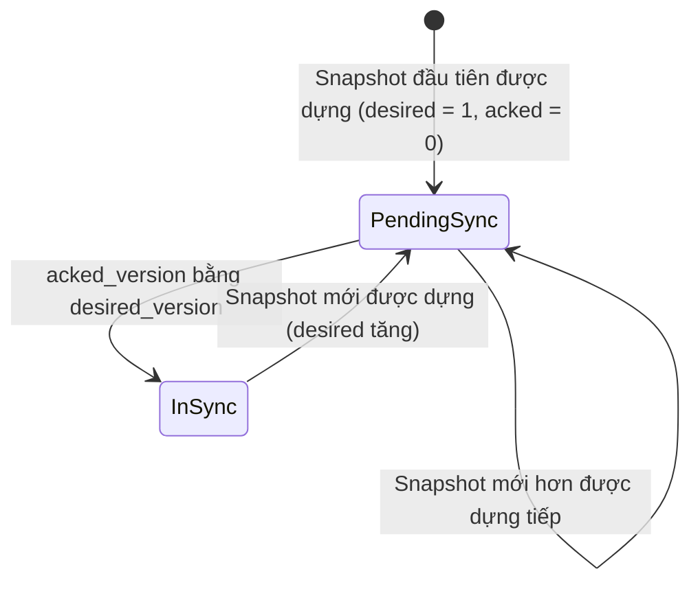

# 🔄 State Machines

## Mục đích
Vòng đời các thực thể có trạng thái. Hai máy trạng thái nằm trong sequence tương ứng: **LocalSession** ở `session-expiry.md`, **trạng thái tin cậy của Agent** ở `lease-expiration.md`. File này gồm phần còn lại.

## 1. Card (INV-006)

- `unbound ⇔ owner rỗng`. Thẻ `unbound` không cho vào (XINV-002).
- Gắn lại từ `unbound` luôn thành `active`, không giữ `disabled` cũ.
- Vô hiệu hóa **user** không đổi trạng thái thẻ (XINV-001); việc chặn do bước 3 của CR-001.
- Mọi chuyển trạng thái phát event cho Distribution (XINV-005); hiệu lực ở PC sau khi nhận snapshot mới (BR-010).

## 2. EnrollmentRequest (INV-010, BR-018, D-014)

- Không có đường tự động duyệt (EnrollmentToken đã bỏ theo D-014).
- Yêu cầu có cờ trùng không được duyệt thành máy mới; duyệt hàng loạt theo Zone bỏ qua các yêu cầu này.
- Sau `Approved`, máy tải credential bằng mã tải một lần; mã chỉ hết hiệu lực khi máy kết nối broker lần đầu thành công, nên mất gói trả lời giữa chừng thì máy tải lại được (D-014).

## 3. WorkstationStatus: kết nối (BR-019)

- Hello có `boot_id` khác lần trước thì phát `WorkstationRebooted` ở **mọi** trường hợp (cả `Offline → Online` lẫn `Online → Online` khi máy khởi động nhanh hơn ngưỡng offline), rồi vào đối soát bên dưới.
- Phát hiện từ Last Will (nếu ADR chọn dùng) chỉ là gợi ý rút ngắn thời gian vào `Offline`; heartbeat vẫn là nguồn sự thật.
- Máy chưa từng kết nối giữ `Offline` với `last_heartbeat` rỗng; dashboard hiển thị "chưa từng kết nối".

## 3b. Đối soát sau reboot (phía server, theo từng máy)

Khi `Draining → Idle`, các Session `active` còn lại của boot cũ chuyển `abandoned` (`workstation_rebooted`, `end_source = inferred`, `ended_at = max(started_at, lần cuối nghe từ máy ở boot cũ)`). Phiên Agent đã báo kết thúc giữ nguyên báo cáo (XINV-008 đã sửa). Nếu báo cáo thật của một phiên đã bị suy luận đến muộn (quá thời gian chờ), báo cáo thật thay kết quả suy luận đúng một lần (INV-007, D-015).

## 4. SyncState (FR-054)

- `InSync` và `PendingSync` là **hàm của hai số** (`acked_version` so với `desired_version`), không phải cờ lưu riêng, nên không có chuyện lệch cờ.
- **`Stuck` (suy ra):** `PendingSync` kéo dài quá ngưỡng trong khi máy `Online`. Dấu hiệu snapshot bị từ chối; dashboard hiển thị `last_apply_error` từ heartbeat.
- Nhãn "đã đồng bộ" chỉ đáng tin khi không còn sự kiện thay đổi nào chưa được xử lý (cửa sổ giữa commit và reconcile).
- Máy báo phiên bản **lớn hơn** `desired_version` (chỉ xảy ra khi server khôi phục từ bản sao lưu cũ): server nâng phiên bản kế tiếp lên `max(desired_version, phiên bản máy báo) + 1`, dựng lại snapshot và gửi đi; không coi đó là lỗi (INV-011, D-016).
- Ngưỡng `Stuck`: 10 phút ([Bảng Tham Số](../../11-operations/deployment.md#bảng-tham-số)).

## Các thực thể còn lại (không cần sơ đồ)
| Thực thể | Trạng thái | Ghi chú |
|---|---|---|
| User | `active` ⇄ `inactive` | Không xóa cứng (XINV-001, BR-014) |
| EnrollmentRequest | `pending` → `approved` / `rejected` | Tạo khi Agent nộp yêu cầu; trùng MAC giữ pending chờ Admin duyệt |
| Workstation | `enrolled` → `disabled` → `enrolled` | Tạo/kích hoạt sau khi EnrollmentRequest được duyệt. `disabled` thu hồi chứng chỉ ở broker; chỉ trở lại `enrolled` qua đăng ký lại (`nfc-agent reenroll` + Admin duyệt cài lại), không bật lại chứng chỉ cũ (D-014) |
| WorkstationProfile | `enabled` ⇄ `disabled` | Tự phát hiện mặc định `enabled`; profile đầu tiên nhận `is_default = true` |
| Schedule | `enabled` ⇄ `disabled`, xóa được | Tắt thì bị bỏ qua khi đánh giá (BR-016) |
| AdminAccount | `active` ⇄ `disabled` | `disabled` không đăng nhập được (INV-016) |
| Session (server) | `active` → `completed` / `forced_logout` / `abandoned` | Nhận từ báo cáo của Edge; trạng thái cuối không quay về `active`; kết thúc suy luận được báo cáo thật thay đúng một lần (INV-007); xem LocalSession ở `session-expiry` |
