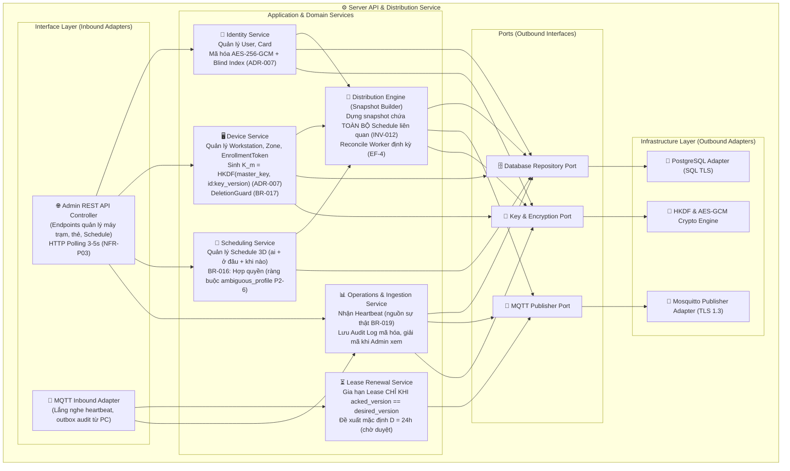
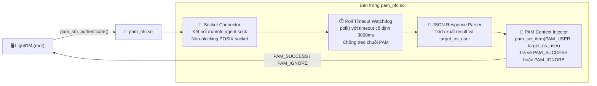
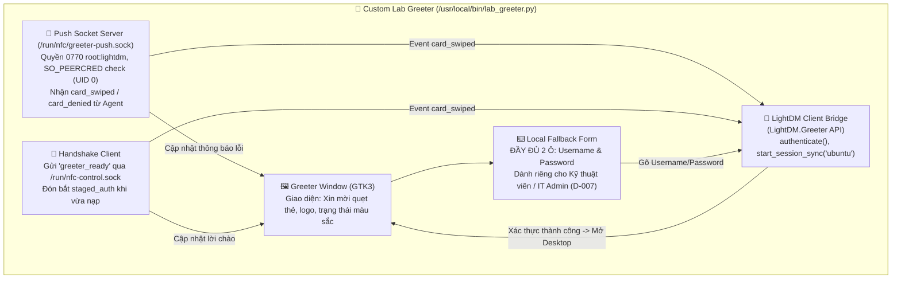

# 🧩 Components (C4 Level 3)

> Tài liệu này mô tả chi tiết kiến trúc ở mức Component (C4 Model Level 3) bên trong các container nòng cốt của Hệ thống Xác thực Phòng Lab bằng Thẻ NFC.  
> Trọng tâm chi tiết hóa gồm: **Server API & Distribution Service**, **NFC Edge Agent Daemon**, **PAM Module C**, và **Custom Lab Greeter**.

---

## 1. Phân Tích Thành Phần Bên Trong Server API & Distribution Service

Service máy chủ trung tâm được tổ chức theo kiến trúc Ports and Adapters (Hexagonal Architecture) kết hợp thiết kế hướng miền (Domain-Driven Design), bảo đảm tính độc lập tuyệt đối của tầng nghiệp vụ và trung lập về miền ứng dụng (sử dụng thuật ngữ `User`, `Schedule`, `Workstation` theo [problem.md](../01-problem/problem.md)).

### Danh mục thành phần Server API

| Component | Layer | Trách nhiệm chi tiết (Responsibility) | Phụ thuộc qua Port / Interface |
|---|---|---|---|
| **Admin REST API Controller** | Interface | Cung cấp các endpoint HTTP bảo mật (JWT Auth) phục vụ Web Dashboard của Quản trị viên (MVP có 1 vai trò duy nhất theo D-003, D-007): CRUD User, gán/khóa thẻ, quản lý máy trạm, phân zone, lập Schedule, tra cứu Audit Log (giải mã UID hiển thị cho Admin). Cung cấp endpoint cho Dashboard thực hiện HTTP Polling chu kỳ 3-5s (NFR-P03). | Application Services |
| **MQTT Inbound Adapter** | Interface | Lắng nghe các topic từ máy trạm qua Mosquitto Broker (TLS 1.3): topic heartbeat `lab/workstation/{id}/heartbeat`, topic audit `lab/workstation/{id}/outbox`, và trạng thái LWT `lab/workstation/{id}/status`. Chuyển tiếp bản tin cho các service tương ứng. | LeaseRenewalService, OperationsService |
| **Identity Service** | Application | Quản lý vòng đời User, nhóm và thẻ. Khi lưu UID thẻ, phối hợp với `CryptoPort` để mã hóa bằng AES-256-GCM và sinh HMAC-SHA256 Blind Index phục vụ tìm kiếm an toàn mà không để lộ UID gốc (ADR-007). | RepoPort, CryptoPort |
| **Device Service** | Application | Quản lý máy trạm theo từng zone. Hỗ trợ quy trình Đăng ký tự động Zero-Touch (D-010): tiếp nhận yêu cầu đăng ký qua `EnrollmentRequest` khi boot từ Master Image sạch (tự sinh keypair Ed25519) hoặc khi đăng ký lại trùng MAC (P1-4, D-010); nếu trùng MAC, giữ yêu cầu ở trạng thái `pending` kèm cờ `duplicate_mac_detected = true` trên Dashboard để Admin duyệt thủ công (không làm gián đoạn máy đang chạy); khi Admin duyệt: gán Zone, cập nhật `Workstation`, tăng `key_version`, cấp Client Certificate mTLS và khóa `K_m`. Hỗ trợ đăng ký tự động qua `EnrollmentToken` theo lô nếu MAC chưa từng tồn tại (BR-018). Phối hợp với `CryptoPort` để sinh khóa riêng của từng máy trạm: `K_m = HKDF(master_key, workstation_id || ":" || key_version)` (theo ADR-007, server không cần lưu từng khóa rời). Tích hợp `DeletionGuard` (BR-017) ngăn chặn xóa máy trạm hoặc zone đang được Schedule tham chiếu. | RepoPort, CryptoPort |
| **Scheduling Service** | Application | Quản lý ca học ba chiều (`ai + ở đâu + khi nào`). Tuân thủ quy tắc **BR-016: Hợp quyền (Union)** — chỉ cần một Schedule khớp là được phép vào, không có luật deny, do đó không có khái niệm xung đột lịch về mặt thời gian. Tuy nhiên, nếu hai schedule trùng khung giờ nhưng chỉ định hai target profile khác nhau (và cả hai đều tồn tại/hợp lệ trên máy), Agent sẽ từ chối với lý do `ambiguous_profile` (P2-6). Server API phát hiện hoặc hiển thị cảnh báo này khi Admin cấu hình lịch. Phát sự kiện để Distribution Engine dựng lại snapshot cho máy trạm liên quan. | RepoPort |
| **Distribution Engine** | Application | Dựng bản snapshot cá nhân hóa cho từng máy trạm: 1. Truy vấn **TOÀN BỘ Schedule liên quan đến máy trạm** (INV-012), không lọc theo giờ hiện tại (việc lọc theo giờ thực tế thuộc trách nhiệm của PC theo CR-001; giữ snapshot không đổi theo thời gian giúp bảo toàn version và tính toàn vẹn hash SHA256). 2. Dùng khóa máy `K_m` tính toán `CardMatchKey = HMAC-SHA256(K_m, CardUID)` cho các thẻ hợp lệ. 3. Publish snapshot dạng Retained Message vào topic `lab/workstation/{id}/snapshot` (QoS 1). 4. Định kỳ chạy `ReconcileWorker` (lúc khởi động server và theo chu kỳ, theo kịch bản EF-4 của schedule-sync) để đảm bảo mọi máy trạm đều nhận đủ snapshot mới nhất. | RepoPort, MQTTPort, CryptoPort |
| **Lease Renewal Service** | Application | Xử lý yêu cầu gia hạn thời hạn tin cậy (Lease Duration đề xuất mặc định `D = 24h` chờ thầy duyệt theo ADR-001): **CHỈ cấp phát gia hạn Lease khi PC báo cáo `acked_version == desired_version`** (khắc phục triệt để lỗ hổng BR-006). Publish bản tin xác nhận gia hạn vào topic `lab/workstation/{id}/lease`. | MQTTPort |
| **Operations Service** | Application | - Tiếp nhận Heartbeat: Đóng vai trò là **nguồn sự thật duy nhất** xác định trạng thái online/offline của máy trạm (BR-019). Gói tin LWT từ broker chỉ đóng vai trò gợi ý bổ trợ giúp rút ngắn thời gian phát hiện. - Tiếp nhận Audit Outbox: Lưu trữ bản ghi quẹt thẻ với UID đã mã hóa và `uid_index` (HMAC), chỉ giải mã UID khi Admin tra cứu trên Dashboard. Phản hồi bản tin ACK theo số thứ tự `outbox_seq`. | RepoPort, MQTTPort, CryptoPort |
| **Infrastructure Adapters** | Infrastructure | Triển khai các port trừu tượng: `PostgresRepo` (truy vấn CSDL nguồn sự thật), `MQTTPublisher` (gửi gói tin qua TLS 1.3), `CryptoEngine` (tính HKDF, AES-256-GCM, HMAC-SHA256). | PostgreSQL Driver, Mosquitto Client, Thư viện Crypto |

---

## 2. Phân Tích Thành Phần Bên Trong NFC Edge Agent Daemon (Python Root)

NFC Edge Agent Daemon là tiến trình nền chạy dưới quyền `root` trên Ubuntu 22.04 LTS. Đây là nơi thực thi toàn bộ logic xác thực biên, quản lý phiên và điều phối giao tiếp IPC.

```mermaid
flowchart TB
    subgraph EDGE_AGENT["🛡️ NFC Edge Agent Daemon (Python Systemd Service - root)"]
        subgraph STATE_COORDINATOR["State & Concurrency Control"]
            StateCoordinator["🔒 Agent State Coordinator\nQuản lý bộ khóa 3 trạng thái độc quyền:\nWaiting ➔ Processing ➔ Authorizing"]
        end

        subgraph HARDWARE_INTERFACE["Hardware Interface"]
            ReaderWorker["📶 Card Reader Worker (PC/SC)\nTheo dõi SCardGetStatusChange (thẻ xuất hiện/rời - BR-007c)\nChuẩn hóa VR-007, tính CardMatchKey, giữ UID gốc cho audit"]
        end

        subgraph CORE_ENGINE["Core Decision & Recovery Engine"]
            RuleEvaluator["⚖️ Rule Evaluator (CR-001 Engine)\nĐánh giá độc lập tại PC, KHÔNG CÓ BUFFER 15 PHÚT\nResolve profile tại Agent, cấm ambiguous_profile (P2-1, P2-6)"]
            ClockValidator["⏱️ Clock Validator (D-012, Point 8)\nCLOCK_BOOTTIME cho timer phiên\nFloor = max(created_at, last_server_time) - 60s"]
            BootRecovery["🔄 Boot & Recovery Worker\nSo sánh boot_id kernel, đối chiếu LocalSession lúc khởi động\nĐánh giá phiên dở dang: abandoned(workstation_rebooted)"]
            SessionReplacer["🛡️ Session Replacement Controller (D-006, BR-008, P1-1, P1-3)\nKiểm tra logind trước khi busy; os_session_lost -> rảnh\nGreeter / hết giờ: Write-Ahead & Two-Phase Teardown thay phiên"]
            StagedAuthMgr["📦 Staged Auth Manager\nQuản lý lượt quẹt đang chờ (PENDING_TIMEOUT = 12s, Spike S6)\nTự động hủy discarded nếu quá hạn"]
        end

        subgraph LOCAL_STORAGE["Local Storage Subsystem"]
            LocalStorageMgr["🗄️ Local Storage Manager (SQLite WAL - 0600)\nWrite-Ahead nguyên tử: audit_outbox + local_session (status='pending')\nQuản lý allowlist profiles, trusted_until, metadata"]
        end

        subgraph IPC_SUBSYSTEM["IPC Communication Subsystem"]
            PamSocketServer["🔑 PAM Socket Server (/run/nfc-agent.sock - 0660 root:root)\nSO_PEERCRED check (root), trả về target_os_user, Timeout 3s"]
            ControlSocketServer["🤝 Control & Handshake Server (/run/nfc-control.sock - 0770 root:lightdm)\nSO_PEERCRED check (root hoặc lightdm), nhận 'greeter_ready' bàn giao staged_auth"]
            GreeterPushClient["📢 Greeter Push Client\nMở kết nối tới /run/nfc/greeter-push.sock (do Greeter mở)\nBắn sự kiện card_swiped / card_denied"]
        end

        subgraph SESSION_LIFECYCLE["Session Lifecycle Management"]
            SessionWatcher["👁️ GUI Session Watcher\n(loginctl list-sessions liên tục)\nBắt GUI ID seat0 active, phát hiện user_logout/os_session_lost"]
            SessionTimer["⏳ Session Timer Worker\nGửi D-Bus pop-up trước khi hết ca học\nQuản lý đếm ngược kết thúc phiên"]
            TwoPhaseTeardown["🧹 Two-Phase Teardown Controller (D-006, BR-009, A6)\n1. loginctl terminate-user (chờ 2s, S4)\n2. kill-user -s SIGKILL theo user slice\nĐợi sạch cgroup slice <= 3s (P1-2)"]
        end

        subgraph NETWORK_SUBSYSTEM["Server Sync & Message Queue"]
            MqttSyncWorker["📡 MQTT Edge Sync Worker (mTLS 1.3)\nHeartbeat / Lease Renewal, nhận Snapshot mới\nOutbox Stop-and-Wait với outbox_seq"]
        end
    end

    ReaderWorker --> StateCoordinator
    StateCoordinator --> RuleEvaluator
    ClockValidator --> RuleEvaluator
    RuleEvaluator --> SessionReplacer

    SessionReplacer -->|"Cùng user (noop)"| LocalStorageMgr
    SessionReplacer -->|"Desktop bận"| GreeterPushClient
    SessionReplacer -->|"Hợp lệ"| LocalStorageMgr
    LocalStorageMgr --> StagedAuthMgr

    StagedAuthMgr --> GreeterPushClient
    StagedAuthMgr --> ControlSocketServer
    StagedAuthMgr --> PamSocketServer

    PamSocketServer --> SessionWatcher
    SessionWatcher --> SessionTimer
    SessionTimer --> TwoPhaseTeardown
    SessionReplacer -->|"Thay phiên"| TwoPhaseTeardown

    BootRecovery --> LocalStorageMgr
    BootRecovery --> SessionWatcher

    MqttSyncWorker --> LocalStorageMgr
```

### Danh mục thành phần bên trong Edge Agent Daemon

| Component | Trách nhiệm chi tiết (Responsibility) | Chi tiết kỹ thuật & Dữ liệu thực chứng |
|---|---|---|
| **Agent State Coordinator** | Quản lý bộ khóa 3 trạng thái độc quyền: `Waiting` (sẵn sàng chờ thẻ) -> `Processing` (đang đọc thẻ, đánh giá CR-001 và ghi SQLite) -> `Authorizing` (đang chờ PAM/Greeter tiêu thụ trong thời gian pending). Ngăn chặn quẹt thẻ dồn dập hoặc race condition làm sai lệch trạng thái nội bộ. | Đảm bảo tính tuần tự tuyệt đối trong luồng xử lý thẻ theo đúng nguyên tắc INV-008. |
| **Card Reader Worker** | Lắng nghe sự kiện thẻ từ ACR122U qua PC/SC ("thẻ xuất hiện" và "thẻ rời" theo BR-007c, chuẩn bị chuyển sang hàm ngắt `SCardGetStatusChange`). Chuẩn hóa UID theo VR-007 (hex, 4/7/10 byte). Nạp `K_m` từ file cấu hình an toàn `/etc/nfc-agent/agent.conf` (`0600 root:root`), tính `CardMatchKey = HMAC-SHA256(K_m, UID)`. **Giữ lại UID gốc** để đưa vào hàng đợi `audit_outbox` (ADR-007 mục 5); nếu lỗi đọc thẻ thì ghi nhận `reader_raw` và outcome `error`. | Đã kiểm chứng ở Spike S1 (Đạt một phần): Nhận diện ổn định Static UID thẻ ngân hàng contactless; từ chối thẻ Random UID (như CCCD) qua polling; đang chờ bổ sung bài đo 100 lần quẹt với thẻ sinh viên MIFARE và chuyển đổi sang hàm bắt sự kiện ngắt `SCardGetStatusChange`. |
| **Rule Evaluator (CR-001 Engine)** | Trái tim nghiệp vụ của Edge: thực thi 8 bước đánh giá theo CR-001 (P1-1: đánh giá thẻ, user, schedule và resolve profile TRƯỚC khi xét trạng thái phiên). **Tuyệt đối không áp dụng buffer 15 phút (D-008)**, đánh giá chính xác khoảng `[bắt đầu, kết thúc)` trong cùng một ngày (`start_time < end_time`, D-011). Tự resolve target profile (`os_username`) từ Schedule hoặc default profile trên máy trạm (P2-1); cấm kết quả mơ hồ (`ambiguous_profile`, BR-016, P2-6). Tính hạn phiên là cuối chuỗi khung giờ liên tục (CR-001 bước 7) không vượt quá `Max Session Duration`. Kiểm tra hạn Lease (`trusted_until`) và mốc sàn đồng hồ (`floor`). | Đánh giá cục bộ hoàn toàn trên RAM và SQLite trong < 10ms, không phụ thuộc kết nối mạng (D-001, BR-005). |
| **Session Replacement Controller** | Thực thi bước 8 của CR-001 và chính sách thay thế phiên theo **D-006 / BR-008 / P1-1 / P1-3**: - *Cùng User (`same_user`):* Không kill phiên, ghi nhận `AuditLog` outcome `noop` kèm lý do `already_active` (P2-4, BR-007), gửi thông báo D-Bus thời gian còn lại lên Desktop. - *Khác User khi Desktop đang active & còn hạn:* Agent chủ động truy vấn `systemd-logind` trên `seat0`. Nếu logind xác nhận phiên đồ họa thực sự vẫn chạy -> từ chối với lý do `workstation_busy`, ghi nhận `denied`, phát tín hiệu bận tại đầu đọc (LED đỏ/còi), không làm gián đoạn người đang học. Nếu logind báo phiên đồ họa không còn tồn tại trên `seat0` (do GNOME crash hoặc logout đột ngột) -> lập tức đóng `LocalSession` cũ là `abandoned(os_session_lost)`, phát `SessionEnded(os_session_lost)`, và xử lý lượt quẹt như máy rảnh. - *Khác User khi máy đang ở Greeter HOẶC phiên cũ đã hết hạn ca học (`now >= expires_at`):* Ghi nhận `granted`, ghi Write-Ahead vào SQLite trước, sau đó kích hoạt Two-Phase Teardown tiêu diệt phiên cũ, đánh dấu phiên cũ là `abandoned` với `end_reason = superseded`. | Loại bỏ hoàn toàn nguy cơ sinh viên quẹt thẻ phá hoại bài thi của nhau; đồng thời giải phóng máy ngay khi người cũ đã hết giờ, đã rời máy, hoặc khi phiên đồ họa bị sập bất thường. |
| **Clock Validator** | Tách bạch cơ chế đồng hồ (D-012, ADR-001, Point 8): - *Thời lượng phiên:* Bắt buộc dùng đồng hồ đơn điệu `CLOCK_BOOTTIME` để đếm thời gian phiên kể từ lúc boot, miễn nhiễm với việc chỉnh giờ hệ thống. - *Kiểm tra Lease:* Đảm bảo thời gian UTC `local_time <= trusted_until`. - *Kiểm tra mốc sàn đồng hồ (Clock Floor - Point 8):* Kiểm tra `local_time >= floor` với `floor = max(snapshot.created_at, last_server_time) - CLOCK_FLOOR_TOLERANCE` (dung sai `CLOCK_FLOOR_TOLERANCE = 60s`). Nếu vi phạm, từ chối với lý do `clock_invalid`. Khi online đối chiếu với `server_time` từ Heartbeat, nếu lệch quá `CLOCK_SKEW_WARN_THRESHOLD` (60s) gửi cảnh báo `clock_skew_detected` lên Server nhưng không chặn gia hạn lease (P2-5). | Đã kiểm chứng ở Spike S5: `CLOCK_BOOTTIME` độc lập hoàn toàn với việc người dùng dùng lệnh `date -s` để gian lận giờ hệ thống. |
| **Boot & Recovery Worker** | Xử lý kịch bản máy tính khởi động lại hoặc Agent phục hồi sau crash: - Đọc `/proc/sys/kernel/random/boot_id`, so sánh với `boot_id` trong `agent_meta`. Nếu khác `boot_id` -> máy vừa reboot -> chuyển toàn bộ phiên dở dang sang `abandoned` với `end_reason = workstation_rebooted` (Spike S6). - Đối chiếu các phiên `active` với `loginctl list-sessions`: nếu phiên còn hạn và tìm thấy GUI session trên `seat0`, tiếp tục duy trì timer giám sát; nếu đã quá hạn, lập tức kích hoạt `forced_logout`. | Đã kiểm chứng ở Spike S6: Sống sót và tự phục hồi chuẩn xác sau khi rút điện cưỡng bức bằng lệnh SysRq `b`. |
| **Local Storage Manager** | Quản lý cơ sở dữ liệu SQLite tại `/var/lib/nfc-agent/edge.db` (`PRAGMA journal_mode=WAL`, `synchronous=FULL`). Thực hiện ghi đồng thời bản ghi `audit_outbox` và bản ghi phiên `local_session (status='pending')` theo nguyên tắc Write-Ahead trước khi mở quyền (D-005). Quản lý bảng allowlist `workstation_profiles` và metadata: `trusted_until`, `last_server_time`, `snapshot_version`, `created_at`. | Đã kiểm chứng ở Spike S5: Sống sót 100/100 lần thử nghiệm mất điện đột ngột (`kill -9`) mà không bao giờ bị hỏng file CSDL. |
| **Staged Auth Manager** | Lưu trữ tạm thời trạng thái xác thực (`staged_auth`): `session_id`, `user` (UserSnapshot), `target_os_user` (`os_username`), hạn chờ đăng nhập `pending_until` (**chốt `PENDING_TIMEOUT = 12.0s`** theo Spike S6), và mốc hết ca học `expires_at`. Tự động đánh dấu phiên là `discarded` nếu quá 12s mà PAM không tiêu thụ token. | Ngăn ngừa việc một thẻ quẹt xong bị bỏ quên dẫn đến người khác vào máy tự do. |
| **PAM Socket Server** | Tạo Unix Domain Socket tại `/run/nfc-agent.sock` với quyền `0660 root:root`. Khi module `pam_nfc.so` kết nối tới, server kiểm tra `SO_PEERCRED` để đảm bảo process gọi có UID=0 (LightDM). Trích xuất `staged_auth` và trả về `{"result": "granted", "user": target_os_user}`. | Đã kiểm chứng ở Spike S2: Thời gian phản hồi IPC cực nhanh (~22ms), bảo mật tuyệt đối chống giả mạo quyền từ user thường. |
| **Greeter Push Client** | Đóng vai trò là Client mở kết nối tới socket `/run/nfc/greeter-push.sock` (do Custom Greeter mở và lắng nghe, quyền `0770 root:lightdm`). Bắn sự kiện UI: `card_swiped` (kèm `target_os_user`) hoặc `card_denied` (kèm mã lý do chi tiết). | Đã kiểm chứng ở Spike S3b: Cập nhật giao diện LightDM ngay tức thì sau khi quẹt thẻ. |
| **Control & Handshake Server** | Lắng nghe tại `/run/nfc-control.sock` với quyền `0770 root:lightdm`. Kiểm tra `SO_PEERCRED` chấp nhận UID 0 (root) hoặc UID của user `lightdm`. Tiếp nhận bản tin `{"action": "greeter_ready"}` từ Custom Greeter khi greeter vừa nạp lên màn hình để bàn giao ngay `staged_auth` đang chờ. | **Giải pháp then chốt của Spike S6:** Giải quyết triệt để Race Condition khi thay phiên, đón bắt lượt quẹt ngay khi Greeter mới khởi động xong. |
| **Two-Phase Teardown Controller** | Thực hiện dọn dẹp phiên triệt để theo cơ chế 2 bước (BR-009, D-006, A6): - *Phase 1:* Ra lệnh `loginctl terminate-user <UID>`, đợi xác nhận phiên đồ họa đã đóng (timeout chờ 2.0s theo Spike S4). Cấu hình SSHD `DenyGroups labstudent` và tắt linger (`loginctl disable-linger`). - *Phase 2:* Cưỡng chế `loginctl kill-user <UID> -s SIGKILL` tiêu diệt toàn bộ cgroup user slice, dọn sạch 100% tiến trình chạy ngầm. - *Đồng bộ hóa Teardown cho cùng UID (P1-2):* Đối với mô hình profile dùng chung (nhiều sinh viên dùng chung tài khoản student/UID), quá trình teardown phải chủ động kiểm tra và đợi cho đến khi cgroup `user-<UID>.slice` và mount point `/run/user/<UID>` biến mất hoàn toàn (chờ tối đa `SLICE_TEARDOWN_TIMEOUT = 3.0s`) trước khi cho phép `staged_auth` bàn giao cho Greeter/PAM, loại bỏ triệt để nguy cơ race condition làm treo D-Bus. - **Tuyệt đối không xóa thư mục home hay file dữ liệu cục bộ** của profile dùng chung (BR-009, D-006). | Đã kiểm chứng ở Spike S4 & S6: Giải phóng hoàn toàn tài nguyên máy cho phiên sau, bảo toàn file bài tập trên máy. |
| **GUI Session Watcher & Timer** | Định kỳ quét `loginctl list-sessions` trên `seat0` để giám sát phiên đồ họa của tài khoản `target_os_user`: - Khi vừa đăng nhập: bắt GUI ID chuyển trạng thái `LocalSession` sang `active`, ghi nhận `started_at` và `os_session_id`. - Trong suốt phiên: thiết lập bộ đếm thời gian; trước khi hết ca 5 phút gửi thông báo D-Bus pop-up (`notify-send`); khi chạm đúng `expires_at`, kích hoạt cưỡng chế dọn phiên (`forced_logout`). - Giám sát liveness (P1-3): Nếu phiên đồ họa biến mất do người dùng đăng xuất sạch sẽ -> đóng `completed(user_logout)`; nếu biến mất bất thường (X/GNOME crash) -> đóng `abandoned(os_session_lost)`, giải phóng máy ngay. | Đã kiểm chứng ở Spike S4: Gửi thông báo D-Bus từ tiến trình root vào user desktop thông qua socket bus `/run/user/<uid>/bus` thành công 100%. |
| **MQTT Edge Sync Worker** | Chạy một luồng nền độc lập quản lý kết nối MQTT Client với Mosquitto Broker qua mTLS 1.3: - Gửi Heartbeat định kỳ mang `acked_version` và nhận phản hồi gia hạn Lease từ `lab/workstation/{id}/lease`. - Nhận Snapshot mới từ `lab/workstation/{id}/snapshot`, kiểm tra hash SHA256 và nạp nguyên tử vào SQLite. - Đọc bản ghi từ `audit_outbox` và đẩy lên server qua topic `lab/workstation/{id}/outbox` theo cơ chế Stop-and-Wait với số thứ tự `outbox_seq`. | Đảm bảo nhật ký quẹt thẻ không bao giờ bị thất lạc ngay cả khi phòng máy mất mạng nhiều ngày. |

---

## 3. Phân Tích Thành Phần Bên Trong PAM NFC Module (`pam_nfc.so`)

Module PAM là một thư viện liên kết động bằng C (`.so`) gọn nhẹ, an toàn và có tính độc lập cao, được cắm trực tiếp vào cấu hình PAM của hệ thống Ubuntu (`/etc/pam.d/lightdm`).

| Component | Ngôn ngữ / Công nghệ | Trách nhiệm chi tiết |
|---|---|---|
| **Socket Connector** | C (POSIX Sockets) | Thiết lập kết nối Unix Domain Socket tới `/run/nfc-agent.sock`. Nếu socket không tồn tại hoặc lỗi quyền, lập tức đóng kết nối và trả về `PAM_IGNORE` để nhường quyền cho xác thực mật khẩu. |
| **Poll Timeout Watchdog** | C (`poll()`, `<poll.h>`) | Chờ dữ liệu phản hồi từ Agent trong tối đa **3000ms**. Nếu quá thời gian này mà Agent không phản hồi, hàm `poll()` timeout, module lập tức gọi `close(sock)` giải phóng socket và trả về `PAM_IGNORE`. Điều này đảm bảo giao diện đăng nhập không bao giờ bị đơ (treo vô hạn) kể cả khi Agent bị dừng đột ngột hoặc deadlock. |
| **JSON Response Parser** | C (micro JSON parser) | Phân tích gói tin chuỗi trả về từ Agent: `{"result": "granted", "user": "student"}` hoặc `{"result": "denied"}`. |
| **PAM Context Injector** | C (`<security/pam_modules.h>`) | - Nếu nhận `granted`: gọi `pam_set_item(pamh, PAM_USER, user)` để nạp tên tài khoản OS dùng chung vào hệ thống, sau đó trả về `PAM_SUCCESS`. - Nếu nhận `denied` hoặc lỗi: ghi nhật ký qua `pam_syslog` và trả về `PAM_IGNORE` để LightDM tiếp tục chuyển sang module `pam_unix.so` hỏi mật khẩu cục bộ. |

---

## 4. Phân Tích Thành Phần Bên Trong Custom Lab Greeter (`lab_greeter.py`)

Custom Lab Greeter là ứng dụng GUI chạy dưới quyền user `lightdm`, được xây dựng bằng Python 3 và thư viện GTK+ 3 thông qua liên kết GObject của LightDM (`liblightdm-gobject`).

| Component | Công nghệ | Trách nhiệm chi tiết |
|---|---|---|
| **Greeter Window (GTK3)** | Python 3, PyGObject, GTK+ 3.0 | Hiển thị giao diện trung tâm: "PHÒNG LAB TỰ ĐỘNG (DATN) - XIN MỜI QUẸT THẺ ĐỂ VÀO MÁY". Sử dụng markup màu sắc (xanh lá cây khi hợp lệ, đỏ khi từ chối, xanh dương khi xử lý). |
| **LightDM Client Bridge** | `gi.repository.LightDM.Greeter` | Đóng vai trò là cầu nối với dịch vụ LightDM daemon: đăng ký callback sự kiện `authentication-complete`, `show-prompt`, gọi `authenticate(username)` và khởi chạy desktop bằng `start_session_sync("ubuntu")`. |
| **Push Socket Server** | Python `socket.AF_UNIX` trong luồng ngầm | Mở socket tại `/run/nfc/greeter-push.sock` với quyền `0770 root:lightdm`. Kiểm tra quyền gọi thông qua `getsockopt(SOL_SOCKET, SO_PEERCRED)` — **chỉ chấp nhận dữ liệu từ UID 0 (root của Agent)** nhằm ngăn chặn người dùng thường giả mạo tín hiệu quẹt thẻ. Khi nhận được `card_swiped`, lập tức gọi `GLib.idle_add` để kích hoạt đăng nhập 0-chạm. |
| **Handshake Client** | Python socket non-blocking | Khắc phục triệt để Race Condition khi thay phiên (BR-008): Khi cửa sổ Greeter vừa nạp xong (sau 300ms), hàm này tự động kết nối `/run/nfc-control.sock` gửi bản tin `{"action": "greeter_ready"}`. Nếu có sinh viên vừa quẹt thẻ trong lúc Greeter đang nạp lại, Agent sẽ trao quyền ngay và Greeter tự động đưa sinh viên vào Desktop mà không làm rớt lượt quẹt. |
| **Local Fallback Form** | GTK Entry & Button | Hộp nhập mật khẩu dự phòng bên dưới màn hình quẹt thẻ, cung cấp **đầy đủ 2 ô: Username và Password** dành riêng cho Kỹ thuật viên / Quản trị viên IT đăng nhập tài khoản quản trị cục bộ khi đầu đọc NFC gặp trục trặc (theo D-007, người dùng sinh viên bị khóa mật khẩu và không có mật khẩu fallback). |

---

## 5. Quy Tắc Phụ Thuộc Giữa Các Lớp (Layering & Dependency Rules)

Nhằm đảm bảo tính mở rộng, khả năng kiểm thử độc lập và ngăn ngừa việc kiến trúc bị suy thoái trong quá trình triển khai mã nguồn, hệ thống tuân thủ nghiêm ngặt các quy tắc sau:

1. **Quy tắc phụ thuộc tại Server (Ports & Adapters):**
   - `Domain Entities` là trung tâm, hoàn toàn độc lập và không phụ thuộc vào bất kỳ framework hoặc cơ sở dữ liệu nào.
   - `Application Services` chỉ phụ thuộc vào `Domain Entities` và các interfaces trừu tượng (Ports: Repositories, CryptoPort, MqttPort).
   - `Infrastructure Adapters & Interface Controllers` nằm ở vòng ngoài cùng, phụ thuộc vào Ports và Application. Tuyệt đối không có chiều phụ thuộc từ Application ngược ra Adapters cụ thể.

2. **Quy tắc phân ly tại Edge (PC):**
   - **Tách rời giữa Quyết định Nghiệp vụ và Thực thi OS (D-005):** `Rule Evaluator` chỉ quan tâm dữ liệu nghiệp vụ (Snapshot, Thời gian, Lease) để ra quyết định `granted` hoặc `denied`. Nó không quan tâm tiến trình Linux OS được tạo bằng cơ chế nào.
   - **Độc lập tuyệt đối với Server khi quẹt thẻ (D-001):** Khối `Core Engine` và `PAM Socket Server` KHÔNG ĐƯỢC PHÉP gọi bất kỳ hàm nào thuộc `MqttSyncWorker` hoặc mở socket ra ngoài mạng internet trong luồng quẹt thẻ.
   - **Write-Ahead Logging trước khi cấp quyền:** Không bao giờ gửi tín hiệu `granted` cho PAM hoặc Greeter trước khi giao dịch ghi `audit_outbox` và `local_session pending` vào SQLite hoàn tất thành công.
