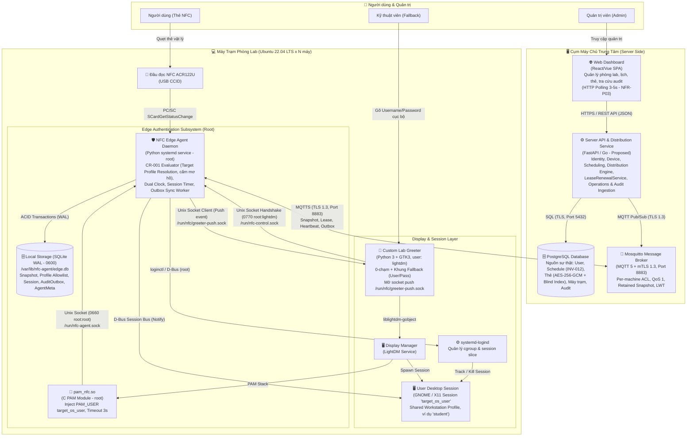

# 📦 Containers (C4 Level 2)

> Tài liệu này mô tả kiến trúc ở mức Container (C4 Model Level 2) của Hệ thống Quản lý và Xác thực Máy tính Phòng Lab qua Thẻ Sinh viên (NFC Edge Authentication).  
> "Container" ở đây được hiểu là các đơn vị phần mềm độc lập có thể thực thi, lưu trữ dữ liệu hoặc giao tiếp qua mạng/IPC (ứng dụng web, tiến trình nền daemon, cơ sở dữ liệu, message broker, PAM module, v.v.).

---

## 1. Container Diagram

Hệ thống áp dụng mô hình **Edge Computing**: Server giữ nguồn sự thật và phân phối dữ liệu; PC trạm tự chủ hoàn toàn việc ra quyết định xác thực và quản lý phiên tại chỗ, hoạt động bình thường ngay cả khi mất kết nối mạng hoàn toàn.

---

## 2. Danh Sách Containers

### 2.1. Phía Máy Chủ Trung Tâm (Server-Side)

| Container | Công nghệ đề xuất | Trách nhiệm chính (Responsibility) | Port / Giao thức |
|---|---|---|---|
| **Web Dashboard** | React / Vue.js SPA, TailwindCSS | Giao diện đồ họa cho Quản trị viên IT (MVP có 1 vai trò duy nhất theo D-003, D-007): - Quản lý máy trạm, zone, cấp `EnrollmentToken`. - Quản lý người dùng, gán/khóa UID thẻ. - Lập Schedule ba chiều (`ai + ở đâu + khi nào`). - Tra cứu Audit Log (giải mã UID hiển thị cho Admin). - Theo dõi trạng thái máy trạm qua cơ chế **HTTP Polling chu kỳ 3-5s** (đáp ứng NFR-P03, không dùng WebSocket để tránh over-design). | 443 (HTTPS) |
| **Server API & Distribution Service** | Python (FastAPI) hoặc Go *(Proposed)* | Xử lý nghiệp vụ của 5 Bounded Contexts phía server: - **Identity & Device:** Sinh khóa máy `K_m = HKDF(master_key, workstation_id || ":" || key_version)` (ADR-007). Phê duyệt Enrollment / Re-enrollment (khi trùng MAC đưa vào `pending_approval` theo P1-4, D-010), ký Client Certificate cho Agent. Mã hóa thẻ AES-256-GCM + HMAC Blind Index. - **Scheduling:** Quản lý Schedule (BR-016 là hợp quyền; tuy nhiên nếu trùng khung giờ mà chỉ định profile khác nhau sẽ dẫn đến `ambiguous_profile` tại Agent theo P2-6). - **Distribution Engine:** Dựng snapshot chứa TOÀN BỘ Schedule liên quan tới máy trạm (INV-012, không lọc theo giờ để giữ version bất biến), phân phối `target_os_username` (nullable) để Agent tự resolve (P2-1). Quản lý cấp phát và gia hạn Lease qua `LeaseRenewalService` (chỉ gia hạn khi `acked_version == desired_version`, đề xuất mặc định `D = 24h` chờ thầy duyệt). - **Operations Service:** Tiếp nhận Heartbeat (nguồn sự thật xác định online/offline theo BR-019); tiếp nhận Audit Outbox và phản hồi ACK theo `outbox_seq`. | 8000/443 (Internal/Reverse Proxy) |
| **Database Server** | PostgreSQL 15+ | Nguồn sự thật (Source of Truth): - Lưu thông tin User, Workstation, Zone, Schedule. - Lưu UID thẻ đã mã hóa an toàn (AES-256-GCM) kèm HMAC Blind Index. - Lưu trữ tập trung nhật ký quẹt thẻ toàn hệ thống (`AuditLog`). | 5432 (TCP, TLS) |
| **Message Broker** | Eclipse Mosquitto (MQTT 5) | Kênh truyền thông tin cậy hai chiều giữa Server và máy trạm: - Hỗ trợ TLS 1.3 với xác thực hai chiều mTLS (Client Certificate có `CN = workstation_id` do Server cấp), Per-machine ACL (máy nào chỉ đọc/ghi topic máy đó theo CN). - Topic chuẩn hóa: &nbsp;&nbsp;• Snapshot: `lab/workstation/{id}/snapshot` (Retained, QoS 1) &nbsp;&nbsp;• Lease: `lab/workstation/{id}/lease` (QoS 1) &nbsp;&nbsp;• Heartbeat: `lab/workstation/{id}/heartbeat` (QoS 0/1) &nbsp;&nbsp;• Outbox: `lab/workstation/{id}/outbox` (QoS 1) &nbsp;&nbsp;• LWT Status: `lab/workstation/{id}/status` (LWT payload: `offline`, Retained, QoS 1 - chỉ là gợi ý bổ trợ phát hiện nhanh). | 8883 (MQTTS, TLS 1.3 / mTLS) |

---

### 2.2. Phía Máy Trạm Phòng Lab (Edge Workstation - Ubuntu 22.04 LTS)

| Container / Thành phần | Công nghệ / Ngôn ngữ | Quyền thực thi | Trách nhiệm chính (Responsibility) |
|---|---|---|---|
| **NFC Edge Agent Daemon** | Python 3 (chạy dưới dạng `systemd` service) | `root` | Trọng tâm điều phối toàn bộ nghiệp vụ tại Edge: 1. Giám sát sự kiện thẻ từ ACR122U qua PC/SC `SCardGetStatusChange` ("thẻ xuất hiện" / "thẻ rời" theo BR-007c). Chuẩn hóa UID (VR-007), nạp `K_m` từ `/etc/nfc-agent/agent.conf`, tính `CardMatchKey` và lưu giữ UID gốc cho audit. 2. Đánh giá quyền quẹt thẻ theo `CR-001` độc lập tại chỗ: **xác định duy nhất target profile (`os_username`)** từ Schedule/Workstation allowlist; cấm kết quả mơ hồ (`ambiguous_profile`, BR-016, D-009). Đánh giá thông tin thẻ và lịch TRƯỚC khi xét trạng thái phiên (P1-1). 3. Kiểm soát thay thế phiên theo **D-006 / BR-008 / P1-3**: cùng user thì giữ nguyên (`noop` kèm `already_active`); khác user: nếu Desktop đang active thì kiểm tra `systemd-logind` trên `seat0`, nếu phiên OS thực sự còn chạy thì từ chối `workstation_busy`, nếu phiên OS đã mất (crash/logout bất thường) thì đóng `abandoned(os_session_lost)` và mở phiên mới; chỉ kích hoạt Two-Phase Teardown thay phiên (`abandoned(superseded)`) khi máy đang ở Greeter hoặc ca cũ đã hết giờ. 4. Quản lý hạn Lease kết hợp đồng hồ kép (`UTC` tuyệt đối với mốc sàn `floor = max(snapshot.created_at, last_server_time) - CLOCK_FLOOR_TOLERANCE` dung sai 60s + `CLOCK_BOOTTIME` đơn điệu đếm ngược phiên). Nếu lệch đồng hồ so với server > `CLOCK_SKEW_WARN_THRESHOLD` (60s), gửi cảnh báo `clock_skew_detected` nhưng không chặn gia hạn lease. Đối chiếu `boot_id` khi khởi động để chuyển phiên dở dang sang `abandoned(workstation_rebooted)`. 5. Đóng vai client đẩy thông báo tới Greeter qua `/run/nfc/greeter-push.sock`; mở socket `/run/nfc-control.sock` (0770 `root:lightdm`) nhận `greeter_ready` để bàn giao `staged_auth`. 6. Quản lý phiên: cảnh báo D-Bus trước khi hết ca, gọi `loginctl terminate-user` (chờ 2s) rồi `kill-user -s SIGKILL` (theo user slice) để dọn sạch tiến trình chạy ngầm; đối với profile dùng chung (cùng UID), đồng bộ đợi cgroup user slice và `/run/user/<UID>` được giải phóng hoàn toàn (chờ tối đa `SLICE_TEARDOWN_TIMEOUT = 3.0s`, P1-2); **tuyệt đối không xóa thư mục home hay file dữ liệu cục bộ** (BR-009, D-006, A6). 7. Đồng bộ snapshot và gửi audit outbox lên Server qua MQTT 5 Client với mTLS. |
| **PAM NFC Module (`pam_nfc.so`)** | C (Native Linux PAM Shared Object) | Gọi bởi LightDM (`root`) | Cắm vào `/etc/pam.d/lightdm`: kết nối tới `/run/nfc-agent.sock` với timeout 3000ms (`poll()`). Khi nhận `granted`, gọi `pam_set_item(pamh, PAM_USER, target_os_user)` và trả về `PAM_SUCCESS`. Nếu không có thẻ hoặc Agent lỗi, trả về `PAM_IGNORE` để chuỗi PAM tự động chuyển sang xác thực mật khẩu cục bộ (`pam_unix.so`). |
| **Custom Lab Greeter** | Python 3 + GTK3 (`liblightdm-gobject`) | User `lightdm` (thuộc nhóm `lightdm`) | Màn hình đăng nhập đồ họa: - Mở socket `/run/nfc/greeter-push.sock` (0770 `root:lightdm`) lắng nghe sự kiện push từ Agent (xác minh `SO_PEERCRED` UID 0). - Khi vừa nạp lên màn hình, chủ động gửi `greeter_ready` qua `/run/nfc-control.sock` để đón bắt lượt quẹt đang chờ (`staged_auth`). - Tự động kích hoạt đăng nhập 0-chạm vào profile dùng chung (`greeter.authenticate(target_os_user)`). - Cung cấp khung Fallback đầy đủ gồm 2 trường: **Username** và **Password** cho Kỹ thuật viên/Admin. - *Cơ chế phục hồi (D-006):* Không tự động lùi về greeter chuẩn khi crash. Khôi phục qua script wrapper kiểm tra trước khi start hoặc can thiệp quản trị qua TTY/SSH. |
| **Local Storage Database** | SQLite 3 (WAL mode) | `root` (`0600`, `/var/lib/nfc-agent/edge.db`) | Cơ sở dữ liệu ACID cục bộ đảm bảo an toàn tuyệt đối khi mất điện đột ngột (Spike S5): - `snapshot_cards`, `snapshot_schedules`: Lưu danh sách thẻ và lịch liên quan đến máy. - `workstation_profiles`: Danh sách allowlist profile dùng chung (tự động phát hiện cục bộ từ nhóm `labstudent`, đồng bộ cờ `enabled`/`disabled` và `is_default` từ Server Snapshot). - `local_session`: Lưu phiên với trạng thái domain (`pending`, `active`, `abandoned` kèm `end_reason = superseded / workstation_rebooted`, `forced_logout`, `discarded`), gắn với `os_username`. - `audit_outbox`: Hàng đợi nhật ký chưa gửi (chứa UID gốc, outcome `granted`/`denied`/`noop`, `outbox_seq`). - `agent_meta`: Lưu `boot_id`, `trusted_until`, `last_server_time`, `last_alive_at`. |
| **Display Manager (LightDM)** | LightDM (Ubuntu native package) | `root` | Quản lý màn hình X11/Greeter và điều phối chuỗi xác thực PAM. |
| **Session Manager (systemd-logind)** | systemd-logind (Linux native) | `root` | Quản lý cgroup, seat0 và session slice. Cung cấp API `loginctl` để Agent theo dõi phiên và dọn sạch tiến trình phiên (`terminate-user` theo user slice). |

---

## 3. Giao Thức Truyền Thông Giữa Các Containers (Communication Contracts)

| Nguồn (From) | Đích (To) | Giao thức | Đồng bộ / Bất đồng bộ | Mục đích & Chi tiết kỹ thuật |
|---|---|---|---|---|
| **Web Dashboard** | **Server API** | HTTPS (REST JSON) | Đồng bộ (Sync) | Quản lý máy trạm, profile dùng chung, thẻ, lịch học, tra cứu audit log. Thực hiện HTTP Polling 3-5s để làm mới trạng thái (NFR-P03). |
| **Server API** | **PostgreSQL** | TCP (Port 5432, TLS) | Đồng bộ (Sync) | Đọc ghi dữ liệu quan hệ, giao dịch nghiệp vụ. |
| **Server API** | **Mosquitto** | MQTT 5 (TLS 1.3, Port 8883) | Bất đồng bộ (Async) | Publish Snapshot (gồm thẻ, lịch, allowlist profile) (Retained, QoS 1), cấp gia hạn Lease qua topic lease; nhận Heartbeat và Audit Outbox từ máy trạm. |
| **Edge Agent** | **Mosquitto** | MQTTS (mTLS, Port 8883) | Bất đồng bộ (Async) | Xác thực hai chiều mTLS (Client Cert với CN = `workstation_id`). - Subscribe `lab/workstation/{id}/snapshot` và `lab/workstation/{id}/lease` - Publish `lab/workstation/{id}/heartbeat` định kỳ - Publish `lab/workstation/{id}/outbox` (Stop-and-wait với ACK) - Thiết lập LWT `lab/workstation/{id}/status` -> `offline`. |
| **NFC Reader** | **Edge Agent** | PC/SC USB CCID | Hướng sự kiện | Lắng nghe `SCardGetStatusChange` ("thẻ xuất hiện / thẻ rời"), đọc UID chuẩn hóa (VR-007). |
| **PAM Module** | **Edge Agent** | Unix Domain Socket (`/run/nfc-agent.sock`) | Đồng bộ (Sync, Timeout 3000ms) | Quyền socket `0660 root:root`. Kiểm tra `SO_PEERCRED` caller là root. Trả về `{"result": "granted", "user": "target_os_user"}` hoặc `{"result": "denied"}`. |
| **Edge Agent** | **Custom Greeter** | Unix Domain Socket (`/run/nfc/greeter-push.sock`) | Bất đồng bộ (Push) | Quyền socket `0770 root:lightdm` (do Greeter mở). Agent kết nối với tư cách Client để bắn sự kiện `card_swiped` (kèm `target_os_user`) hoặc `card_denied` (kèm mã lỗi cụ thể). |
| **Custom Greeter** | **Edge Agent** | Unix Domain Socket (`/run/nfc-control.sock`) | Đồng bộ (Sync) | Quyền socket `0770 root:lightdm` (do Agent mở). Kiểm tra `SO_PEERCRED` chấp nhận UID 0 hoặc UID của user `lightdm`. Greeter gửi `{"action": "greeter_ready"}` để đón nhận `staged_auth`. |
| **Edge Agent** | **SQLite DB** | C/Python SQLite Driver (WAL) | Đồng bộ (Sync ACID) | Giao dịch nguyên tử ghi đồng thời `audit_outbox` và `local_session (status='pending')` theo nguyên tắc Write-Ahead trước khi mở quyền đăng nhập. |
| **Edge Agent** | **systemd-logind** | D-Bus / `loginctl` CLI | Đồng bộ / Bất đồng bộ | Tra cứu phiên đồ họa trên `seat0`, thực thi lệnh `loginctl terminate-user` và `kill-user -s SIGKILL` theo user slice. |
| **Edge Agent** | **User Desktop** | D-Bus Session Bus | Bất đồng bộ (Async) | Gửi popup cảnh báo nguy cấp `notify-send` trực tiếp vào Desktop của người dùng trước khi hết hạn ca học. |
| **Custom Greeter** | **LightDM** | GObject API (`liblightdm-gobject`) | Đồng bộ (Callback) | Gọi `greeter.authenticate(target_os_user)` và `greeter.start_session_sync("ubuntu")`. |
