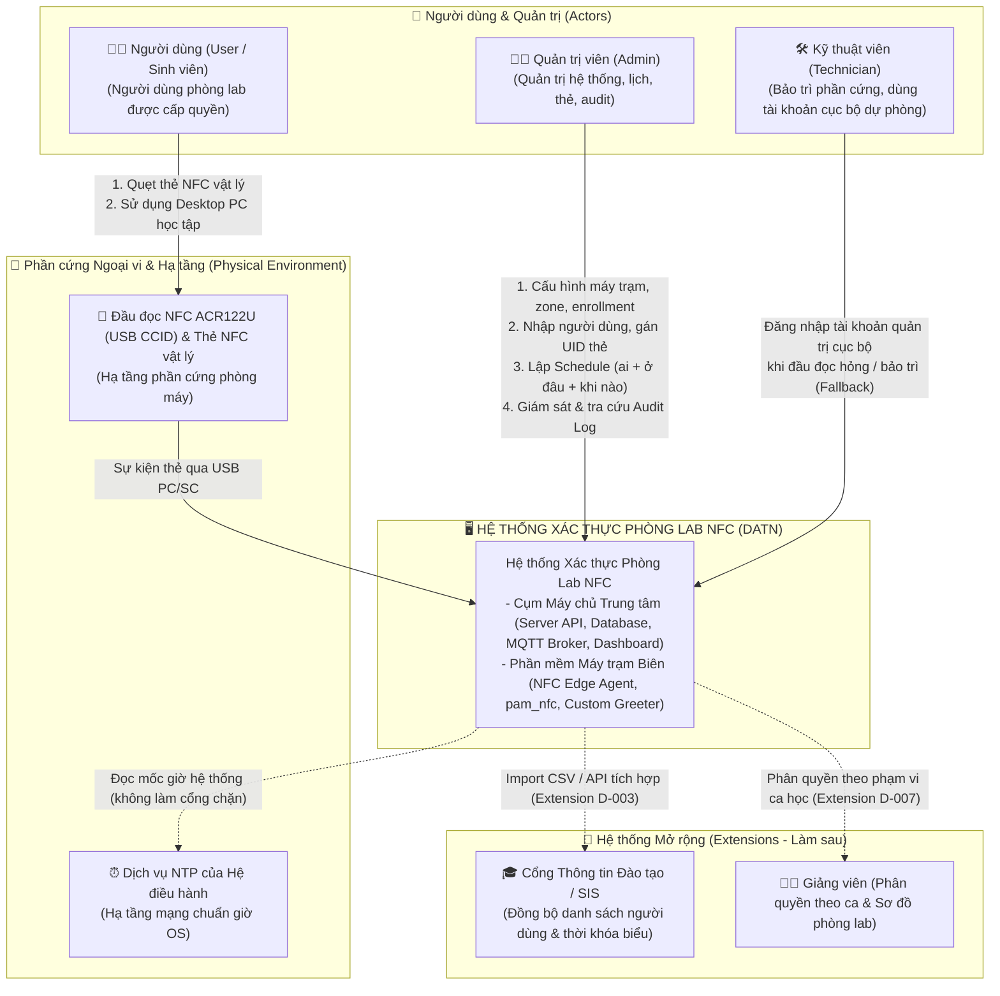

# 🌐 System Context (C4 Level 1)

> Tài liệu này mô tả kiến trúc ở mức Bối cảnh Hệ thống (C4 Model Level 1) của **Hệ thống Quản lý và Xác thực Máy tính Phòng Lab qua Thẻ Sinh viên (NFC Edge Authentication)**.  
> Xác định ranh giới hệ thống, các đối tượng người dùng tương tác trực tiếp và các thành phần ngoại vi/hệ thống liên quan.

---

## 1. Context Diagram

---

## 2. Mô Tả Hệ Thống (System Description)

Hệ thống Xác thực Phòng Lab NFC là giải pháp tích hợp phần mềm điều khiển trên máy trạm Linux và máy chủ quản trị tập trung:
- **Zero-Touch Login (Đăng nhập 0-chạm):** Người dùng chỉ cần chạm thẻ NFC đã đăng ký vào đầu đọc gắn tại PC. Hệ thống tự động nhận diện và đưa thẳng vào môi trường Desktop Ubuntu Linux mà không cần gõ bàn phím.
- **Edge Computing (Tự chủ tại biên):** Mỗi máy tính phòng lab được trang bị agent độc lập với kho dữ liệu SQLite WAL cục bộ. Việc kiểm tra quyền (CR-001) và cấp phép diễn ra tức thì tại PC, đảm bảo phòng máy hoạt động 100% bình thường kể cả khi mất kết nối mạng.
- **Lease & Bảo mật đa tầng:** Dữ liệu thẻ được băm HMAC riêng biệt cho từng máy trạm (`CardMatchKey = HKDF`); dữ liệu cục bộ có thời hạn tin cậy (Lease); hỗ trợ cơ chế đồng hồ kép (`UTC` + `CLOCK_BOOTTIME`) chống gian lận thời gian; hủy phiên cũ triệt để theo cgroup khi hết giờ hoặc quẹt đè hợp lệ.
- **Quản lý tập trung:** Quản trị viên quản lý toàn bộ ca học, danh sách thẻ và nhật ký ra vào thông qua giao diện Web Dashboard trực quan.

---

## 3. Các Bên Liên Quan & Vai Trò (Actors & Roles)

Tuân thủ quyết định **D-003, D-007** và quy định **FR-082** (MVP có duy nhất một vai trò quản trị):

| Vai trò (Role) | Mô tả đối tượng | Quyền hạn và tương tác chính |
|---|---|---|
| **Người dùng (User)** | Sinh viên hoặc học viên thực hành tại phòng máy | - Quẹt thẻ NFC vật lý lên đầu đọc để mở máy tự động vào tài khoản OS dùng chung (`WorkstationProfile`). - Nhận thông báo D-Bus pop-up trước khi hết hạn ca học. - Quẹt lại thẻ của chính mình để xem thời gian còn lại. - **Không có mật khẩu dự phòng cá nhân** (tài khoản OS dùng chung bị khóa mật khẩu `passwd -l` đối với luồng thường). |
| **Quản trị viên (Admin)** | Đội ngũ quản trị IT phòng máy trường (Actor duy nhất trong MVP) | - Truy cập Web Dashboard với quyền cao nhất. - Quản lý danh mục máy trạm, phân zone, cấp `EnrollmentToken` cho máy mới. - Quản lý danh mục User, thẻ NFC, khóa thẻ khi cần. - Lập Schedule ba chiều (`ai + ở đâu + khi nào`). - Tra cứu toàn bộ Audit Log hệ thống (UID thẻ được giải mã trên Dashboard). |
| **Kỹ thuật viên (Technician)** | Nhân sự trực tiếp tại phòng máy | - Sử dụng **đường đăng nhập dự phòng (Fallback)** bằng tài khoản quản trị cục bộ (ngoài phạm vi quản lý của Agent) thông qua ô Username + Password trên Greeter để bảo trì máy hoặc xử lý sự cố đầu đọc NFC hỏng (BR-004). |
| **Giảng viên (Lecturer)** *(Extension)* | Cán bộ phụ trách lớp thực hành | *(Tính năng mở rộng - D-003, D-007)*: Phân quyền theo ca học để chỉ xem audit log của sinh viên lớp mình và xem sơ đồ phòng máy trực quan thời gian thực. |

---

## 4. Phần Cứng Ngoại Vi & Hạ Tầng Mạng (Environment & Infrastructure)

| Thành phần | Phân loại | Mô tả vai trò kỹ thuật |
|---|---|---|
| **Đầu đọc NFC ACR122U & Thẻ NFC** | Phần cứng ngoại vi (Physical Hardware) | Thiết bị phần cứng cắm qua cổng USB hỗ trợ chuẩn PC/SC (USB CCID). Giao tiếp với Agent thông qua daemon `pcscd` của OS để truyền nhận UID thẻ chuẩn ISO/IEC 14443 Type A/B. |
| **Dịch vụ NTP của Hệ điều hành** | Hạ tầng mạng Host OS (Host Service) | Dịch vụ `systemd-timesyncd` hoặc `chrony` trên máy trạm Ubuntu đồng bộ thời gian từ máy chủ NTP trường. Agent chỉ đọc cờ trạng thái đồng bộ NTP để ghi nhận chẩn đoán hệ thống (`ClockSuspect`), tuyệt đối không dùng cờ NTP làm điều kiện cổng để từ chối quẹt thẻ (ADR-001). |
| **Cổng Thông tin Đào tạo (SIS / ERP)** *(Extension)* | Hệ thống bên ngoài (External System) | Hệ thống quản lý đào tạo hiện hữu của trường. Ở MVP, Quản trị viên nhập danh sách trực tiếp trên Web Dashboard hoặc import file CSV. Việc tích hợp API đồng bộ thời khóa biểu tự động thuộc giai đoạn mở rộng. |
