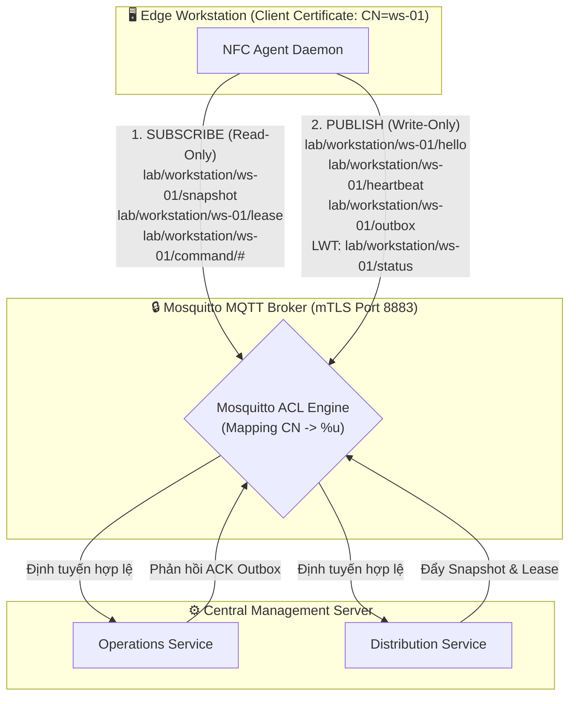
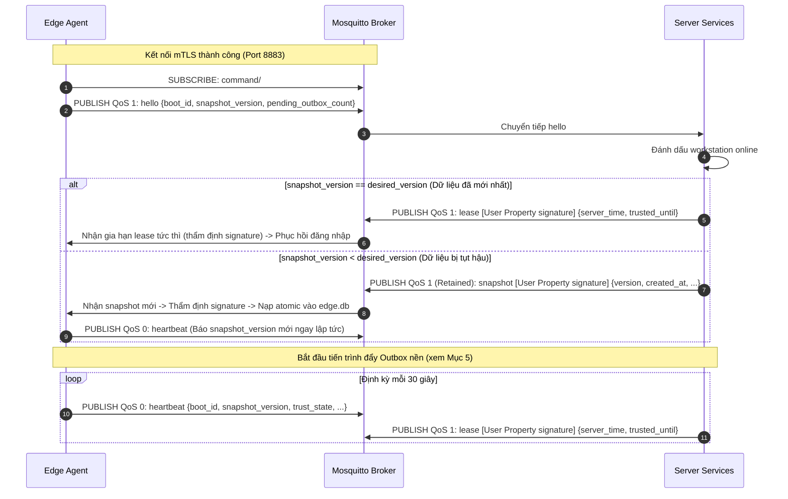
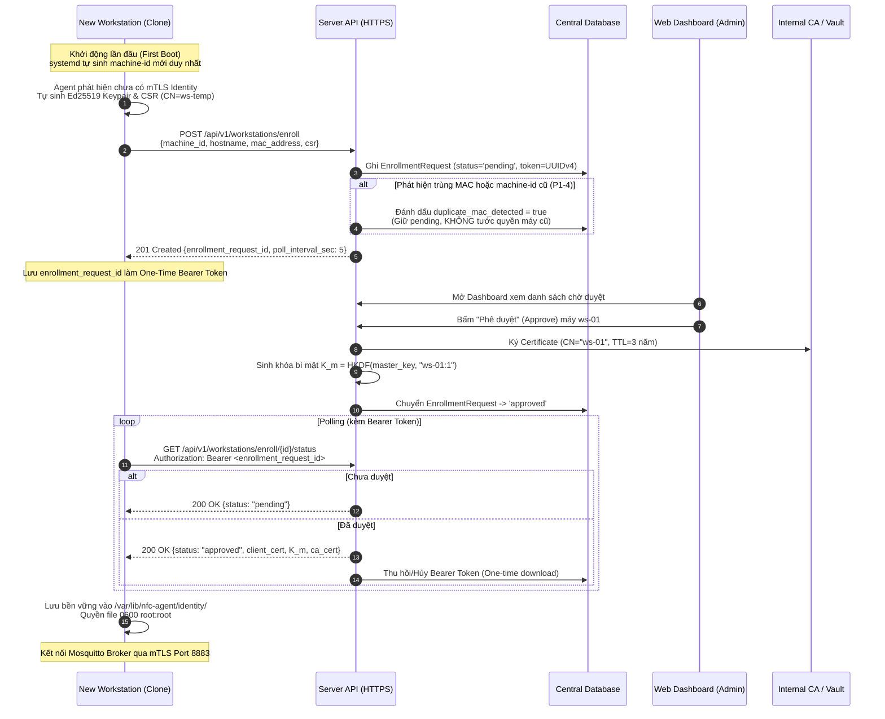

# ADR-002: Giao Thức MQTT 5, Phân Quyền ACL, Định Danh Máy Trạm và Xác Thực mTLS

## Metadata

| Field | Value |
|---|---|
| **Status** | Proposed |
| **Date** | 2026-11-10 |
| **Deciders** | Nhóm tác giả ĐATN & Giảng viên hướng dẫn |
| **Supersedes** | Không |

---

## Context

Trong kiến trúc Edge Authentication của hệ thống, máy trạm phòng lab (Workstation) hoạt động như một nút biên tự trị, tự thẩm định đăng nhập dựa trên Snapshot và Lease cục bộ. Kênh truyền thông giữa Máy chủ Trung tâm (Server) và Máy trạm đóng vai trò sống còn để:
1. **Phân phối cấu hình & gia hạn:** Đẩy Snapshot người dùng/lịch học mới nhất và gia hạn thời hạn tin cậy (`trusted_until`).
2. **Thu thập nhật ký kiểm toán:** Đồng bộ các bản ghi kiểm toán (`AuditLog`) và sự kiện phiên (`LocalSession`) từ máy trạm về trung tâm theo cơ chế ngoại tuyến trước - đồng bộ sau (Outbox pattern).
3. **Giám sát trạng thái máy:** Báo cáo máy trực tuyến (Online/Offline) phục vụ kỹ thuật viên phòng lab.

Khi triển khai trên quy mô phòng lab trường học (hàng trăm máy trạm nhân bản từ cùng một đĩa mẫu qua Clonezilla/PXE), hệ thống đối mặt với các thách thức lớn:
- **Nguy cơ xung đột định danh do nhân bản đĩa (Clone Collision):** Nếu định danh máy hoặc chứng chỉ bảo mật được ghi cứng trong ảnh đĩa mẫu, hàng trăm máy sau khi clone sẽ dùng chung định danh, dẫn đến hiện tượng đá kết nối liên tục trên broker.
- **Nguy cơ máy trạm can thiệp cấu hình của nhau (Lateral Movement):** Nếu broker phân quyền wildcard lỏng lẻo (`readwrite #`), một máy bị chiếm quyền root có thể nghe lén snapshot của máy khác hoặc tự ý giả mạo bản tin snapshot/lease.
- **Hiện tượng bão kết nối (Thundering Herd):** Khi mạng phòng lab hoặc server trung tâm phục hồi sau sự cố, hàng trăm máy trạm kết nối lại đồng loạt gây nghẽn broker.
- **Độ tin cậy truyền nhận dữ liệu kiểm toán:** Mạng trường học chập chờn, bản tin nhật ký có thể bị thất lạc hoặc gửi lặp; server cần cơ chế xác nhận tin cậy mà không làm nghẽn hiệu năng ghi tại Edge.

Tài liệu này ghi nhận các quyết định kiến trúc chuẩn hóa kênh truyền MQTT 5, kiểm soát truy cập Mosquitto ACL, giao thức Outbox và quy trình cấp phát định danh máy tự động qua mTLS.

---

## Decision Drivers

- **Bảo mật Tối thiểu (Principle of Least Privilege - NFR-SEC02):** Máy trạm chỉ được đọc lệnh/snapshot của chính mình và chỉ được gửi log/heartbeat của chính mình.
- **Không Cần Cấu Hình Thủ Công Tại Từng Máy (Zero-Touch Provisioning - D-010):** Kỹ thuật viên clone hàng loạt máy mà không cần ngồi gõ token hay cấu hình IP/tên máy thủ công.
- **Bảo toàn Dữ liệu Kiểm toán (Audit Durability - INV-013, NFR-A04):** Không bao giờ làm mất hay trùng lặp bản ghi nhật ký kiểm toán khi đứt mạng hay sập nguồn.
- **Khả năng Phục hồi Tự động & Chống Bão Mạng (Resilience & Thundering Herd Prevention - NFR-A01):** Tự động kết nối lại an toàn với độ lùi ngẫu nhiên.
- **Dựa trên Bằng chứng Thực nghiệm (Spike S5 & S8):** Payload 500 thẻ truyền trong 1 message MQTT TLS chỉ mất < 0.01s (S5); kết nối mTLS bằng Client Cert Ed25519 do Node.js cấp (`CN=ws-test-01` -> `%u`) cô lập hoàn toàn dữ liệu giữa các máy trạm (0 byte rò rỉ) và chặn ghi trái phép bằng mã lỗi `0x87 / 135 (Not Authorized)` (S8).

---

## Options Considered

### Option 1: Giao tiếp hoàn toàn qua HTTP REST API (Polling)
- **Ưu điểm:** Đơn giản, dễ cài đặt qua HTTP client thông thường.
- **Nhược điểm:** Kém thời gian thực; hàng trăm máy trạm liên tục gửi request polling gây quá tải server; không có cơ chế đẩy (push) snapshot tức thời; không có Last Will Testament (LWT) để phát hiện máy mất mạng đột ngột.

### Option 2: MQTT 3.1.1 với Xác thực Username/Password thông thường
- **Ưu điểm:** Phổ biến, dễ cấu hình trên Mosquitto.
- **Nhược điểm:** Phải quản lý và lưu trữ mật khẩu tĩnh trên máy trạm; mật khẩu dễ bị trích xuất nếu ổ cứng bị tháo; thiếu các tính năng hiện đại của MQTT 5 (Session Expiry Interval, Reason Codes như `0x87 Not Authorized`, User Properties).

### Option 3: MQTT 5 qua TLS với mTLS X.509 Certificate và Mosquitto Pattern ACL (Được chọn)
- **Ưu điểm:**
  - Xác thực 2 chiều (Mutual TLS): Máy trạm xác thực đúng Broker máy chủ; Broker xác thực máy trạm qua chứng chỉ Client Certificate Ed25519 được ký bởi CA nội bộ.
  - Định danh máy gắn chặt với Common Name (`CN = workstation_id`), ánh xạ tự động vào biến `%u` của Mosquitto ACL.
  - Phân tách đọc/ghi tuyệt đối, loại trừ hoàn toàn nguy cơ nghe lén hay can thiệp chéo giữa các máy trạm.
  - Tận dụng LWT và User Properties của MQTT 5.
- **Nhược điểm:** Cần xây dựng quy trình Đăng ký tự động (Auto-Enrollment CSR) để cấp phát chứng chỉ lần đầu.

---

## Decision

Chúng tôi quyết định chuẩn hóa **Giao thức MQTT 5, Mô hình Phân quyền ACL và Quy trình Cấp phát Định danh mTLS** với các nội dung chi tiết sau:



---

### 1. Cấu trúc Topic và Phân quyền Mosquitto ACL Triệt để (Least Privilege)

Broker áp dụng cơ chế xác thực chứng chỉ Client qua tùy chọn `use_identity_as_username true`. Mosquitto tự động trích xuất Common Name từ chứng chỉ máy trạm làm username nội bộ (`%u = workstation_id`).

Hệ thống phân tách tuyệt đối giữa luồng ĐỌC (Subscribe) và luồng GHI (Publish), **bãi bỏ hoàn toàn wildcard `readwrite lab/workstation/%u/#`**:

| Nhóm luồng | Quyền ACL | Topic Pattern | Mục đích nghiệp vụ |
|---|---|---|---|
| **Máy trạm nhận lệnh** | **Read-Only** (SUBSCRIBE) | `pattern read lab/workstation/%u/command/#` | Nhận lệnh quản trị từ xa (ACK outbox, yêu cầu sync...) |
| **Máy trạm nhận Snapshot** | **Read-Only** (SUBSCRIBE) | `pattern read lab/workstation/%u/snapshot` | Nhận gói cấu hình dữ liệu Snapshot đầy đủ |
| **Máy trạm nhận Lease** | **Read-Only** (SUBSCRIBE) | `pattern read lab/workstation/%u/lease` | Nhận gói gia hạn thời hạn tin cậy và đồng bộ giờ |
| **Máy trạm báo kết nối** | **Write-Only** (PUBLISH) | `pattern write lab/workstation/%u/hello` | Gửi báo cáo trạng thái khởi động / kết nối lại |
| **Máy trạm báo sống** | **Write-Only** (PUBLISH) | `pattern write lab/workstation/%u/heartbeat` | Gửi nhịp tim định kỳ và phiên bản dữ liệu hiện hành |
| **Máy trạm gửi kiểm toán** | **Write-Only** (PUBLISH) | `pattern write lab/workstation/%u/outbox` | Gửi các lô bản ghi AuditLog và sự kiện phiên |
| **Máy trạm báo trạng thái** | **Write-Only** (PUBLISH) | `pattern write lab/workstation/%u/status` | Kênh xuất bản trạng thái online và Last Will (LWT) |

> **Bảo vệ an ninh & Hành vi thực tế Mosquitto `acl_file` (kiểm chứng tại Spike S5 & S8):**
> - Mọi nỗ lực `PUBLISH` trái phép của máy trạm (như tự ghi vào `/snapshot` hay ghi trộm topic máy khác) đều bị Mosquitto Broker từ chối ngay lập tức ở tầng giao thức với mã lỗi MQTT 5: **`0x87 / 135 (Not Authorized)`** (S5, S8).
> - Đối với `SUBSCRIBE` trái phép sang máy trạm khác: khi dùng `acl_file` truyền thống (`pattern read ...`), Mosquitto chấp nhận gói `SUBACK` (`qos: 1`) nhưng **kiểm soát quyền `read` lúc chuyển phát (egress)** và âm thầm loại bỏ bản tin, bảo đảm máy trạm nhận **0 byte rò rỉ** (đã kiểm chứng thực tế bằng cert Ed25519 `CN=ws-test-01` tại Spike S8). Nếu muốn broker từ chối ngay cả gói `SUBACK` bằng mã `0x87`, có thể chuyển sang plugin `dynamic-security` của Mosquitto 2.x khi triển khai nâng cao.

---

### 2. Chiến lược QoS, LWT và Cờ Retained

| Loại bản tin | Topic | QoS | Retain? | Lý do kỹ thuật |
|---|---|:---:|:---:|---|
| **Hello** | `.../hello` | **1** | `false` | Đảm bảo server nhận được báo cáo kết nối lại; không lưu đệm để tránh xử lý bản tin cũ. |
| **Snapshot Push** | `.../snapshot` | **1** | `true` | Đảm bảo chuyển giao tin cậy. Đặt `retain=true` để nếu Agent restart, ngay khi subscribe lại sẽ nhận được snapshot mới nhất mà không cần server gửi lại. |
| **Lease Renewal** | `.../lease` | **1** | `false` | Bản tin gia hạn thời gian thực, có giá trị tức thời. |
| **Heartbeat** | `.../heartbeat` | **0** | `false` | Gửi định kỳ (30s). Nếu mất một nhịp do nghẽn mạng thì nhịp sau sẽ bù, không cần tốn chi phí ACK mạng của QoS 1. |
| **Outbox Batch** | `.../outbox` | **1** | `false` | Dữ liệu kiểm toán bắt buộc giao nhận ít nhất một lần (At-least-once). |
| **Outbox ACK** | `.../command/ack` | **1** | `false` | Xác nhận tin cậy từ Server để Agent an tâm xóa SQLite Outbox. |
| **Last Will (LWT)** | `.../status` | **1** | `true` | Khi kết nối đứt đột ngột (rút dây mạng, sập nguồn), Broker tự publish payload `{"status": "offline", "reason": "connection_lost"}`. Khi Agent online, nó publish `{"status": "online"}` (retained) đè lên. |

---

### 3. Tham số Kết nối MQTT 5: Clean Start & Session Expiry Interval

Để cân bằng giữa việc lưu trữ hàng đợi tin nhắn khi mất mạng ngắn và tránh cạn kiệt bộ nhớ RAM của Mosquitto Broker khi máy trạm tắt nguồn dài ngày:
1. **`Clean Start = false`:** Khi Agent kết nối lại, Broker duy trì các subscription và các message QoS 1 đang chờ trong hàng đợi.
2. **`Session Expiry Interval = 3600` (1 giờ):**
   - Nếu máy trạm mất mạng tạm thời hoặc Agent restart trong vòng 1 giờ, toàn bộ message QoS 1 đang chờ vẫn được giữ nguyên.
   - Nếu máy trạm tắt nguồn qua đêm hoặc nghỉ cuối tuần (quá 1 giờ), Broker tự động giải phóng session để giải phóng bộ nhớ. Khi bật nguồn lại, Agent chỉ cần gửi bản tin `Hello` để đồng bộ lại từ đầu.

---

### 4. Giao thức Bắt tay Kết nối Lại (Hello & Heartbeat Flow)

Theo nguyên tắc thiết kế từ `reconnect.md`: **Khôi phục khả năng quẹt thẻ trước, đẩy nhật ký sau.**



- **Xác thực toàn vẹn bằng MQTT 5 User Property:**
  Để chống kẻ xấu giả mạo Lease / Snapshot khi Broker bị chiếm quyền, toàn bộ các bản tin từ Server (`snapshot`, `lease`, `command/ack`) bắt buộc phải mang **MQTT 5 User Property** `signature: <hex>`.
  - Chữ ký tính trên toàn bộ chuỗi byte thô của payload (`raw_mqtt_payload_bytes`) kèm nhãn miền tách biệt (Domain Separation Tag):
    * Snapshot: `signature = HMAC-SHA256(K_m, "snapshot-v1:" || raw_mqtt_payload_bytes)`
    * Lease: `signature = HMAC-SHA256(K_m, "lease-v1:" || raw_mqtt_payload_bytes)`
    * ACK: `signature = HMAC-SHA256(K_m, "ack-v1:" || raw_mqtt_payload_bytes)`
  - Agent thẩm định chữ ký trực tiếp trên chuỗi byte nhận được từ MQTT wire trước khi xử lý logic hoặc parse JSON. Nếu chữ ký sai, từ chối ngay lập tức.
- **Payload Hello (`.../hello`):**
  ```json
  {
    "workstation_id": "ws-01",
    "boot_id": "9f2c8d14-...",
    "snapshot_version": 12,
    "pending_outbox_count": 4,
    "agent_version": "1.0.0"
  }
  ```
- **Payload Phản hồi Lease (`.../lease`):**
  *(Mang User Property `signature` tương ứng)*
  ```json
  {
    "server_time": 1793049263.96,
    "trusted_until": 1793078063.96,
    "desired_version": 12,
    "max_drift": 60.0
  }
  ```
- **Payload Heartbeat thống nhất (`.../heartbeat`):**
  ```json
  {
    "workstation_id": "ws-01",
    "boot_id": "9f2c8d14-...",
    "snapshot_version": 12,
    "trust_state": "trusted",
    "local_time": 1793049263.81,
    "clock_skew_detected": false,
    "last_apply_error": null
  }
  ```
  *(Thay thế bản tin `SnapshotApplied` riêng biệt: Ngay sau khi nạp snapshot mới thành công, Agent lập tức phát một bản tin Heartbeat mang `snapshot_version` mới để Server nhận biết mà không cần thêm topic riêng trong ACL).*

---

### 5. Giao thức Đẩy Outbox Theo Lô và Xác Nhận Lũy Tiến (Cumulative ACK)

Để đảm bảo tính bất biến **INV-013** (chỉ xóa khỏi outbox sau khi server đã xác nhận) và **XINV-006** (chống trùng lặp):

1. **Đóng lô (Batching):** 
   - Agent đọc tối đa `BATCH_SIZE = 50` bản ghi từ bảng `audit_outbox` theo thứ tự tăng dần của khóa `outbox_seq` (FIFO).
   - Gói payload mang trường `from_seq` và `to_seq`.
   - **Bảo toàn Audit Trail đầy đủ (FR-072, ADR-007):** Bản tin Outbox bắt buộc phải chứa `card_uid` thực tế của lần quẹt thẻ và ảnh chụp thông tin người dùng / máy trạm tại thời điểm quẹt (để Server mã hóa AES-256-GCM lưu trữ và Admin có thể xem được trên Dashboard):
     ```json
     {
       "workstation_id": "ws-01",
       "batch_id": "b-68192a",
       "from_seq": 101,
       "to_seq": 150,
       "records": [
         {
           "entry_id": "d-84f9...",
           "outbox_seq": 101,
           "timestamp": 1793048324.61,
           "event_type": "swipe_decision",
           "payload": {
             "card_uid": "1F0820CF",
             "outcome": "granted",
             "user_id": "SV001",
             "target_os_username": "student",
             "matched_schedule_id": "SCH_01"
           }
         }
       ]
     }
     ```
2. **Xử lý phía Server (Idempotency):**
   - Server bóc tách từng bản ghi, dùng `entry_id` để loại trùng (Dedup) bằng ràng buộc `ON CONFLICT (entry_id) DO NOTHING` trong cơ sở dữ liệu PostgreSQL.
3. **Xác nhận Lũy tiến (Cumulative ACK):**
   - Server gửi bản tin xác nhận về topic `lab/workstation/%u/command/ack`:
     ```json
     {
       "command": "ack_outbox",
       "acked_seq": 150
     }
     ```
4. **Xóa cục bộ tại Edge:**
   - Khi nhận được `acked_seq = 150`, Agent thực thi lệnh SQLite:
     ```sql
     DELETE FROM audit_outbox WHERE outbox_seq <= 150;
     ```
   - Cơ chế xác nhận lũy tiến giúp hệ thống tự phục hồi ngay cả khi một vài gói ACK trung gian bị thất lạc trên mạng.

---

### 6. Chiến lược Kết Nối Lại & Exponential Backoff Có Ngẫu Nhiên Hóa (Jitter)

Để triệt tiêu hiện tượng thundering herd làm sập Broker khi hàng trăm máy trạm cùng kết nối lại:
- **Công thức tính độ trễ kết nối lại:**
  `delay = min(MAX_BACKOFF, BASE_BACKOFF * 2^attempt) * (0.8 + 0.4 * random())`
- **Các tham số chuẩn hóa:**
  - `BASE_BACKOFF = 1.0` giây.
  - `MAX_BACKOFF = 60.0` giây.
  - Hệ số Jitter ngẫu nhiên trong khoảng `[0.8, 1.2]` nhằm phân tán thời điểm gửi gói `CONNECT` của các máy trạm trong phòng lab.

---

### 7. Quy trình Định Danh Máy Trạm, Master Image và Tự Đăng Ký mTLS (P1-4, D-010)

Để giải quyết bài toán nhân bản ảnh đĩa hàng loạt:



1. **Chuẩn hóa Master Image (Sysprep sạch):**
   - Đĩa mẫu trước khi clone qua Clonezilla/PXE phải được xóa trắng `/etc/machine-id` (hoặc đặt uninitialized) và xóa toàn bộ thư mục `/var/lib/nfc-agent/identity/`.
2. **Khởi động lần đầu (First Boot):**
   - Systemd tự động sinh `machine-id` duy nhất cho phần cứng mới.
   - Agent khởi động, nhận thấy thiếu chứng chỉ số sẽ tự động sinh cặp khóa riêng Ed25519 và Certificate Signing Request (CSR) lưu tại `/var/lib/nfc-agent/identity.key` với quyền `0600 root:root`.
3. **Đăng ký tập trung qua HTTPS REST API:**
   - Agent gửi yêu cầu đăng ký `POST /api/v1/workstations/enroll` chứa: `machine_id`, `hostname`, `mac_address`, và nội dung tệp `csr`.
   - Server ghi nhận vào bảng `enrollment_requests` ở trạng thái **`pending`**, sinh một `enrollment_request_id` ngẫu nhiên (UUID v4 bí mật) đóng vai trò **One-Time Bearer Token**, và trả về cho Agent trong HTTP response code 201.
   - *Phòng vệ trùng MAC (P1-4):* Nếu phát hiện MAC hoặc `machine-id` trùng với một máy trạm đang hoạt động, Server **tuyệt đối không ghi đè** hay tước quyền máy cũ, mà chỉ gắn cờ cảnh báo `duplicate_mac_detected = true` và đưa vào danh sách chờ duyệt riêng biệt để chống giả mạo ARP/MAC cướp credential.
4. **Phê duyệt trên Web Dashboard:**
   - Quản trị viên đối chiếu danh sách máy mới trong phòng lab và bấm phê duyệt (hỗ trợ duyệt hàng loạt theo Zone).
   - Server cấp phát `workstation_id` chính thức, ký chứng chỉ số Client Certificate (`CN = workstation_id`) với thời hạn **TTL = 3 năm** (đủ cho trọn vẹn chu kỳ hoạt động đồ án mà không gây gián đoạn do hết hạn chứng chỉ giữa chừng; việc tự động xoay vòng cert trước khi hết hạn được ghi nhận là Future Extension).
   - Đồng thời trích xuất khóa định danh máy `K_m = HKDF(master_key, workstation_id || ":" || key_version)` theo [ADR-007](ADR-007-khoa-so-khop-uid.md).
5. **Kích hoạt mTLS và Thu hồi Token:**
   - Agent gửi yêu cầu `GET /api/v1/workstations/enroll/{enrollment_request_id}/status` kèm header `Authorization: Bearer <enrollment_request_id>`. Kẻ tấn công trên mạng LAN dù biết `hostname` hay `mac_address` cũng không thể tải trộm chứng chỉ và `K_m` nếu không sở hữu Bearer Token bí mật này.
   - Sau khi trả về chứng chỉ và `K_m` thành công 1 lần, Server hủy ngay quyền tải tiếp (One-time fetch) để ngăn rò rỉ.
   - Agent lưu chứng chỉ và `K_m` vào đĩa an toàn. Kể từ thời điểm này, Agent ngắt kênh HTTP bootstrap và chuyển sang sử dụng 100% kênh mTLS bảo mật cổng 8883 kết nối với Broker Mosquitto.

---

## Consequences

### Positive
- **Bảo mật Đỉnh cao:** mTLS ngăn chặn 100% nghe lén trên mạng LAN phòng lab; Mosquitto ACL tách biệt đọc/ghi triệt tiêu nguy cơ máy trạm can thiệp cấu hình của nhau; Bearer token một lần bảo vệ K_m trong quy trình bootstrap.
- **Vận hành Tiện lợi (Zero-Touch):** Kỹ thuật viên clone hàng loạt không cần cấu hình mật khẩu hay token thủ công trên từng máy trạm; quản trị phê duyệt tập trung trên Web Dashboard.
- **Toàn vẹn Dữ liệu Tuyệt đối:** Kết hợp Outbox batching và Cumulative ACK loại trừ rủi ro mất mát hay gửi trùng lặp bản ghi kiểm toán khi đứt mạng.
- **Chống Bão Kết nối:** Cơ chế Exponential Backoff có Jitter bảo vệ hạ tầng máy chủ khi phòng lab 40-100 máy trạm cùng khởi động lại.

### Negative & Operational Trade-offs
- **Gánh nặng Hạ tầng PKI:** Server trung tâm phải quản lý CA nội bộ để ký chứng chỉ số X.509. (Giải pháp: Đặt TTL = 3 năm cho MVP để giảm bớt độ phức tạp của auto-renewal cert).
- **Ràng buộc Thời gian Ban đầu:** Quá trình mTLS yêu cầu đồng hồ máy trạm không được lệch quá thời hạn chứng chỉ X.509; với chứng chỉ 3 năm, rủi ro lệch giờ cản trở mTLS ban đầu là gần như bằng không.
