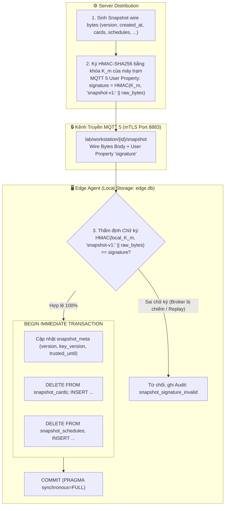

# ADR-003: Lưu Trữ Cục Bộ SQLite WAL, Hợp Nhất Cơ Sở Dữ Liệu và Xác Thực Toàn Vẹn Snapshot Bằng Khóa K_m

## Metadata

| Field | Value |
|---|---|
| **Status** | Proposed |
| **Date** | 2026-11-10 |
| **Deciders** | Nhóm tác giả ĐATN & Giảng viên hướng dẫn |
| **Supersedes** | Quyết định lưu file Snapshot JSON rời trong Spike S5 |

---

## Context

Máy trạm phòng lab (Workstation) hoạt động theo mô hình biên tự trị (Edge Authentication): tự đưa ra quyết định cấp quyền đăng nhập (`LoginDecision`) dựa trên dữ liệu cấu hình cục bộ mà không phụ thuộc vào kết nối mạng tới Server tại thời điểm quẹt thẻ (BR-005, D-001). Do đó, tầng lưu trữ cục bộ tại Edge đóng vai trò là xương sống vận hành của hệ thống, đòi hỏi phải giải quyết cùng lúc các bài toán:

1. **Tính Nguyên Tử Ghi Trước (Atomic Write-Ahead - INV-014, D-005):** Quyết định quẹt thẻ (`granted`) và bản ghi phiên khởi tạo (`LocalSession status='pending'`) bắt buộc phải được ghi bền vững xuống đĩa trong **cùng một giao dịch duy nhất** trước khi trả quyền mở cửa cho PAM. Nếu ghi rời rạc, một cú sập nguồn giữa hai thao tác sẽ tạo ra trạng thái bất nhất: PAM mở Desktop nhưng hệ thống không lưu vết kiểm toán hoặc không theo dõi được thời hạn phiên.
2. **Xung Đột Kiến Trúc Giữa S5 và D-006.4:**
   - Trong thử nghiệm ban đầu (Spike S5), hệ thống lưu Snapshot thành tệp JSON riêng biệt (`snapshot.json`) và áp dụng quy trình ghi file tạm `.tmp` + `os.fsync(file)` + `os.replace` (atomic rename) + `os.fsync(dir_fd)` trên thư mục cha để chống mất metadata trên hệ thống tệp ext4.
   - Tuy nhiên, quyết định [D-006.4](../../decisions.md) đã chốt hợp nhất toàn bộ trạng thái máy trạm vào một cơ sở dữ liệu SQLite duy nhất. Cần làm rõ: phát hiện về fsync thư mục cha của S5 còn hiệu lực ở đâu và cơ chế lưu trữ mới bảo đảm tính bền vững (Durability) ra sao.
3. **Nguy cơ Giả mạo hoặc Đầu độc Snapshot (Snapshot Tampering / Cross-Machine Replay):**
   - Snapshot chứa danh sách thẻ hợp lệ (`CardMatchKey`), lịch học (`Schedule`) và thời hạn tin cậy (`trusted_until`).
   - Mặc dù kênh truyền MQTT được bảo vệ bằng TLS, nếu Broker trung gian bị xâm nhập (Compromised Broker / MITM) hoặc kẻ tấn công trích xuất file snapshot từ máy này sang máy khác, kẻ xấu có thể tiêm snapshot giả mạo để cấp quyền mở máy trái phép. Cần một cơ chế xác thực toàn vẹn độc lập ngay tại nội dung payload.
4. **Độ Bền Vững Trước Sự Cố Ngắt Nguồn Cưỡng Bức (Power Loss / SysRq `b`):** Phòng lab trường học thường xuyên xảy ra tình huống sinh viên rút phích cắm đột ngột hoặc ngắt cầu dao tổng; cơ sở dữ liệu không bao giờ được phép rơi vào trạng thái hỏng tệp (database corrupted).

---

## Decision Drivers

- **Tính Bất Biến Giao Dịch (INV-011, INV-014):** Ghi đồng thời Audit Log và Session Pending trong một khối nguyên tử; chỉ xóa Outbox khi Server đã xác nhận (INV-013).
- **Chống giả mạo (Cryptographic Integrity):** Đảm bảo Snapshot chỉ do Server chính danh phát hành cho riêng máy trạm đó; Broker bị chiếm quyền cũng không thể giả mạo dữ liệu.
- **Tối Ưu Hiệu Năng Đọc (Zero-Touch Latency):** Thời gian truy vấn kiểm tra thẻ và đối soát lịch trên đĩa cục bộ phải đạt dưới 5ms để bảo đảm trải nghiệm 0-chạm.
- **Khả Năng Chống Chịu Mất Điện (Crash-Safe):** Dựa trên Spike S5: ghi lặp 545 vòng rồi cắt điện cưỡng chế (SysRq `b`) **một lần** trên máy ảo, sau khởi động `integrity_check = ok`. Giới hạn: N = 1, chạy trên VM (host còn write-cache), chưa chứng minh trên ổ vật lý; vì vậy vẫn giữ quy trình phục hồi khi DB hỏng (D-017, `migrations.md` §3.2).

---

## Options Considered

### Option 1: Mô hình Lai (Hybrid) — Snapshot JSON rời + SQLite cho Outbox & Session (Mô hình thử nghiệm S5)
- **Ưu điểm:** Tệp Snapshot JSON dễ đọc trực tiếp bằng mắt; kiểm chứng được kỹ thuật POSIX directory fsync.
- **Nhược điểm:** Phân mảnh lưu trữ; không thể bọc thao tác nạp snapshot và cập nhật lease vào cùng một giao dịch ACID với bảng phiên; đòi hỏi mã nguồn tự quản lý nhiều cơ chế đồng bộ đĩa song song.

### Option 2: Cơ sở dữ liệu nhúng Key-Value (RocksDB / LMDB)
- **Ưu điểm:** Tốc độ ghi cực cao, phù hợp ghi chuỗi thời gian (time-series).
- **Nhược điểm:** Thiếu hỗ trợ truy vấn quan hệ bảng (phức tạp khi join giữa `audit_outbox` và `local_session` qua `entry_id`); đòi hỏi biên dịch thư viện C++ phức tạp trên máy trạm.

### Option 3: Hợp Nhất 100% Vào SQLite WAL (`edge.db`) & Xác Thực Snapshot Bằng HMAC `K_m` (Được chọn)
- **Ưu điểm:**
  - Toàn bộ trạng thái máy trạm (Snapshot, Lease, Session, Outbox, Metadata) được quản lý tập trung trong một tệp duy nhất `/var/lib/nfc-agent/edge.db`.
  - Cơ chế Write-Ahead Logging (WAL) tách biệt hoàn toàn luồng Đọc và Ghi: PAM và luồng quẹt thẻ đọc dữ liệu tức thì (< 1ms) không bao giờ bị nghẽn bởi luồng nền đang ghi outbox hoặc nạp snapshot.
  - Sử dụng khóa đối xứng riêng của máy `K_m` để ký và thẩm định HMAC cho snapshot, ngăn chặn tuyệt đối việc can thiệp payload hoặc sao chép snapshot giữa các máy.
- **Nhược điểm:** Cần cấu hình PRAGMA chuẩn xác để tránh checkpoint dở dang khi mất điện.

---

## Decision

Chúng tôi quyết định áp dụng **Mô hình Lưu trữ Hợp nhất SQLite WAL (`edge.db`) và Cơ chế Xác thực Toàn vẹn Snapshot bằng HMAC-SHA256 (`K_m`)** với các quy chuẩn kỹ thuật sau:



---

### 1. Vị Trí Lưu Trữ và Chuẩn Hóa Phân Quyền Hệ Thống Tệp

- Tệp cơ sở dữ liệu duy nhất: `/var/lib/nfc-agent/edge.db`.
- **Phân quyền nghiêm ngặt Linux (D-013, Threat Boundary):**
  - Thư mục cha `/var/lib/nfc-agent`: Thuộc quyền sở hữu `root:root`, quyền truy cập `0700` (chỉ root được đọc/ghi/duyệt).
  - Tệp cơ sở dữ liệu `edge.db`, tệp WAL `edge.db-wal` và tệp shared-memory `edge.db-shm`: Quyền truy cập `0600 root:root`.
  - Thư mục định danh `/var/lib/nfc-agent/identity/` (`0700 root:root`, mọi tệp `0600`) chứa: `client.key` (khóa riêng Ed25519), `client.pem` (chứng chỉ mTLS), `identity.json` (`mqtt_identity`, `key_version`, `K_m` dạng hex). Ba tệp được ghi cùng lúc khi đăng ký/cài lại (ghi thư mục tạm rồi đổi tên, fsync thư mục cha theo phát hiện S5).
  - **Nguồn sự thật về định danh là `identity/`, không phải `edge.db` (D-017).** `agent_meta` chỉ giữ bản sao `mqtt_identity`/`key_version` và được ghi đè từ `identity/` mỗi lần Agent khởi động; nhờ vậy dựng lại `edge.db` không làm sai `key_version`.
  - CA của server: `/etc/nfc-agent/ca.pem` (nhúng sẵn trong Master Image, ADR-002 §7).
  - Sinh viên hoặc người dùng không đặc quyền (kể cả tài khoản `student`) không có quyền truy cập vào thư mục này, triệt tiêu nguy cơ đọc trộm snapshot hoặc can thiệp nhật ký.

---

### 2. Cấu Hình Động Cơ SQLite Chống Chịu Sự Cố (Engine Tuning & S5 fsync)

Để đảm bảo an toàn tuyệt đối trước sự cố cắt điện đột ngột:
1. **Thiết lập PRAGMA Bắt Buộc:**
   ```sql
   PRAGMA journal_mode = WAL;
   PRAGMA synchronous = FULL;
   PRAGMA busy_timeout = 5000;
   PRAGMA foreign_keys = ON;
   ```
2. **Làm rõ tính hiệu lực của phát hiện POSIX fsync từ Spike S5:**
   - Trong S5, phát hiện về việc phải gọi `os.fsync(dir_fd)` trên thư mục cha là bắt buộc khi sử dụng cơ chế ghi đè tệp bằng lệnh hệ thống `os.replace` (atomic rename), nhằm ép metadata của directory entry từ RAM xuống NAND Flash.
   - Khi chuyển sang hợp nhất trong SQLite WAL, việc tạo mới file `edge.db` chỉ diễn ra một lần duy nhất lúc cài đặt Agent (được bảo vệ bởi fsync của tiến trình khởi tạo). Trong quá trình vận hành bình thường, SQLite **không tạo mới tệp mà chỉ ghi nối tiếp vào WAL file**.
   - Thiết lập **`PRAGMA synchronous = FULL`** buộc SQLite phải gọi `fdatasync()` / `fsync()` trên cả file WAL lẫn header sau mỗi giao dịch ghi, bảo đảm dữ liệu nằm an toàn trong bộ nhớ cố định trước khi trả kết quả thành công, đáp ứng trọn vẹn tiêu chuẩn an toàn của S5 mà không cần code ứng dụng tự can thiệp tầng file descriptor.

---

### 3. Lược Đồ Cơ Sở Dữ Liệu Cục Bộ (`edge.db` Architecture)

Để đảm bảo tính tự trị của Edge và khả năng thẩm định tức thời không cần Server, cơ sở dữ liệu `edge.db` được tổ chức thành 4 phân vùng bảng logic:
1. **Phân vùng Cấu hình & Trạng thái Tin cậy (Metadata & Lease):** Bảng `agent_meta` (bản sao định danh từ `identity/`, `boot_id`), `local_liveness` và `snapshot_meta`. `snapshot_meta` lưu `key_version` của snapshot đang dùng cùng cặp mốc thời gian tin cậy (`trusted_until`, `last_server_time`); snapshot chỉ được nạp khi `key_version` của nó bằng `key_version` trong `identity/`.
2. **Phân vùng Thẩm định Thẻ & Phân Lịch (Identity, Cards & Schedules):** Lưu trữ dữ liệu cấu hình đồng bộ từ Server:
   - `snapshot_cards`: Ánh xạ `card_match_key` (HMAC theo máy) sang `user_id`, kèm trạng thái kích hoạt của thẻ.
   - `snapshot_users`: Lưu thông tin sinh viên/giảng viên, trạng thái hoạt động (`active`/`inactive`).
   - `snapshot_user_groups`: Thành viên nhóm của các user trong snapshot (để khớp lịch gán cho nhóm).
   - `snapshot_schedules`: Lưu lịch thực hành được gán cho người dùng hoặc nhóm lớp, profile hệ điều hành đích (`target_os_username`), ngày hiệu lực và khung giờ cho phép (`start_minute`, `end_minute`, `days_mask`).
   - `local_workstation_profiles`: Allowlist profile của máy. Cờ `enabled`/`is_default` đến từ snapshot và được thay **trong cùng giao dịch** với các bảng `snapshot_*`; Auto-Discovery chỉ ghi nhận profile có thật trên máy (`present_locally`). Một profile chỉ dùng được khi **có trong snapshot với `enabled` và có thật trên máy** (INV-018).
3. **Phân vùng Phiên Làm Việc (Session Management):** Bảng `local_sessions` theo dõi trọn vẹn vòng đời phiên [ADR-008](ADR-008-vong-doi-phien-va-teardown-da-pha.md). Bắt buộc lưu trữ: `decided_at` (thời điểm Agent chốt cấp quyền, dùng để phát hiện phiên đua khi recovery), `boottime_limit` (mốc MONOTONIC/BOOTTIME tuyệt đối để cưỡng chế ngắt), `boot_id`, `os_session_id`, `status` (`pending`, `active`, `completed`, `forced_logout`, `abandoned`, `discarded`), `end_reason` (`schedule_expired`, `superseded`, `user_logout`, `os_session_lost`, `workstation_rebooted`).
4. **Phân vùng Hàng Đợi Kiểm Toán (Audit Outbox):** Bảng `audit_outbox` với khóa đơn điệu tự tăng `outbox_seq` phục vụ cơ chế xác nhận lũy tiến (Cumulative ACK) và khóa loại trùng `entry_id` (INV-013, INV-014).

> **Lưu ý triển khai:** Định nghĩa chi tiết các trường, kiểu dữ liệu, ràng buộc khóa ngoại và chỉ mục DDL của `edge.db` được đặc tả thống nhất và đầy đủ tại tài liệu tầng dữ liệu: [07-data/data-model.md](../../07-data/data-model.md). ADR-003 chỉ chốt các nguyên tắc kiến trúc lưu trữ, tính nguyên tử và cơ chế kiểm soát toàn vẹn.

---

### 4. Cơ Chế Xác Thực Toàn Vẹn Snapshot & Lease Bằng Khóa K_m và MQTT 5 User Property

Để ngăn chặn tuyệt đối kịch bản Broker MQTT bị tấn công chiếm quyền tiêm snapshot giả, tua lại lease hoặc kẻ xấu sao chép snapshot giữa các máy trạm:

1. **Nguồn gốc khóa K_m (ADR-007, D-010):**
   - Khóa bí mật `K_m` là khóa đối xứng 256-bit riêng biệt của từng máy trạm:
     `K_m = HKDF-SHA256(master_key, mqtt_identity || ":" || key_version)` (`mqtt_identity` là tên máy trong CN, ví dụ `ws-01`, mã hóa UTF-8; không dùng UUID nội bộ của server).
   - Khóa này được Server cấp khi duyệt máy trạm qua HTTPS đã xác thực bằng CA nhúng sẵn (ADR-002 §7) và lưu trong `/var/lib/nfc-agent/identity/identity.json`.
2. **Quy trình ký tại Server (Raw-Byte Hashing & Domain Separation):**
   - Thay vì nhúng chữ ký vào bên trong nội dung JSON (gây khó khăn cho việc băm chuỗi byte gốc), chữ ký xác thực bắt buộc phải được truyền tải trong **MQTT 5 User Property** `signature`.
   - Ký trên toàn bộ chuỗi byte thô nhận được từ MQTT wire (`raw_mqtt_payload_bytes`), kết hợp với tiền tố định danh miền (Domain Separation Tag) để triệt tiêu nguy cơ hoán đổi ngữ cảnh:
     * Snapshot: `signature = HexEncode(HMAC-SHA256(K_m, "snapshot-v1:" || raw_mqtt_payload_bytes))`
     * Lease: `signature = HexEncode(HMAC-SHA256(K_m, "lease-v1:" || raw_mqtt_payload_bytes))`
     * ACK Outbox: `signature = HexEncode(HMAC-SHA256(K_m, "ack-v1:" || raw_mqtt_payload_bytes))`
   - Việc bao gồm toàn bộ wire bytes (chứa cả `version`, `created_at`, `cards`, `schedules`...) vào phạm vi HMAC đảm bảo kẻ tấn công broker không thể làm giả việc tăng `version` ảo để đầu độc máy trạm.
3. **Quy trình thẩm định tại Edge Agent (Loại trừ rủi ro Canonical JSON):**
   - Agent đọc `K_m` cục bộ từ tệp bí mật.
   - Lấy chuỗi byte thô nhận được từ tầng mạng MQTT (`message.payload`), tuyệt đối không giải mã JSON rồi mã hóa lại (không round-trip parse/serialize), loại trừ 100% rủi ro sai lệch định dạng khoảng trắng hay thứ tự key giữa Node.js và Python.
   - Tính toán: `expected_sig = HexEncode(HMAC-SHA256(K_m, "snapshot-v1:" || message.payload))`.
   - So khớp bằng thuật toán an toàn hằng số thời gian (`hmac.compare_digest`) với giá trị trong MQTT 5 User Property `signature`.
   - **Xử lý vi phạm:** Nếu chữ ký không khớp, Agent **từ chối nạp snapshot**, ghi sự kiện `security_alert` (`snapshot_signature_invalid`) vào `audit_outbox` và giữ cấu hình tin cậy cũ. Nếu chữ ký đúng nhưng `version` **bằng** bản hiện hành (snapshot retained giao lại khi reconnect) thì bỏ qua lặng lẽ; nhỏ hơn thì bỏ qua và ghi `last_apply_error`; `key_version` khác `identity/` thì bỏ qua và ghi `last_apply_error = key_version_mismatch`.
   - **Lease và ACK:** áp dụng các quy tắc nhận ở ADR-002 §4 (lease chỉ tiến, `server_time` phải lớn hơn `last_server_time`, `desired_version` phải bằng version cục bộ).

---

### 5. Chính Sách Giảm Tần Suất Ghi Đĩa Cho Lease (Lease Persist Policy)

Trong điều kiện mạng bình thường, Agent nhận bản tin gia hạn Lease định kỳ mỗi 30 giây qua Heartbeat (ADR-002).
- Nếu mỗi nhịp 30 giây Agent đều thực thi lệnh `UPDATE snapshot_meta ...` với `PRAGMA synchronous = FULL`, ổ cứng thể rắn (SSD) của máy trạm sẽ phải chịu hơn 2.800 lần ghi bắt buộc mỗi ngày, gây suy giảm tuổi thọ bộ nhớ Flash của phòng lab.
- **Giải pháp tối ưu hóa:**
  1. Agent cập nhật và duy trì cặp mốc `trusted_until` và `last_server_time` trong **bộ nhớ RAM** để phục vụ việc thẩm định quẹt thẻ với độ trễ 0-ms.
  2. Agent chỉ thực hiện ghi bền vững (persist) xuống bảng `snapshot_meta` trên SQLite khi:
     - Giá trị `trusted_until` mới tăng thêm **tối thiểu 5 phút (300 giây)** so với mốc đã lưu trên đĩa; HOẶC
     - Khi có một giao dịch ghi khác đang diễn ra (ví dụ: vừa nạp Snapshot mới, hoặc vừa ghi nhận một sự kiện quẹt thẻ / mở phiên).
  3. Khi tắt máy trạm an toàn (`SIGTERM` tới Agent daemon), Agent thực hiện flush mốc lease hiện hành xuống SQLite trước khi thoát.

Chính sách này giảm tần suất ghi đĩa của lease từ 120 lần/giờ xuống còn tối đa 12 lần/giờ. `trusted_until` và `last_server_time` luôn được ghi cùng nhau. Khi sập nguồn, giá trị trên đĩa cũ hơn tối đa 5 phút: lease ngắn đi và mốc sàn đồng hồ thấp hơn một chút, cả hai đều lệch về phía an toàn (ADR-001, D-012).

---

### 6. Giao Dịch Ghi Trước Nguyên Tử (Atomic Write-Ahead Pairing - D-005)

Mỗi lần quẹt thẻ thành công tại đầu đọc NFC, Agent thực thi một khối giao dịch duy nhất trước khi trả kết quả `granted` cho PAM:

```python
# Thực thi nguyên tử bảo toàn INV-014
with db_connection:
    cursor.execute("BEGIN IMMEDIATE;")
    # 1. Ghi nhật ký quyết định quẹt thẻ
    cursor.execute("""
        INSERT INTO audit_outbox (entry_id, occurred_at, event_type, payload_json, created_at)
        VALUES (?, ?, 'swipe_decision', ?, ?);
    """, (entry_id, now, payload_json, now))

    # 2. Tạo phiên pending chờ Display Manager bắt đầu
    cursor.execute("""
        INSERT INTO local_sessions (session_id, entry_id, user_id, card_id, os_username,
                                    boot_id, decided_at, expires_at, boottime_limit, status)
        VALUES (?, ?, ?, ?, ?, ?, ?, ?, ?, 'pending');
    """, (session_id, entry_id, user_id, card_id, target_os_user,
          boot_id, now, expires_at, boottime_limit))
    cursor.execute("COMMIT;")
```

Nếu máy tính mất điện đúng thời điểm này:
- Hoặc cả hai bản ghi đều chưa được ghi -> PAM không nhận được token, máy không mở phiên, không có dữ liệu rác.
- Hoặc cả hai bản ghi đều đã nằm an toàn trong WAL -> Khi máy khởi động lại, Agent phát hiện phiên `pending` mồ côi và dọn dẹp chuyển sang `discarded` theo đúng đặc tả recovery.

---

### 7. Cơ Chế Xóa Outbox Lũy Tiến (Cumulative Truncation - INV-013)

Khi nhận bản tin `ack_outbox` mang số thứ tự `acked_seq` từ Server qua MQTT (ADR-002):
```sql
-- Xóa toàn bộ các bản ghi đã được server tiếp nhận an toàn
DELETE FROM audit_outbox WHERE outbox_seq <= :acked_seq;
```
`outbox_seq` là khóa chính nên thao tác xóa đi theo khóa chính, không cần chỉ mục riêng; giữ cho kích thước tệp `edge.db` luôn tinh gọn (thường dưới 10MB trong suốt kỳ học).

---

## Consequences

### Positive
- **Tính nguyên tử ACID:** Nhật ký kiểm toán và phiên `pending` luôn được ghi cùng nhau hoặc không ghi gì; dữ liệu đã `COMMIT` sống sót qua mất điện trong phạm vi bằng chứng S5.
- **Bảo Vệ Độc Lập Khỏi Broker:** Ngay cả khi Broker MQTT bị hacker kiểm soát, kẻ tấn công không thể tiêm snapshot giả mạo vào máy trạm do không nắm giữ khóa đối xứng `K_m`.
- **Hiệu Năng Cực Cao:** Cơ chế SQLite WAL cho phép PAM kiểm tra thẻ tức thì (< 2ms) mà không bị xung đột khóa (lock contention) với các tiến trình nền.
- **Dung Lượng Gọn Nhẹ:** Một tệp duy nhất dễ sao lưu, kiểm tra toàn vẹn bằng lệnh `PRAGMA integrity_check`.

### Negative & Operational Trade-offs
- **Kích Thước WAL Khi Ghi Dồn Dập:** Nếu Agent mất mạng dài ngày và sinh viên quẹt thẻ liên tục, tệp `edge.db-wal` có thể tăng kích thước; cần cấu hình checkpoint tự động định kỳ (`PRAGMA wal_autocheckpoint = 1000`).
- **Phụ Thuộc Khóa Cục Bộ:** Nếu thư mục `/var/lib/nfc-agent/identity/` bị hỏng hoặc mất, Agent không thể nạp snapshot mới; kỹ thuật viên thực hiện Re-enrollment để Server cấp lại khóa. Ngược lại, `edge.db` hỏng thì Agent tự dựng lại từ `identity/` mà không cần Re-enrollment (D-017).
