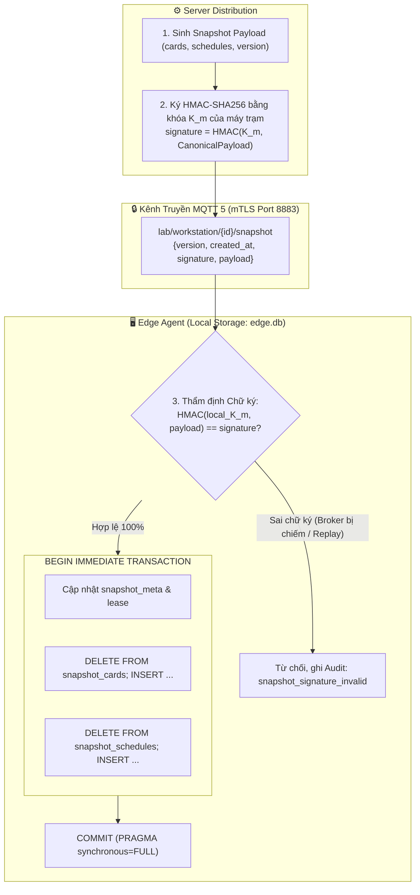

# ADR-003: Lưu Trữ Cục Bộ SQLite WAL, Hợp Nhất Cơ Sở Dữ Liệu và Xác Thực Toàn Vẹn Snapshot Bằng Khóa K_m

## Metadata

| Field | Value |
|---|---|
| **Status** | Proposed |
| **Date** | 2026-11-10 |
| **Deciders** | Nhóm tác giả ĐATN & Giảng viên hướng dẫn |
| **Supersedes** | Quyết định lưu file Snapshot JSON rời trong Spike S5 |

---

## Context

Máy trạm phòng lab (Workstation) hoạt động theo mô hình biên tự trị (Edge Authentication): tự đưa ra quyết định cấp quyền đăng nhập (`LoginDecision`) dựa trên dữ liệu cấu hình cục bộ mà không phụ thuộc vào kết nối mạng tới Server tại thời điểm quẹt thẻ (BR-005, D-001). Do đó, tầng lưu trữ cục bộ tại Edge đóng vai trò là xương sống vận hành của hệ thống, đòi hỏi phải giải quyết cùng lúc các bài toán:

1. **Tính Nguyên Tử Ghi Trước (Atomic Write-Ahead - INV-014, D-005):** Quyết định quẹt thẻ (`granted`) và bản ghi phiên khởi tạo (`LocalSession status='pending'`) bắt buộc phải được ghi bền vững xuống đĩa trong **cùng một giao dịch duy nhất** trước khi trả quyền mở cửa cho PAM. Nếu ghi rời rạc, một cú sập nguồn giữa hai thao tác sẽ tạo ra trạng thái bất nhất: PAM mở Desktop nhưng hệ thống không lưu vết kiểm toán hoặc không theo dõi được thời hạn phiên.
2. **Xung Đột Kiến Trúc Giữa S5 và D-006.4:**
   - Trong thử nghiệm ban đầu (Spike S5), hệ thống lưu Snapshot thành tệp JSON riêng biệt (`snapshot.json`) và áp dụng quy trình ghi file tạm `.tmp` + `os.fsync(file)` + `os.replace` (atomic rename) + `os.fsync(dir_fd)` trên thư mục cha để chống mất metadata trên hệ thống tệp ext4.
   - Tuy nhiên, quyết định [D-006.4](../../decisions.md) đã chốt hợp nhất toàn bộ trạng thái máy trạm vào một cơ sở dữ liệu SQLite duy nhất. Cần làm rõ: phát hiện về fsync thư mục cha của S5 còn hiệu lực ở đâu và cơ chế lưu trữ mới bảo đảm tính bền vững (Durability) ra sao.
3. **Nguy cơ Giả mạo hoặc Đầu độc Snapshot (Snapshot Tampering / Cross-Machine Replay):**
   - Snapshot chứa danh sách thẻ hợp lệ (`CardMatchKey`), lịch học (`Schedule`) và thời hạn tin cậy (`trusted_until`).
   - Mặc dù kênh truyền MQTT được bảo vệ bằng TLS, nếu Broker trung gian bị xâm nhập (Compromised Broker / MITM) hoặc kẻ tấn công trích xuất file snapshot từ máy này sang máy khác, kẻ xấu có thể tiêm snapshot giả mạo để cấp quyền mở máy trái phép. Cần một cơ chế xác thực toàn vẹn độc lập ngay tại nội dung payload.
4. **Độ Bền Vững Trước Sự Cố Ngắt Nguồn Cưỡng Bức (Power Loss / SysRq `b`):** Phòng lab trường học thường xuyên xảy ra tình huống sinh viên rút phích cắm đột ngột hoặc ngắt cầu dao tổng; cơ sở dữ liệu không bao giờ được phép rơi vào trạng thái hỏng tệp (database corrupted).

---

## Decision Drivers

- **Tính Bất Biến Giao Dịch (INV-011, INV-014):** Ghi đồng thời Audit Log và Session Pending trong một khối nguyên tử; chỉ xóa Outbox khi Server đã xác nhận (INV-013).
- **Chống Giả Mạo Tuyệt Đối (Cryptographic Integrity):** Đảm bảo Snapshot chỉ do Server chính danh phát hành cho riêng máy trạm đó; Broker bị chiếm quyền cũng không thể giả mạo dữ liệu.
- **Tối Ưu Hiệu Năng Đọc (Zero-Touch Latency):** Thời gian truy vấn kiểm tra thẻ và đối soát lịch trên đĩa cục bộ phải đạt dưới 5ms để bảo đảm trải nghiệm 0-chạm.
- **Khả Năng Chống Chịu Mất Điện (Crash-Safe):** Dựa trên bằng chứng thực nghiệm Spike S5 (vượt qua 545 vòng ngắt điện SysRq `b` không hỏng dữ liệu).

---

## Options Considered

### Option 1: Mô hình Lai (Hybrid) — Snapshot JSON rời + SQLite cho Outbox & Session (Mô hình thử nghiệm S5)
- **Ưu điểm:** Tệp Snapshot JSON dễ đọc trực tiếp bằng mắt; kiểm chứng được kỹ thuật POSIX directory fsync.
- **Nhược điểm:** Phân mảnh lưu trữ; không thể bọc thao tác nạp snapshot và cập nhật lease vào cùng một giao dịch ACID với bảng phiên; đòi hỏi mã nguồn tự quản lý nhiều cơ chế đồng bộ đĩa song song.

### Option 2: Cơ sở dữ liệu nhúng Key-Value (RocksDB / LMDB)
- **Ưu điểm:** Tốc độ ghi cực cao, phù hợp ghi chuỗi thời gian (time-series).
- **Nhược điểm:** Thiếu hỗ trợ truy vấn quan hệ bảng (phức tạp khi join giữa `audit_outbox` và `local_session` qua `entry_id`); đòi hỏi biên dịch thư viện C++ phức tạp trên máy trạm.

### Option 3: Hợp Nhất 100% Vào SQLite WAL (`edge.db`) & Xác Thực Snapshot Bằng HMAC `K_m` (Được chọn)
- **Ưu điểm:**
  - Toàn bộ trạng thái máy trạm (Snapshot, Lease, Session, Outbox, Metadata) được quản lý tập trung trong một tệp duy nhất `/var/lib/nfc-agent/edge.db`.
  - Cơ chế Write-Ahead Logging (WAL) tách biệt hoàn toàn luồng Đọc và Ghi: PAM và luồng quẹt thẻ đọc dữ liệu tức thì (< 1ms) không bao giờ bị nghẽn bởi luồng nền đang ghi outbox hoặc nạp snapshot.
  - Sử dụng khóa đối xứng riêng của máy `K_m` để ký và thẩm định HMAC cho snapshot, ngăn chặn tuyệt đối việc can thiệp payload hoặc sao chép snapshot giữa các máy.
- **Nhược điểm:** Cần cấu hình PRAGMA chuẩn xác để tránh checkpoint dở dang khi mất điện.

---

## Decision

Chúng tôi quyết định áp dụng **Mô hình Lưu trữ Hợp nhất SQLite WAL (`edge.db`) và Cơ chế Xác thực Toàn vẹn Snapshot bằng HMAC-SHA256 (`K_m`)** với các quy chuẩn kỹ thuật sau:



---

### 1. Vị Trí Lưu Trữ và Chuẩn Hóa Phân Quyền Hệ Thống Tệp

- Tệp cơ sở dữ liệu duy nhất: `/var/lib/nfc-agent/edge.db`.
- **Phân quyền nghiêm ngặt Linux (D-013, Threat Boundary):**
  - Thư mục cha `/var/lib/nfc-agent`: Thuộc quyền sở hữu `root:root`, quyền truy cập `0700` (chỉ root được đọc/ghi/duyệt).
  - Tệp cơ sở dữ liệu `edge.db`, tệp WAL `edge.db-wal` và tệp shared-memory `edge.db-shm`: Quyền truy cập `0600 root:root`.
  - Khóa riêng định danh `K_m` lưu tại: `/var/lib/nfc-agent/identity/k_m.key` với quyền `0600 root:root`.
  - Sinh viên hoặc người dùng không đặc quyền (kể cả tài khoản `student`) không có quyền truy cập vào thư mục này, triệt tiêu nguy cơ đọc trộm snapshot hoặc can thiệp nhật ký.

---

### 2. Cấu Hình Động Cơ SQLite Chống Chịu Sự Cố (Engine Tuning & S5 fsync)

Để đảm bảo an toàn tuyệt đối trước sự cố cắt điện đột ngột:
1. **Thiết lập PRAGMA Bắt Buộc:**
   ```sql
   PRAGMA journal_mode = WAL;
   PRAGMA synchronous = FULL;
   PRAGMA busy_timeout = 5000;
   PRAGMA foreign_keys = ON;
   ```
2. **Làm rõ tính hiệu lực của phát hiện POSIX fsync từ Spike S5:**
   - Trong S5, phát hiện về việc phải gọi `os.fsync(dir_fd)` trên thư mục cha là bắt buộc khi sử dụng cơ chế ghi đè tệp bằng lệnh hệ thống `os.replace` (atomic rename), nhằm ép metadata của directory entry từ RAM xuống NAND Flash.
   - Khi chuyển sang hợp nhất trong SQLite WAL, việc tạo mới file `edge.db` chỉ diễn ra một lần duy nhất lúc cài đặt Agent (được bảo vệ bởi fsync của tiến trình khởi tạo). Trong quá trình vận hành bình thường, SQLite **không tạo mới tệp mà chỉ ghi nối tiếp vào WAL file**.
   - Thiết lập **`PRAGMA synchronous = FULL`** buộc SQLite phải gọi `fdatasync()` / `fsync()` trên cả file WAL lẫn header sau mỗi giao dịch ghi, bảo đảm dữ liệu nằm an toàn trong bộ nhớ cố định trước khi trả kết quả thành công, đáp ứng trọn vẹn tiêu chuẩn an toàn của S5 mà không cần code ứng dụng tự can thiệp tầng file descriptor.

---

### 3. Lược Đồ Cơ Sở Dữ Liệu Cục Bộ (`edge.db` Schema)

Cơ sở dữ liệu bao gồm 6 bảng quan hệ chặt chẽ:

```sql
-- 1. Metadata cấu hình máy và mốc thời gian
CREATE TABLE IF NOT EXISTS agent_meta (
    key TEXT PRIMARY KEY,
    value TEXT NOT NULL,
    updated_at REAL NOT NULL
);

-- 2. Metadata Snapshot và Lease tin cậy (D-002, D-012)
CREATE TABLE IF NOT EXISTS snapshot_meta (
    version INTEGER PRIMARY KEY,
    created_at REAL NOT NULL,
    trusted_until REAL NOT NULL,
    last_server_time REAL NOT NULL,
    signature TEXT NOT NULL,
    applied_at REAL NOT NULL
);

-- 3. Bảng thẻ hợp lệ đã băm theo máy (ADR-007 CardMatchKey)
CREATE TABLE IF NOT EXISTS snapshot_cards (
    card_match_key TEXT PRIMARY KEY,  -- HMAC-SHA256(K_m, card_uid)
    user_id TEXT NOT NULL,
    target_os_username TEXT NOT NULL, -- Profile Linux đích (ví dụ: student)
    status TEXT NOT NULL DEFAULT 'active'
);
CREATE INDEX IF NOT EXISTS idx_cards_user ON snapshot_cards(user_id);

-- 4. Bảng phân lịch ba chiều (ai + ở đâu + khi nào - D-004, D-011)
CREATE TABLE IF NOT EXISTS snapshot_schedules (
    schedule_id TEXT PRIMARY KEY,
    target_os_username TEXT NOT NULL,
    start_time TEXT NOT NULL,          -- Format "HH:MM:SS" (ví dụ: "07:30:00")
    end_time TEXT NOT NULL,            -- Format "HH:MM:SS" (ví dụ: "11:45:00")
    days_of_week TEXT NOT NULL         -- JSON array: "[1,2,3,4,5]" (Thứ 2 - Thứ 6)
);

-- 5. Bảng theo dõi phiên làm việc cục bộ (LocalSession - ADR-008)
CREATE TABLE IF NOT EXISTS local_sessions (
    session_id TEXT PRIMARY KEY,       -- UUID v4 của phiên
    entry_id TEXT UNIQUE NOT NULL,     -- Khóa ngoại liên kết 1:1 với audit_outbox
    user_id TEXT NOT NULL,             -- Mã sinh viên
    os_username TEXT NOT NULL,         -- Tài khoản Linux đã đăng nhập (student)
    status TEXT NOT NULL,              -- pending | active | discarded | forced_logout | superseded | abandoned
    started_at REAL,                   -- Thời điểm bắt được GUI session
    expires_at REAL NOT NULL,          -- Hạn giờ phiên cố định (BR-001)
    end_reason TEXT                    -- schedule_expired | superseded | workstation_rebooted
);
CREATE INDEX IF NOT EXISTS idx_sessions_status ON local_sessions(status);

-- 6. Hàng đợi kiểm toán ngoại tuyến (AuditOutbox - INV-013, INV-014)
CREATE TABLE IF NOT EXISTS audit_outbox (
    seq INTEGER PRIMARY KEY AUTOINCREMENT, -- Khóa tự tăng đơn điệu cho ACK lũy tiến
    entry_id TEXT UNIQUE NOT NULL,         -- Khóa loại trùng idempotent
    timestamp REAL NOT NULL,               -- Thời điểm xảy ra sự kiện
    event_type TEXT NOT NULL,              -- swipe_decision | session_started | session_ended
    payload TEXT NOT NULL                  -- JSON chi tiết sự kiện
);
CREATE INDEX IF NOT EXISTS idx_outbox_seq ON audit_outbox(seq);
```

---

### 4. Cơ Chế Xác Thực Toàn Vẹn Snapshot Bằng Khóa K_m (Cryptographic Verification)

Để ngăn chặn tuyệt đối kịch bản Broker MQTT bị tấn công chiếm quyền tiêm snapshot giả hoặc kẻ xấu sao chép snapshot giữa các máy trạm:

1. **Nguồn gốc khóa `K_m` (ADR-007, D-010):**
   - Khóa bí mật `K_m` là khóa đối xứng 256-bit riêng biệt của từng máy trạm:
     `K_m = HKDF-SHA256(master_key, workstation_id || ":" || key_version)`.
   - Khóa này được Server cấp phát an toàn qua kênh mTLS Bootstrap khi duyệt máy trạm và lưu tại `/var/lib/nfc-agent/identity/k_m.key`.
2. **Quy trình ký tại Server (Raw-Byte Hashing):**
   - Server sinh chuỗi byte JSON của `payload` (`raw_payload_bytes`).
   - Server tính toán chữ ký số HMAC trực tiếp trên chuỗi byte gốc:
     `signature = HexEncode(HMAC-SHA256(K_m, raw_payload_bytes))`.
   - Gói bản tin MQTT xuất bản vào topic `lab/workstation/{workstation_id}/snapshot` mang cấu trúc:
     ```json
     {
       "version": 14,
       "created_at": 1793049263.0,
       "signature": "3a8f12c9b4e7...",
       "payload": {
         "cards": [
           { "card_match_key": "a1b2...", "user_id": "SV001", "target_os_username": "student" }
         ],
         "schedules": [
           { "schedule_id": "SCH_01", "target_os_username": "student", "start_time": "07:00:00", "end_time": "11:30:00", "days_of_week": "[1,2,3,4,5]" }
         ]
       }
     }
     ```
3. **Quy trình thẩm định tại Edge Agent (Loại trừ rủi ro Canonical JSON):**
   - Agent đọc `K_m` cục bộ.
   - Trích xuất chính xác chuỗi byte thô nhận được từ MQTT của trường `payload` (hoặc toàn bộ chuỗi byte của snapshot message trừ field `signature`).
   - **Băm trực tiếp chuỗi byte nhận được, tuyệt đối không serialize lại:** Tránh hoàn toàn sự sai khác định dạng khoảng trắng, thứ tự key giữa các thư viện JSON của các ngôn ngữ khác nhau (Node.js vs Python).
   - Tính toán `expected_signature = HexEncode(HMAC-SHA256(K_m, raw_payload_bytes))`.
   - So khớp bằng thuật toán so sánh thời gian không đổi (`hmac.compare_digest`) để chống tấn công Timing Attack.
   - **Xử lý vi phạm:** Nếu chữ ký không khớp, Agent **từ chối nạp snapshot ngay lập tức**, ghi nhật ký sự kiện `snapshot_signature_invalid` vào `audit_outbox` và giữ nguyên snapshot hợp lệ cũ đang có.

---

### 5. Giao Dịch Ghi Trước Nguyên Tử (Atomic Write-Ahead Pairing - D-005)

Mỗi lần quẹt thẻ thành công tại đầu đọc NFC, Agent thực thi một khối giao dịch duy nhất trước khi trả kết quả `granted` cho PAM:

```python
# Thực thi nguyên tử bảo toàn INV-014
with db_connection:
    cursor.execute("BEGIN IMMEDIATE;")
    # 1. Ghi nhật ký quyết định quẹt thẻ
    cursor.execute("""
        INSERT INTO audit_outbox (entry_id, timestamp, event_type, payload)
        VALUES (?, ?, 'swipe_decision', ?);
    """, (entry_id, now, payload_json))
    
    # 2. Tạo phiên pending chờ Display Manager bắt đầu
    cursor.execute("""
        INSERT INTO local_sessions (session_id, entry_id, user_id, os_username, status, expires_at)
        VALUES (?, ?, ?, ?, 'pending', ?);
    """, (session_id, entry_id, user_id, target_os_user, expires_at))
    cursor.execute("COMMIT;")
```

Nếu máy tính mất điện đúng thời điểm này:
- Hoặc cả hai bản ghi đều chưa được ghi $\rightarrow$ PAM không nhận được token, máy không mở phiên, không có dữ liệu rác.
- Hoặc cả hai bản ghi đều đã nằm an toàn trong WAL $\rightarrow$ Khi máy khởi động lại, Agent phát hiện phiên `pending` mồ côi và dọn dẹp chuyển sang `discarded` theo đúng đặc tả recovery.

---

### 6. Cơ Chế Xóa Outbox Lũy Tiến (Cumulative Truncation - INV-013)

Khi nhận bản tin `ack_outbox` mang số thứ tự `acked_seq` từ Server qua MQTT (ADR-002):
```sql
-- Xóa toàn bộ các bản ghi đã được server tiếp nhận an toàn
DELETE FROM audit_outbox WHERE seq <= :acked_seq;
```
Thao tác xóa dựa trên chỉ mục `idx_outbox_seq` diễn ra trong < 1ms, giữ cho kích thước tệp `edge.db` luôn tinh gọn (thường dưới 10MB trong suốt kỳ học).

---

## Consequences

### Positive
- **Tính Bất Biến ACID Hoàn Hảo:** Loại bỏ triệt để hiện tượng bất đồng bộ giữa log kiểm toán và phiên làm việc; bảo toàn 100% dữ liệu trước các cú ngắt điện đột ngột.
- **Bảo Vệ Độc Lập Khỏi Broker:** Ngay cả khi Broker MQTT bị hacker kiểm soát, kẻ tấn công không thể tiêm snapshot giả mạo vào máy trạm do không nắm giữ khóa đối xứng `K_m`.
- **Hiệu Năng Cực Cao:** Cơ chế SQLite WAL cho phép PAM kiểm tra thẻ tức thì (< 2ms) mà không bị xung đột khóa (lock contention) với các tiến trình nền.
- **Dung Lượng Gọn Nhẹ:** Một tệp duy nhất dễ sao lưu, kiểm tra toàn vẹn bằng lệnh `PRAGMA integrity_check`.

### Negative & Operational Trade-offs
- **Kích Thước WAL Khi Ghi Dồn Dập:** Nếu Agent mất mạng dài ngày và sinh viên quẹt thẻ liên tục, tệp `edge.db-wal` có thể tăng kích thước; cần cấu hình checkpoint tự động định kỳ (`PRAGMA wal_autocheckpoint = 1000`).
- **Phụ Thuộc Khóa Cục Bộ:** Nếu tệp `/var/lib/nfc-agent/identity/k_m.key` bị hỏng hoặc mất, Agent sẽ không thể nạp snapshot mới; kỹ thuật viên phải thực hiện quy trình Re-enrollment để Server cấp lại khóa.
