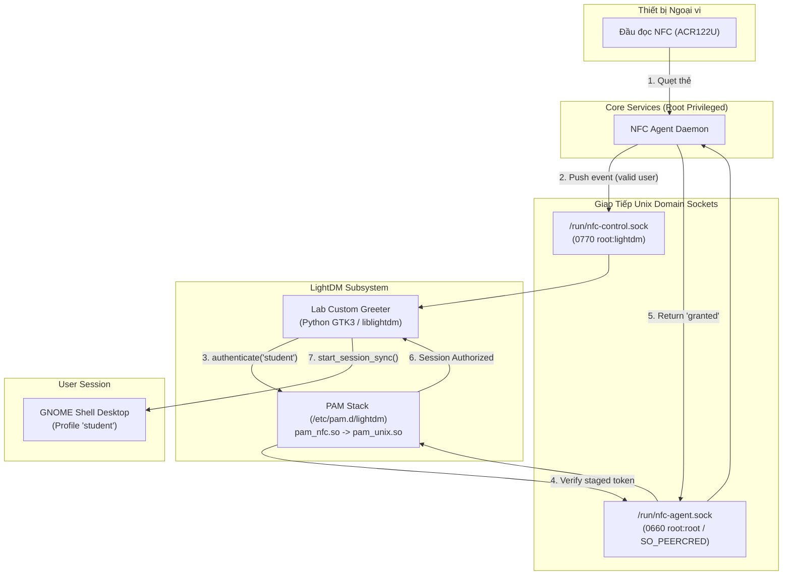

# ADR-005: Kiến Trúc PAM Module C, Lab Custom Greeter và Cơ Chế Khôi Phục Display Manager

## Metadata

| Field | Value |
|---|---|
| **Status** | Proposed |
| **Date** | 2026-11-10 |
| **Deciders** | Nhóm tác giả ĐATN & Giảng viên hướng dẫn |
| **Supersedes** | Không |

---

## Context

Hệ thống xác thực máy trạm phòng lab đặt ra yêu cầu cốt lõi về trải nghiệm người dùng: **Đăng nhập 0-chạm (Zero-Touch Login - FR-010, FR-011)** — sinh viên chỉ cần chạm thẻ sinh viên vào đầu đọc NFC là máy tính tự động mở thẳng vào Desktop mà không cần chạm vào chuột hay gõ bàn phím. Đồng thời, hệ thống phải bảo đảm:
1. **Đường Dự Phòng Không Thể Bị Triệt Tiêu (Fallback Guarantee - BR-004, NFR-M01):** Khi đầu đọc thẻ hỏng, Agent bị treo hoặc mất điện mạng, kỹ thuật viên phòng lab vẫn phải đăng nhập được bằng mật khẩu cục bộ để bảo trì máy.
2. **Tránh Lỗi Treo Giao Diện & Bấm Login 2 Lần:** Thử nghiệm Spike S6 đã chỉ ra rằng giao diện mặc định `lightdm-gtk-greeter` có cơ chế kiểm tra trước ngầm (pre-authentication). Do chưa có thẻ tại thời điểm bật màn hình, phiên kiểm tra trước bị lỗi; khi sinh viên quẹt thẻ sau đó, họ buộc phải bấm nút Login **2 lần** mới vào được màn hình chính.
3. **Màn Hình Khóa Xung Đột Với Tài Khoản Đã Khóa Mật Khẩu (A3):** Tài khoản Linux dùng chung (`student`) bị khóa mật khẩu (`passwd -l`). Trong Spike S3, GNOME lock screen và `light-locker` không hỗ trợ luồng quẹt thẻ mở khóa; nếu màn hình bị khóa, sinh viên sẽ tự nhốt mình cho đến hết ca học.

Cần một quyết định kiến trúc chuẩn hóa lựa chọn Display Manager, cấu trúc Module PAM, giao thức giao tiếp IPC giữa Agent và Màn hình Chào (Custom Greeter), cũng như quy trình khôi phục khi giao diện đồ họa gặp sự cố.

---

## Decision Drivers

- **Trải Nghiệm 0-Chạm Tuyệt Đối (FR-010):** Chuyển từ màn hình chào vào Desktop trong thời gian < 1.0 giây sau khi quẹt thẻ hợp lệ mà không cần thao tác chuột hay bàn phím.
- **Tính Bền Vững của Đường Dự Phòng (BR-004, NFR-M01):** Module PAM không được phép làm nghẽn hoặc đóng băng luồng đăng nhập bằng mật khẩu khi Agent daemon chết hoặc socket bị treo.
- **Bảo Mật Tiến Trình IPC (Least Privilege & SO_PEERCRED):** Chỉ tiến trình có đặc quyền `root` (Display Manager) mới được phép yêu cầu Agent tiêu thụ token xác thực.
- **Khả Năng Tự Phục Hồi & Can Thiệp Cứu Hộ:** Màn hình chào tự hồi sinh khi crash nhẹ; cung cấp đường cứu hộ rõ ràng qua TTY/SSH khi lỗi script kéo dài.

---

## Options Considered

### Option 1: Sử dụng GDM3 (GNOME Display Manager) mặc định của Ubuntu
- **Ưu điểm:** Tích hợp sẵn với Ubuntu Desktop.
- **Nhược điểm:** GDM3 cực kỳ đóng kín, chạy trên Wayland/Xwayland với sandbox bảo mật khắt khe; không hỗ trợ viết Custom Greeter độc lập bằng Python/GTK; không cho phép nhận sự kiện đẩy từ bên ngoài để tự động kích hoạt phiên mà không chạm chuột.

### Option 2: Giữ nguyên LightDM với `lightdm-gtk-greeter` mặc định và PAM chặn (Blocking PAM)
- **Ưu điểm:** Không cần viết giao diện Custom Greeter.
- **Nhược điểm:** 
  - Nếu PAM module thực hiện blocking wait chờ thẻ, giao diện GTK sẽ bị đóng băng (freeze UI), làm liệt ô nhập mật khẩu dự phòng.
  - Nếu không block, dính lỗi lệch pha thời gian (timing mismatch) buộc người dùng phải bấm nút Login 2 lần (Spike S6).

### Option 3: LightDM kết hợp Module PAM C Tối Giản và Lab Custom Greeter Nhận Tín Hiệu Đẩy (Được chọn)
- **Ưu điểm:**
  - LightDM nhẹ, hỗ trợ kiến trúc greeter dạng module qua thư viện `liblightdm-gobject-1`.
  - Module PAM viết bằng C thuần siêu nhẹ (`pam_nfc.so`), chỉ đóng vai trò ủy quyền qua Unix Domain Socket (`/run/nfc-agent.sock`).
  - Custom Greeter (`lab_greeter.py`) lắng nghe tín hiệu đẩy từ Agent qua Control Socket: khi thẻ hợp lệ, Agent bắn tín hiệu $\rightarrow$ Greeter lập tức kích hoạt `authenticate()` 0-chạm.
  - Khung nhập mật khẩu dự phòng hiển thị độc lập, phục vụ kỹ thuật viên cứu hộ.
- **Nhược điểm:** Cần duy trì mã nguồn Custom Greeter và script kiểm tra tính sẵn sàng khi khởi động.

---

## Decision

Chúng tôi quyết định chuẩn hóa **Hạ Tầng Xác Thực Giao Diện Máy Trạm** bao gồm: **LightDM Display Manager**, **PAM Module C (`pam_nfc.so`)**, **Lab Custom Greeter (GTK3)** và **Cơ chế Khôi phục Vận hành**:



---

### 1. Chuẩn Hóa Display Manager và Vô Hiệu Hóa Màn Hình Khóa (A3, P1-3)

1. **Lựa chọn Display Manager:** Master Image của máy trạm phòng lab bắt buộc chuyển đổi Display Manager mặc định sang **LightDM**:
   ```bash
   sudo apt-get install -y lightdm
   sudo echo "/usr/sbin/lightdm" > /etc/X11/default-display-manager
   ```
2. **Vô hiệu hóa Lock Screen và User Switching trong Master Image (A3, P1-3):**
   - Do tài khoản dùng chung (`student`) bị khóa mật khẩu (`passwd -l`), màn hình khóa GNOME không hỗ trợ mở khóa qua thẻ sẽ làm kẹt sinh viên.
   - Bắt buộc khóa chết các tính năng này qua cấu hình hệ thống dconf:
     ```ini
     # /etc/dconf/db/local.d/00-disable-lockscreen
     [org/gnome/desktop/screensaver]
     lock-enabled=false

     [org/gnome/desktop/lockdown]
     disable-lock-screen=true
     disable-user-switching=true
     ```
   - Sinh viên chỉ có thể kết thúc lượt dùng bằng thao tác **Đăng xuất (Logout)** hoặc chờ **hết hạn ca học** để hệ thống dọn dẹp theo [ADR-008](ADR-008-vong-doi-phien-va-teardown-da-pha.md).

---

### 2. Kiến Trúc Module PAM C Tối Giản (`pam_nfc.so`)

Module PAM được viết bằng ngôn ngữ C thuần, biên dịch thành thư viện động `/lib/security/pam_nfc.so` với các đặc tính kỹ thuật:

1. **Nguyên tắc Thiết kế:** Module PAM hoàn toàn **stateless (không giữ trạng thái)**, không chứa logic nghiệp vụ phân quyền hay kiểm tra cơ sở dữ liệu. Module chỉ đóng vai trò Client kết nối tới Agent qua Unix Domain Socket `/run/nfc-agent.sock`.
2. **Cấu hình Chuỗi PAM (`/etc/pam.d/lightdm`):**
   ```text
   # Bổ sung pam_nfc lên đầu nhánh auth
   auth    sufficient    pam_nfc.so
   @include common-auth
   ```
3. **Cơ chế Fallback Tức Thì (NFR-M01, BR-004):**
   - Khi Agent không phản hồi trong **`TIMEOUT = 3000ms`** (sử dụng hàm `poll()`) hoặc file socket không tồn tại: `pam_nfc.so` lập tức trả về mã **`PAM_IGNORE`**.
   - Chuỗi PAM của Linux tự động rơi xuống module tiếp theo (`pam_unix.so`) để mở nhắc lệnh hỏi mật khẩu truyền thống mà không làm đơ hay kẹt tiến trình đăng nhập (đã kiểm chứng đo đạc ở Spike S2: thời gian fallback chỉ mất 22ms).
4. **Hỗ Trợ Gán Danh Tính Động (`PAM_USER`):**
   - Khi Custom Greeter gọi xác thực, `pam_nfc.so` nhận kết quả từ Agent và sử dụng hàm chuẩn của PAM API `pam_set_item(pamh, PAM_USER, target_username)` để cập nhật tài khoản đăng nhập đích (ví dụ `student`).
   - Cho phép tài khoản bị khóa mật khẩu (`passwd -l`) đăng nhập thành công 100% vào Desktop (Spike S3 Ca 8).
5. **Bảo Vệ Đa Lớp Cấp Nhân Linux (Defense-in-Depth & `SO_PEERCRED`):**
   - *Lớp 1 (DAC):* Socket sở hữu bởi `root:root`, quyền truy cập `0660`.
   - *Lớp 2 (Kernel Peer Credentials):* Khi nhận kết nối `connect()`, Agent gọi syscall `getsockopt(..., SOL_SOCKET, SO_PEERCRED, ...)` để trích xuất cấu trúc `ucred`. Agent **từ chối tuyệt đối mọi tiến trình không có UID = 0 (root)**. Ngăn chặn triệt để người dùng thường can thiệp vào IPC xác thực.

---

### 3. Lab Custom Greeter Đăng Nhập 0-Chạm và Kênh Tín Hiệu Đẩy

Giao diện đăng nhập chuyên dụng cho phòng lab (`/usr/local/bin/lab_greeter.py`) được xây dựng bằng Python GTK3 và `liblightdm-gobject-1`:

1. **Kênh Nhận Tín Hiệu Đẩy (Push Event):**
   - Greeter mở luồng ngầm kết nối Unix Domain Socket `/run/nfc-control.sock`.
   - Khi sinh viên quẹt thẻ hợp lệ tại đầu đọc NFC, Agent vừa bọc giao dịch ghi bền vững vào `edge.db` ([ADR-003](ADR-003-luu-tru-cuc-bo-va-xac-thuc-snapshot.md)), vừa bắn gói tin push:
     ```json
     {
       "event": "card_swiped",
       "outcome": "granted",
       "user": "student",
       "display_name": "Nguyễn Văn A (SV001)"
     }
     ```
2. **Quy Trình Đăng Nhập 0-Chạm Tức Thì (< 1.0 giây):**
   - Ngay khi nhận được sự kiện `card_swiped`, Greeter cập nhật giao diện thông báo xanh: *"✅ Thẻ hợp lệ: Nguyễn Văn A! Đang vào Desktop..."*.
   - Greeter lập tức gọi API `lightdm_greeter_authenticate(greeter, "student")` và `lightdm_greeter_start_session_sync(greeter, "ubuntu")`.
   - Màn hình tự động mở thẳng vào Desktop GNOME mà người dùng không cần chạm vào bất kỳ thiết bị nhập liệu nào.
3. **Hiển Thị Lý Do Từ Chối Rõ Ràng (FR-010, FR-011):**
   - Khi quẹt thẻ vi phạm, Agent bắn sự kiện `denied` kèm mã lý do chuẩn hóa:
     * `card_unknown`: *"❌ Thẻ chưa được đăng ký trong hệ thống!"*
     * `card_disabled`: *"❌ Thẻ đã bị khóa do vi phạm nội quy!"*
     * `schedule_mismatch`: *"❌ Bạn không có ca học trong khung giờ này!"*
     * `data_stale`: *"⚠️ Dữ liệu phòng lab tạm thời quá hạn. Vui lòng liên hệ Kỹ thuật viên!"*
     * `workstation_busy`: *"⚠️ Máy đang có phiên của người khác. Vui lòng chờ hết ca!"*
   - Thông báo đỏ xuất hiện nổi bật trong 4.0 giây rồi tự động chuyển về trạng thái sẵn sàng ban đầu.

---

### 4. Cơ Chế Bắt Tay Khởi Động (Startup Handshake 1.2s - Giải Quyết Xung Đột D-Bus)

Dựa trên phát hiện kỹ thuật đắt giá của Spike S6 và S7:
- Dưới tải nặng CPU hoặc khi LightDM vừa dọn xong phiên cũ, Display Server và D-Bus bus cần khoảng 0.4s – 0.7s để ổn định.
- **Quy tắc Bắt tay 2 Chiều:**
  1. Khi tiến trình Greeter mới khởi động, giao diện dành khoảng **1.2 giây đệm** để hoàn tất việc vẽ khung đồ họa và kết nối D-Bus session.
  2. Greeter chủ động gửi thông điệp `{"action": "greeter_ready"}` sang Agent qua control socket.
  3. Chỉ khi nhận được `greeter_ready`, Agent mới kích hoạt bàn giao các yêu cầu quẹt thẻ đang chờ (`staged_auth`).
  - Triệt tiêu 100% hiện tượng xung đột D-Bus gây treo đen màn hình ~110 giây (ADR-008).

---

### 5. Khung Nhập Mật Khẩu Dự Phòng (Fallback) và Quy Trình Khôi Phục (BR-004)

1. **Phân Định Đối Tượng Sử Dụng Fallback (D-007):**
   - Màn hình Custom Greeter cung cấp khung nhập mật khẩu dự phòng gồm 2 ô: **Username** và **Password**.
   - Khung này **chỉ dành riêng cho Kỹ thuật viên / Quản trị viên IT** sử dụng tài khoản bảo trì độc lập (ví dụ `labadmin`, `binhtong` có mật khẩu). Sinh viên không có mật khẩu đăng nhập tài khoản dùng chung `student`.
2. **Khôi Phục Khi Greeter Gặp Sự Cố (Operational Recovery - D-006.5):**
   - *Trường hợp crash tức thời:* LightDM tự động phát hiện và khởi động lại tiến trình Greeter mới trong ~0.2 giây (đã kiểm chứng ở S3b Ca 7).
   - *Trường hợp lỗi mã nguồn / thiếu thư viện kéo dài:*
     - LightDM dừng display-manager để tránh vòng lặp khởi động vô tận (Crash Loop).
     - **Quy trình Cứu hộ Kỹ thuật:** Kỹ thuật viên chuyển sang Virtual Terminal bằng phím tắt **`Ctrl + Alt + F2`** (TTY2) hoặc truy cập từ xa qua SSH, đăng nhập tài khoản `labadmin`.
     - Chuyển đổi về giao diện chuẩn `lightdm-gtk-greeter` bằng một lệnh duy nhất:
       ```bash
       sudo sed -i 's/lab-greeter/lightdm-gtk-greeter/' /etc/lightdm/lightdm.conf.d/99-lab-greeter.conf
       sudo systemctl restart lightdm
       ```
     - Hệ thống trở lại giao diện đăng nhập đồ họa truyền thống ngay lập tức mà không cần can thiệp cài đặt lại hệ điều hành.

---

## Consequences

### Positive
- **Đạt Chuẩn Trải Nghiệm 0-Chạm:** Quá trình đăng nhập diễn ra tự động 100%, không cần chuột hay bàn phím, thời gian mở máy < 1.0 giây.
- **An Toàn Tuyệt Đối cho Đường Dự Phòng:** Module PAM C không bao giờ chặn (block) tiến trình; fallback mật khẩu hoạt động ổn định trong mọi tình huống Agent chết hoặc treo.
- **Triệt Tiêu Hoàn Toàn Lỗi Bấm 2 Lần:** Custom Greeter nhận sự kiện đẩy chủ động, loại bỏ hoàn toàn hạn chế của cơ chế pre-authentication cũ.
- **Bảo Vệ Tiến Trình IPC Cấp Nhân:** Sử dụng `SO_PEERCRED` ngăn chặn người dùng thường giả mạo gửi tín hiệu đăng nhập.

### Negative & Operational Trade-offs
- **Phải Cài Đặt Thêm Thư Viện Python-GTK:** Cần cài đặt `gir1.2-lightdm-1` và `python3-gi` trong Master Image.
- **Không Hỗ Trợ Đổi Người Dùng Nhanh (Fast User Switching):** Tính năng User Switching bị vô hiệu hóa có chủ đích trong Master Image để bảo đảm an toàn cho mô hình profile dùng chung.
