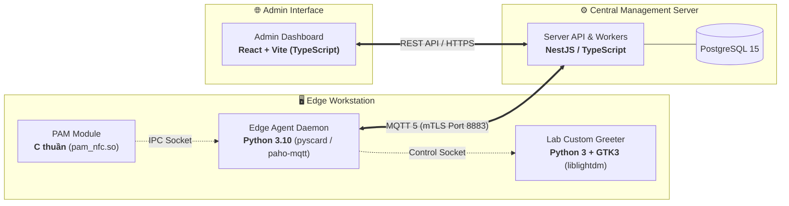

# ADR-006: Lựa Chọn Ngôn Ngữ và Techstack Cho Edge Agent, Server và Dashboard

## Metadata

| Field | Value |
|---|---|
| **Status** | Accepted |
| **Date** | 2026-11-11 |
| **Deciders** | Nhóm tác giả ĐATN & Giảng viên hướng dẫn |
| **Supersedes** | Không |

---

## Context

Hệ thống quản lý và xác thực phòng máy trạm bao gồm 3 phân vùng công nghệ độc lập:
1. **Edge Workstation (Máy trạm phòng lab):** Bao gồm module xác thực hệ thống PAM, màn hình chào đồ họa (Custom Greeter) và tiến trình dịch vụ nền (Agent Daemon) chạy quyền `root` để điều phối thiết bị phần cứng NFC PC/SC, cơ sở dữ liệu cục bộ SQLite WAL, giao tiếp D-Bus và quản lý vòng đời cgroup user slice.
2. **Server API & Distribution Service (Máy chủ trung tâm):** Xử lý nghiệp vụ quản trị, cấp phát định danh mTLS (CA), phân phối Snapshot và thu thập nhật ký kiểm toán qua MQTT 5 Broker, lưu trữ trên cơ sở dữ liệu quan hệ PostgreSQL.
3. **Web Dashboard (Giao diện quản trị):** Cung cấp bảng điều khiển cho Quản trị viên duyệt máy trạm, xếp lịch học và theo dõi audit log thời gian thực.

Trong các tài liệu ban đầu và `spike.md`, quyết định về ngôn ngữ được tạm gác lại ("quyết ở ADR sau"), README ghi nhận tùy chọn "Python/Rust", còn tài liệu kiến trúc `containers.md` đề xuất "FastAPI / Go". 

Khi đối chiếu với thực tiễn triển khai của một Đồ án Tốt nghiệp (thời gian có hạn, nguồn lực cá nhân), kiến trúc sư hệ thống phải đối mặt với bài toán tối ưu hóa chi phí học tập: **Làm sao để giữ phần công nghệ phải học mới ở mức nhỏ nhất, dồn toàn bộ ngân sách thời gian vào vùng rủi ro kỹ thuật cao nhất của đề tài (tầng Edge Authentication)?**

---

## Decision Drivers

- **Tối Thiểu Hóa Độ Dốc Học Tập (Cognitive Load Driver):** Giữ phần phải học mới ở mức nhỏ nhất. Không dàn trải việc học ngôn ngữ mới ở cả hai đầu, tập trung năng lượng vào xử lý các rủi ro cốt lõi tại Edge.
- **Tái Sử Dụng Triệt Để Bằng Chứng Thực Nghiệm (Spike Reuse):** Tận dụng mã nguồn đã chạy thành công và đo đạc thực tế từ Spike S1 đến S8 (`pyscard`, Unix sockets, LightDM Greeter GTK3, SQLite WAL, cgroup/GNOME teardown, Node.js `@peculiar/x509`, `mqtt.js` mTLS, `pg`).
- **Nguyên Tắc Đơn Runtime Tại Máy Trạm (Single Runtime on Edge):** Tránh việc cài cắm và duy trì nhiều môi trường thực thi (runtime) khác nhau trên cùng một máy trạm phòng lab.
- **Khớp 1:1 Với Kiến Trúc Hexagonal / DDD:** Tầng Server có các bounded contexts rõ ràng (Identity, Device, Scheduling, Distribution, Operations), cần một framework hỗ trợ Dependency Injection và Module Pattern tự nhiên.
- **An Toàn Mật Mã và Tính Khả Thi CA (Crypto & PKI Feasibility):** Thư viện nền tảng phải hỗ trợ đầy đủ các thuật toán mật mã chuẩn: HKDF (RFC 5869), HMAC-SHA256, AES-256-GCM và cấp phát chứng chỉ X.509 từ CSR Ed25519.

---

## Decision

Chúng tôi quyết định chuẩn hóa bộ công nghệ cho 3 phân vùng của hệ thống dựa trên 3 quyết định độc lập:

---

### 1. Edge Workstation: Python 3 + C Thuần (PAM Module)

- **Lựa chọn:** **Python >= 3.10** (cho Agent Daemon và Lab Custom Greeter) kết hợp **C thuần** (cho PAM Module `pam_nfc.so`).
- **Lý do quyết định:**
  1. *Greeter bắt buộc dùng Python/GTK:* Kết quả Spike S3b chứng minh Custom Greeter chạy trên LightDM thông qua thư viện `liblightdm-gobject-1` yêu cầu binding GTK/GObject. Sử dụng Python cho Agent bảo đảm máy trạm chỉ duy trì **duy nhất một runtime Python**, tránh việc vừa cài Python cho Greeter vừa cài runtime Go/Rust cho Agent.
  2. *Tái cấu trúc từ bài học và mã nguồn thực nghiệm spike:* Toàn bộ logic lõi của Agent (quản lý PC/SC `pyscard`, SQLite WAL, 3 Unix domain sockets, bắt tay Greeter 1.2s, điều khiển `loginctl` và dọn cgroup) đã được viết, debug và đo đạc thực tế thành công ở S1–S7b. Việc phát triển Agent chính thức là quá trình tái cấu trúc (refactoring) mã nguồn sẵn có theo Clean Architecture, không phải viết lại từ đầu.
  3. *Lợi thế Go bị triệt tiêu:* Go khi gọi thư viện phần cứng `pcsclite` bắt buộc phải sử dụng `cgo`, làm mất đi ưu điểm "single static binary" và tăng độ phức tạp khi build.
  4. *Module PAM C tối giản:* Không nhúng Python vào tiến trình đăng nhập của hệ điều hành. Module PAM viết bằng C thuần (`pam_nfc.so`, chỉ ~100 dòng code, không cấp phát heap phức tạp), chỉ làm nhiệm vụ ủy quyền qua socket với độ trễ 22ms và fallback an toàn tuyệt đối (Spike S2).

---

### 2. Central Server: NestJS / TypeScript + PostgreSQL 15

- **Lựa chọn:** **NestJS (Node.js LTS)** sử dụng ngôn ngữ **TypeScript**, lưu trữ trên **PostgreSQL 15**.
- **Lý do quyết định:**
  1. *Không phát sinh chi phí học mới:* Tác giả đã thành thạo TypeScript, NestJS, PostgreSQL, migration và unit test (Jest). Việc chọn NestJS giải phóng toàn bộ áp lực học ngôn ngữ ở phía Server, cho phép dồn 100% sự tập trung vào vùng rủi ro công nghệ cao tại Edge.
  2. *Khớp hoàn hảo với Kiến trúc Hexagonal (Ports & Adapters):* Bản đặc tả [components.md](../components.md) tổ chức Server thành các service độc lập: `Identity`, `Device`, `Scheduling`, `Distribution`, `Operations`. Cấu trúc module hóa (`@Module()`), hệ thống Dependency Injection và cơ chế Interceptor/Filter của NestJS ánh xạ 1:1 với mô hình này.
  3. *Thư viện mật mã chuẩn có sẵn:* Module chuẩn `node:crypto` của Node.js đã hỗ trợ gốc toàn bộ các thuật toán cần thiết:
     - `crypto.hkdfSync()`: Dẫn xuất khóa `K_m` từ Master Key (RFC 5869) theo [ADR-007](ADR-007-khoa-so-khop-uid.md).
     - `crypto.createHmac()`: Tính toán chữ ký HMAC-SHA256 cho Snapshot theo [ADR-003](ADR-003-luu-tru-cuc-bo-va-xac-thuc-snapshot.md).
     - `crypto.createCipheriv('aes-256-gcm', ...)`: Mã hóa UID thẻ lưu trữ trong cơ sở dữ liệu.
  4. *Giải pháp cấp phát chứng chỉ mTLS X.509:*
     - Ưu tiên 1: Sử dụng thư viện `@peculiar/x509` (thư viện PKI WebCrypto chuẩn cho Node.js) để bóc tách CSR Ed25519 và ký cấp Client Certificate (`CN = workstation_id`).
     - Phương án dự phòng (Fallback): Nếu thư viện gặp vướng mắc với Ed25519, Server gọi trực tiếp lệnh CLI `openssl ca` hoặc tích hợp dịch vụ CA nội bộ chuyên dụng (`step-ca`) mà không cần thay đổi ngôn ngữ Server.

---

### 3. Admin Dashboard: React + Vite + Tailwind CSS

- **Lựa chọn:** **React (TypeScript)** đóng gói bằng **Vite**, tạo kiểu bằng **Tailwind CSS**.
- **Lý do quyết định:**
  1. *Chia sẻ kiểu dữ liệu (Shared DTOs):* Do cả Server và Dashboard đều sử dụng TypeScript, toàn bộ Data Transfer Objects (DTO), enum trạng thái máy, lược đồ bản tin kiểm toán đều có thể dùng chung hoặc đồng bộ type tự động từ backend, loại bỏ lỗi lệch kiểu dữ liệu.
  2. *Hệ sinh thái phong phú:* Hỗ trợ sẵn các thư viện bảng biểu, biểu đồ (Recharts) và dashboard components, phục vụ tốt việc dựng giao diện quản trị phòng máy trực quan.

---

## Cross-Language Verification & Defense Mechanisms

Do hệ thống sử dụng hai ngôn ngữ khác nhau giữa Edge (Python) và Server (TypeScript), kiến trúc áp dụng 3 cơ chế kiểm soát nhằm loại trừ rủi ro bất đồng bộ:

### 1. Bộ Test Vector Mật Mã Chung (Shared Cryptographic Test Vectors)
Để bảo đảm thuật toán HKDF và HMAC-SHA256 trên Node.js và Python cho ra kết quả trùng khớp từng byte:
- Xây dựng tệp test vector cố định chứa cặp mẫu: `(master_key, workstation_id, expected_K_m)` và `(K_m, raw_bytes, expected_hmac)`.
- Bộ unit test của cả NestJS (Jest) và Python (pytest) bắt buộc phải nạp chung test vector này để xác minh tính tương thích chéo trước khi tích hợp.

### 2. Xác Thực Snapshot Theo Chuỗi Byte Gốc (Raw-Byte Hashing - ADR-003)
- Để tránh triệt để vấn đề sai lệch định dạng JSON (khoảng trắng, thứ tự thuộc tính giữa `JSON.stringify` của Node.js và `json.dumps` của Python):
- Phía Server NestJS ký HMAC trực tiếp trên chuỗi byte thô của payload JSON xuất bản lên MQTT.
- Phía Edge Python nhận gói tin MQTT sẽ **băm trực tiếp chuỗi byte thô nhận được từ đường truyền**, tuyệt đối không parse thành dict rồi serialize lại. Giải pháp này triệt tiêu hoàn toàn rủi ro sai lệch chữ ký giữa hai ngôn ngữ.

### 3. Kết Quả Kiểm Chứng Thực Tế (Spike S8 — Đạt 3/3)
Bài kiểm chứng thực tế trên **Node.js `v20.20.2` + Mosquitto `2.0.11` + PostgreSQL `14.24`** ([Chi tiết Spike S8](../../../../spike-results/s8-server-crypto-mtls-pg.md)) đã đạt toàn bộ 3 hạng mục:
1. `@peculiar/x509` (kèm `import 'reflect-metadata'` do phụ thuộc `tsyringe`) + `crypto.webcrypto` xác thực chữ ký **CSR Ed25519** (`CN=ws-test-01`, `Valid: true`) và ký phát hành X.509 Client Certificate thành công mà không cần fallback OpenSSL CLI; đối khớp `crypto.hkdfSync` + `crypto.createHmac` với Python 3 (`hashlib`/`hmac`) cho kết quả trùng khớp từng byte (`Parity: true`).
2. `mqtt.js` (MQTT v5) kết nối mTLS cổng `8883` bằng Client Cert Ed25519 qua `use_identity_as_username true` -> `%u`: nhận bản tin kèm MQTT 5 `User Property` hợp lệ, nhận **0 tin rò rỉ** từ topic máy khác (`ws-other-99/snapshot`), và mọi `PUBLISH` trái phép bị Broker từ chối với mã `135 (0x87 Not Authorized)`.
3. Thư viện `pg` thực thi giao dịch nguyên tử PostgreSQL (`BEGIN ... COMMIT` + `ROLLBACK` khi ném lỗi) ghi `schedules` + `outbox_events` sạch sẽ (`schedules=1, outbox_events=1`).

---

## Consequences

### Positive
- **Tối Ưu Tuyệt Đối Nguồn Lực ĐATN:** Không phải học Go hay Rust, toàn bộ thời gian học mới được dành trọn vẹn cho việc làm chủ Linux PAM, systemd cgroup và đầu đọc thẻ NFC.
- **Tiến Độ Chắc Chắn:** Tận dụng toàn bộ mã nguồn của 8 nhóm Spike kỹ thuật (S1–S8) đã kiểm chứng thành công.
- **Kiến Trúc Sạch Sẽ:** Phân định rõ ràng ranh giới giữa Edge Agent (hệ thống nhúng/hệ điều hành) và Server (quản trị phân tán).
- **Trải Nghiệm Phát Triển Frontend Mượt Mà:** Sử dụng chung TypeScript giữa Dashboard và Server API.

### Negative & Mitigations
- **Bảo Vệ Python Chạy Root ở Edge:**
  - *Nguy cơ:* Lỗ hổng bộ nhớ hoặc thư viện bên thứ ba khi chạy quyền root.
  - *Biện pháp giảm thiểu:* 
    1. Module PAM C độc lập ngăn sự cố của Agent ảnh hưởng đến chuỗi xác thực hệ thống.
    2. Cấu hình Systemd Hardening giam lỏng Agent daemon: `ProtectSystem=strict`, `ProtectHome=read-only`, `PrivateTmp=true`, `ReadWritePaths=/var/lib/nfc-agent /run`, `CapabilityBoundingSet=CAP_KILL CAP_DAC_OVERRIDE CAP_SETUID CAP_SETGID`.
    3. Cố định phiên bản Python >= 3.10 mặc định của Ubuntu 22.04 LTS và cô lập dependencies trong virtualenv thuộc sở hữu `root:root 0700`.
- **Duy Trì Hai Ngôn Ngữ:**
  - *Nguy cơ:* Lệch chuẩn hợp đồng giao tiếp JSON qua MQTT.
  - *Biện pháp giảm thiểu:* Định nghĩa JSON Schema chặt chẽ tại [08-api/events.md](../../08-api/events.md) và áp dụng cơ chế Raw-byte HMAC.
