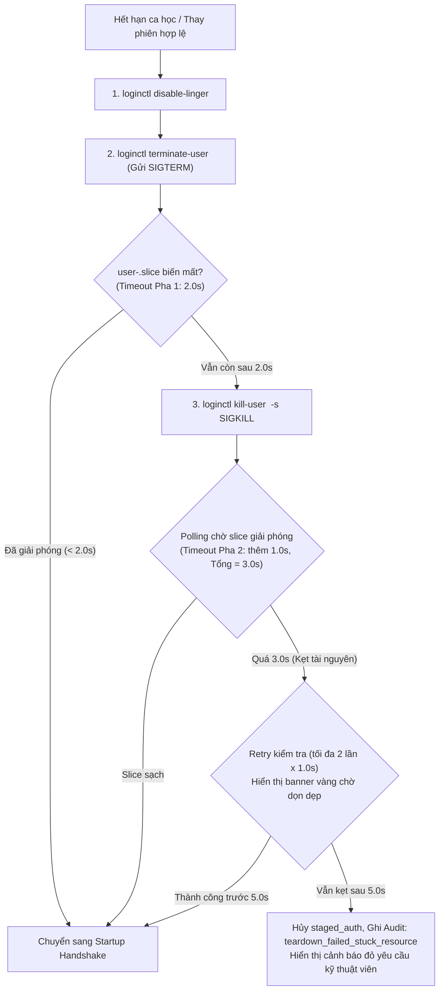

# ADR-008: Quản Lý Vòng Đời Phiên và Cơ Chế Teardown Đa Pha

## Metadata

| Field | Value |
|---|---|
| **Status** | Accepted |
| **Date** | 2026-11-11 |
| **Deciders** | Nhóm tác giả ĐATN & Giảng viên hướng dẫn |
| **Supersedes** | Tách một phần nội dung kết thúc phiên khỏi [ADR-004](ADR-004-mo-hinh-profile-os-dung-chung.md) |

---

## Context

Trong hệ thống xác thực máy trạm phòng lab, việc quản lý vòng đời phiên làm việc (`LocalSession`) chịu sự chi phối của các ràng buộc nghiệp vụ và kỹ thuật ngặt nghèo:
1. **Nguyên tắc Hạn giờ Cố định (BR-001):** Hạn phiên (`expires_at`) được chốt cứng tại thời điểm Agent cấp quyền quẹt thẻ (`decided_at`). Mọi độ trễ khởi động môi trường hay dọn dẹp phiên cũ đều làm co lại thời gian sử dụng thực tế của sinh viên, không bao giờ được cấp bù giờ gian lận.
2. **Xung đột khi Thay phiên trên Cùng UID (BR-008, P1-2):** Sau khi chuẩn hóa theo [ADR-004](ADR-004-mo-hinh-profile-os-dung-chung.md) với Mô hình Profile OS Dùng Chung, mọi sinh viên đều đăng nhập vào cùng một tài khoản Linux (`student`, cùng một UID). Thử nghiệm Spike S6 đã chỉ ra rằng: Nếu phiên mới kích hoạt đăng nhập quá nhanh trong khi phiên cũ chưa kịp giải phóng X11 display server và D-Bus session bus, hệ thống sẽ gặp lỗi nghiêm trọng:
   ```text
   dbus-update-activation-environment: error: unable to connect to D-Bus
   ```
   Hậu quả là màn hình máy trạm bị treo đen trong ~110 giây trước khi GNOME Session bỏ cuộc (`return value 1`).
3. **Nguy cơ Sinh viên Cài cắm Tiến trình Ngầm (Linger & User Services):** Sinh viên có thể chạy lệnh nền ngầm (như `nohup`, `tmux`, hoặc `systemd-run --user`) và cố tình bật `loginctl enable-linger` để duy trì tiến trình đào coin/botnet sau khi hết ca học.
4. **Giả định Thời gian Dọn dẹp Slice:** Thiết kế ban đầu đặt giả định `SLICE_TEARDOWN_TIMEOUT = 3.0s` nhưng chưa có số liệu đo đạc thực tế dưới tải nặng khi tái sử dụng cùng một UID.

Cần một quyết định kiến trúc chuẩn hóa toàn bộ máy trạng thái vòng đời phiên, quy trình cưỡng chế dọn dẹp cgroup và cơ chế đồng bộ khởi động giữa Agent và Display Manager.

---

## Decision Drivers

- **Bảo toàn Hạn giờ Tuyệt đối (BR-001):** Máy trạng thái chuyển đổi dứt khoát, tự động tống xuất người dùng khi chạm hạn.
- **Bảo vệ Tính Toàn vẹn Phiên (A4):** Ngăn chặn người ngoài quẹt đè cướp phiên khi sinh viên đang làm việc dở dang trên Desktop (`workstation_busy`).
- **Dọn sạch 100% Tiến trình Ngầm (BR-009, A6):** Tiêu diệt triệt để mọi tiến trình thuộc user slice của phiên trước, bảo đảm phiên sau nhận môi trường sạch sẽ.
- **Bảo toàn Dữ liệu Học tập (BR-009):** Tuyệt đối **không xóa thư mục `/home/<user>`** hay tệp tin bài tập của sinh viên.
- **Loại bỏ Hoàn toàn Lỗi Treo Màn hình Đen (P1-2):** Đồng bộ hóa giữa việc dọn dẹp phiên cũ và khởi tạo phiên mới, dựa trên bằng chứng thực nghiệm của Spike S6, S7 và S7b.

---

## Options Considered

### Option 1: Chỉ dừng phiên đồ họa qua `loginctl kill-session` (Mô hình thử nghiệm ban đầu ở S6)
- **Ưu điểm:** Đơn giản, gọi nhanh một lệnh.
- **Nhược điểm:** Chỉ dập tắt scope phiên đồ họa (`session-cX.scope`). Các tiến trình ngầm, user services (`user@<UID>.service`) và cgroup user slice (`user-<UID>.slice`) vẫn sống. Khi người tiếp theo vào cùng UID sẽ bị đụng độ session bus cũ, gây lỗi treo đen màn hình ~110s.

### Option 2: Xóa tài khoản Linux và tạo lại mỗi phiên (`userdel` / `useradd`)
- **Ưu điểm:** Cô lập dữ liệu triệt để.
- **Nhược điểm:** Phá vỡ cấu hình môi trường chuẩn bị sẵn của giảng viên; độ trễ nạp lần đầu cao (8.0s - 9.5s theo S6); nguy cơ cạn kiệt dung lượng ổ đĩa. Bị bãi bỏ bởi ADR-004.

### Option 3: Two-Phase Teardown theo User Slice kết hợp Startup Handshake với Custom Greeter (Được chọn)
- **Ưu điểm:**
  - Tiêu diệt 100% tiến trình bằng cách hủy user manager và cgroup slice.
  - Có cơ chế bắt tay 2 chiều giữa Agent và Greeter để loại trừ race condition.
  - Đã được chứng minh bằng thực nghiệm tại Spike S6, S7 và S7b.
- **Nhược điểm:** Đòi hỏi Agent phải chạy quyền `root` để điều khiển `loginctl` và giám sát cgroup.

---

## Decision

Chúng tôi quyết định chuẩn hóa **Cơ chế Quản lý Vòng đời Phiên và Two-Phase Teardown Đa pha** với các đặc tả kiến trúc sau:

### 1. Chính sách Thay thế Phiên và Trạng thái `workstation_busy` (BR-008, A4)
1. **Chống cướp phiên khi Desktop đang Active:** Khi máy trạm đang có phiên `active` của sinh viên A và thời hạn chưa hết, nếu sinh viên B quẹt thẻ, Agent **từ chối ngay lập tức** với lý do `workstation_busy`. Tuyệt đối không đá phiên giữa chừng làm mất bài của người khác.
2. **Các trường hợp kích hoạt Thay thế Phiên (Teardown `superseded`):** Agent chỉ kích hoạt dọn phiên cũ để nhường quyền cho người mới khi và chỉ khi:
   - Phiên cũ đã chuyển về màn hình Greeter (sinh viên A chủ động bấm Đăng xuất - Logout).
   - Phiên cũ đã hết hạn ca học (`now >= expires_at`).
3. **Cùng sinh viên quẹt lại (`same_user`):** Nếu chính sinh viên A quẹt lại thẻ trên máy mình đang ngồi, Agent không tạo phiên mới mà chỉ gửi thông báo D-Bus lên Desktop hiển thị số phút ca học còn lại.
4. **Chấp nhận rủi ro vận hành (A4):** Nếu sinh viên bỏ quên không đăng xuất khi ra về, máy tiếp tục ở trạng thái `workstation_busy` cho đến khi chạm hạn phiên. Kỹ thuật viên xử lý các ca kẹt máy bằng tài khoản quản trị dự phòng (chuyển VT sang TTY hoặc đăng nhập mật khẩu admin).

---

### 2. Quy trình Two-Phase Teardown Chuẩn hóa và Cơ Cấu Timeout Lồng Nhau (A6, P1-2)

Khi phiên kết thúc (do hết giờ ca học hoặc do thay thế phiên hợp lệ), Agent thực thi chuỗi dọn dẹp theo cơ chế thời gian lồng nhau nghiêm ngặt:



1. **Bước 1 — Vô hiệu hóa Linger:** `loginctl disable-linger <username>`. Triệt tiêu quyền duy trì tiến trình nền ngầm của sinh viên.
2. **Bước 2 — Pha 1: Kết thúc Văn minh (SIGTERM, tối đa 2.0s):**
   - Phát lệnh `loginctl terminate-user <username>`. Systemd gửi tín hiệu `SIGTERM` đến toàn bộ tiến trình trong slice và ra lệnh cho `user@<UID>.service` tắt tuần tự.
   - Agent polling kiểm tra `user-<UID>.slice` và `/run/user/<UID>` mỗi 50ms với thời hạn trần **`GRACE_TIMEOUT = 2.0s`**.
3. **Bước 3 — Pha 2: Cưỡng chế Bằng SIGKILL (thêm 1.0s, Tổng trần = 3.0s):**
   - Nếu sau 2.0 giây mà slice chưa giải phóng hoàn toàn, Agent lập tức phát lệnh cưỡng chế: `loginctl kill-user <username> -s SIGKILL`.
   - Polling tiếp tục trong tối đa **1.0 giây bổ sung**. Tổng thời gian cho chu trình tiêu chuẩn là **`TOTAL_TEARDOWN_TIMEOUT = 3.0s`**.
4. **Xử lý Nhánh Quá 3.0s (Trường hợp Tài nguyên Nhân Linux Bị Kẹt):**
   - Nếu sau 3.0s slice vẫn chưa biến mất, Agent **không hủy bỏ đột ngột** yêu cầu quẹt thẻ của người mới (`staged_auth`).
   - Greeter hiển thị banner thông báo màu vàng: *"Đang dọn dẹp phiên trước, vui lòng chờ trong giây lát..."*.
   - Agent kích hoạt chế độ retry thăm dò tối đa **2 lần** (mỗi lần 1.0 giây, mở rộng trần lên tối đa **5.0s**).
   - Nếu sau 5.0s tài nguyên vẫn bị kẹt (ví dụ kẹt I/O không thể ngắt - uninterruptible sleep `D state` do lỗi ổ cứng hoặc NFS mount):
     * Agent chính thức hủy bỏ yêu cầu quẹt thẻ (`staged_auth = null`).
     * Ghi sự kiện cảnh báo `security_alert(kind = teardown_failed_stuck_resource)` vào `audit_outbox` (Server lưu ở `workstation_alerts`, `08-api/events.md` §3.3). Bản ghi `granted` của lần quẹt giữ nguyên (D-005); phiên `pending` chuyển `discarded`.
     * Greeter hiển thị cảnh báo đỏ: *"Máy trạm gặp sự cố giải phóng tài nguyên. Vui lòng liên hệ Kỹ thuật viên!"*.
5. **Cơ sở Thực nghiệm & Bằng chứng Hoàn chỉnh (Spike S7 & S7b):**
   - *Kết quả tầng kernel (Spike S7):* 20 chu kỳ `systemd-run --scope` dưới tải CPU 100% ghi nhận dọn cgroup trung bình **105.8 ms** (tối đa **165.0 ms**), nhưng chưa kích hoạt GNOME/Xorg thật và `0/20` đi qua Pha 2 (`SIGKILL`).
   - *Kết quả End-to-End GNOME thật (Spike S7b, 2026-11-11):* Kiểm chứng toàn chuỗi **LightDM -> `pam_nfc.so` -> `lab_greeter.py` (1.2s Handshake) -> GNOME Desktop** trên UID dùng chung `student` (1001) với tiến trình autostart bẫy `SIGTERM` (`stubborn_worker.sh`) qua 20 chu kỳ liên tiếp:
     - **20/20 chu kỳ thành công**, không xuất hiện lỗi treo D-Bus ~110s, **20/20** thỏa `started > decided_at`.
     - **20/20 buộc đi qua Pha 2 (`kill-user -s SIGKILL`):** độ trễ diệt `SIGKILL` đạt Min **113.2 ms**, Mean **163.8 ms**, Max **262.2 ms**.
     - **Tổng thời gian Two-Phase Teardown (`GRACE_TIMEOUT 2.0s + SIGKILL`):** Min **2142.4 ms**, Mean **2210.8 ms**, P95/Max **2314.8 ms** (**0/20** vượt trần `TOTAL_TEARDOWN_TIMEOUT = 3.0s`, biên dự phòng ~685 ms).
     - **Diệt Linger & Rogue Unit (`N=5`):** **5/5** sạch hoàn toàn.
     - **Thời gian từ Login -> GNOME Desktop sẵn sàng:** Min **4825 ms**, Mean **5793 ms**, P95/Max **7133 ms**.
     - *Lưu ý hạ tầng & giới hạn bằng chứng:* Ở Lần chạy 1 với `stress-ng` mức ưu tiên `nice 0` trên VM 2 vCPU, xung đột CPU với `snapd-desktop-integration.service` gây soft lockup nhân (198s ở chu kỳ 09; 0 lỗi D-Bus) -> đã hạ `stress-ng` xuống `nice -n 10` ở Lần chạy 2 (`Load1m` `2.30`–`8.58`) và ghi nhận khuyến nghị gỡ `snapd-desktop-integration` ở Master Image (ADR-004). Kích hoạt đăng nhập trong S7b mô phỏng qua socket cục bộ (thay vì quẹt thẻ ACR122U vật lý 20 lần) và chạy trực tiếp `lab_greeter.py` chưa bọc `lab-greeter-wrapper.sh`.
   - Chi tiết xem tại [Spike S7b Result](../../../../spike-results/s7b-teardown-gnome-e2e.md). Với bằng chứng S7b hoàn chỉnh, **ADR-008** chính thức chuyển sang trạng thái **Accepted**.
6. **Bảo tồn Dữ liệu Bài tập (BR-009):** Tuyệt đối **không can thiệp, không xóa tệp tin trong `/home/<username>`**. Việc dọn dẹp file do giảng viên hoặc kỹ thuật viên thực hiện định kỳ.

---

### 3. Cơ chế Startup Handshake với Custom Greeter (Giải quyết Race Condition D-Bus)

Để ngăn ngừa lỗi xung đột D-Bus và hiện tượng bấm login 2 lần (Spike S6):
1. Khi phiên cũ bị dập tắt, LightDM hồi sinh tiến trình Lab Custom Greeter (`/usr/local/bin/lab_greeter.py`).
2. **Khoảng đệm Ổn định (Greeter Startup Buffer):** Greeter mới dành **1.2 giây đệm** để hoàn tất việc vẽ khung giao diện, kết nối với Xorg display server và khởi tạo D-Bus.
3. **Bắt tay 2 Chiều (Handshake):** Greeter chủ động gửi thông điệp `{"action": "greeter_ready"}` sang Agent qua Unix Socket `/run/nfc/greeter-push.sock` ([ADR-005](ADR-005-pam-greeter-va-display-manager.md)).
4. **Bàn giao Xác thực (Staged Auth Handoff):**
   - Chỉ khi nhận được `greeter_ready` và user slice cũ đã giải phóng 100%, Agent mới bàn giao quyền xác thực đang chờ (`staged_auth`) cho Greeter.
   - Greeter hiển thị trạng thái chuyển phiên và kích hoạt đăng nhập 0-chạm vào thẳng Desktop mà người dùng không cần chạm chuột hay bàn phím.

---

### 4. Logic Recovery Sau Khởi Động Lại / Sự Cố Máy Trạm

1. **Phân biệt Phiên Mới và Phiên Đang Chết:** Khi Agent khởi động lại giữa lúc máy trạm đang hoạt động, Agent chỉ liên kết và theo dõi các phiên đồ họa có `started_at > decided_at` (với `decided_at` lưu trong bảng SQLite `local_session`). Tuyệt đối không nhận nhầm các session ID cũ đang trong quá trình bị nhân Linux thu hồi.
2. **Khởi động lại Cưỡng bức (SysRq `b` / Mất điện):** Khi Agent phát hiện kernel `boot_id` mới (`/proc/sys/kernel/random/boot_id`), toàn bộ phiên dở dang trong `local_session` được chuyển thành `abandoned(end_reason = 'workstation_rebooted')`.
3. **Hết hạn khi Agent Tắt (Offline Expiration):** Nếu máy trạm bị tắt Agent trong lúc sinh viên đang ngồi máy và ca học trôi qua hết hạn: ngay thời điểm Agent bật lại, hệ thống tính toán `now >= expires_at`, lập tức phát lệnh tiêu diệt phiên và lưu vết `forced_logout`.

---

## Consequences

### Positive
- **Triệt tiêu hoàn toàn race condition:** Không bao giờ xảy ra lỗi treo đen màn hình ~110s trên LightDM.
- **Bảo đảm an toàn bảo mật phòng lab:** Ngăn chặn triệt để nguy cơ sinh viên chiếm dụng máy trạm bằng tiến trình đào coin hay bot ngầm chạy bằng linger.
- **Chính xác tuyệt đối về hạn giờ:** Tuân thủ nghiêm ngặt nguyên tắc hạn giờ cố định BR-001.
- **Có đầy đủ bằng chứng thực nghiệm định lượng:** Dựa trên kết quả đo đạc thực tế của Spike S6, S7 và S7b (20/20 chu kỳ GNOME thật qua LightDM/PAM + SIGKILL dưới tải CPU 100%).

### Negative & Operational Trade-offs
- Không hỗ trợ đá phiên tức thì khi Desktop đang active (chấp nhận rủi ro `workstation_busy` theo A4 khi sinh viên quên đăng xuất).
- Dữ liệu tệp tin, cookie trình duyệt trên profile dùng chung không được tự động xóa sau phiên; cần có quy định sinh viên chủ động đăng xuất web cá nhân và kỹ thuật viên bảo trì định kỳ.
