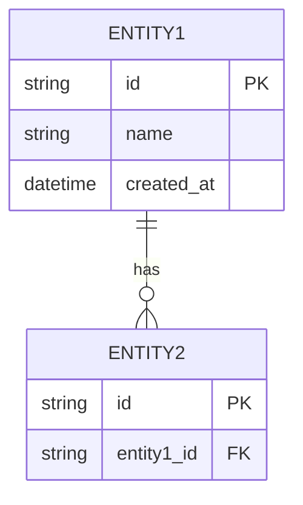

# 🗄️ Data Model

## ER Diagram

## Tables

### [Table Name]

| Column | Type | Nullable | Default | Mô tả |
|--------|------|----------|---------|--------|
| id | UUID | No | gen_random_uuid() | Primary key |
| | | | | |

**Indexes:**
- `idx_table_column` on (column)

**Constraints:**
- FK: column → other_table(id)

## Data Flow

> Dữ liệu di chuyển như thế nào giữa các hệ thống?

| Source | Destination | Trigger | Frequency |
|--------|------------|---------|----------|
| | | | |
