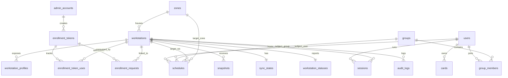
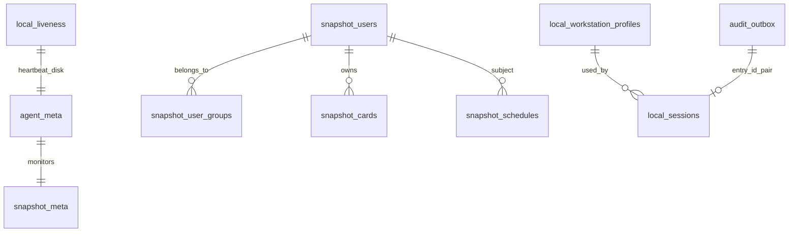

# 🗄️ Data Model (Server PostgreSQL & Edge SQLite WAL)

> Tài liệu đặc tả lược đồ dữ liệu đầy đủ cho **2 kho lưu trữ vật lý**:
> 1. **Central Server (`PostgreSQL 15`):** Nguồn sự thật cho `Identity`, `Device`, `Scheduling`, `Distribution`, `Operations` ([ADR-006](../06-architecture/decisions/ADR-006-ngon-ngu-va-techstack.md), [ADR-007](../06-architecture/decisions/ADR-007-khoa-so-khop-uid.md)).
> 2. **Edge Workstation (`/var/lib/nfc-agent/edge.db`, `SQLite 3 WAL`):** Kho cục bộ tự trị phục vụ xác thực 0-chạm, giám sát phiên và outbox ([ADR-003](../06-architecture/decisions/ADR-003-luu-tru-cuc-bo-va-xac-thuc-snapshot.md), [ADR-008](../06-architecture/decisions/ADR-008-vong-doi-phien-va-teardown-da-pha.md)).

---

## 1. Kiến Trúc Phân Tầng Lưu Trữ & Ranh Giới Bảo Mật

| Kho dữ liệu | DBMS / Chế độ | Phạm vi & Mục đích | Bảo vệ UID thẻ ([ADR-007](../06-architecture/decisions/ADR-007-khoa-so-khop-uid.md)) |
|---|---|---|---|
| **Server DB** | PostgreSQL 15 (UTF-8, TLS) | Nguồn sự thật quản trị, lịch, snapshot đã ký, phiên & audit | Mã hóa `AES-256-GCM` (`uid_encrypted` + `key_id`) kèm blind index `HMAC-SHA256(K_index, uid)`. Tuyệt đối không lưu UID thô. |
| **Edge DB** | SQLite 3 (`WAL`, `synchronous=FULL`, `0600 root:root`) | Cache cấu hình, `LocalSnapshot`, `LocalSession`, `AuditOutbox` | Bảng thẻ chỉ lưu `card_match_key = HMAC-SHA256(K_m, "uid-match-v1" || uid)`. Chỉ `audit_outbox` mang tạm `card_uid` (quyền `0600 root:root`), truyền qua mTLS và bị xóa ngay sau khi Server ACK. |

---

## 2. Central Server Schema (PostgreSQL 15)

### 2.1. ER Diagram Tổng Thể (Server)



---

### 2.2. Phân Vùng Identity (`users`, `cards`, `groups`, `group_members`, `admin_accounts`)

#### `users`
| Column | Type | Nullable | Default | Mô tả & Ràng buộc |
|---|---|---|---|---|
| `id` | `UUID` | No | `gen_random_uuid()` | Primary Key (`UserId`) |
| `external_id` | `VARCHAR(64)` | No | — | Mã sinh viên/giảng viên (`INV-002`, `VR-001`) |
| `full_name` | `VARCHAR(255)` | No | — | Họ tên đầy đủ, không rỗng |
| `email` | `VARCHAR(255)` | Yes | `NULL` | Email liên hệ (tùy chọn) |
| `status` | `VARCHAR(16)` | No | `'active'` | `CHECK (status IN ('active', 'inactive'))` (`XINV-001`: không hard-delete) |
| `created_at` | `TIMESTAMPTZ` | No | `now()` | Thời điểm tạo |
| `updated_at` | `TIMESTAMPTZ` | No | `now()` | Thời điểm cập nhật |

- **Constraints & Indexes:**
  - `CONSTRAINT chk_users_nonempty CHECK (length(btrim(external_id)) > 0 AND length(btrim(full_name)) > 0)`
  - `CREATE UNIQUE INDEX uq_users_external_id ON users (btrim(external_id));` (`INV-002`)

#### `cards`
| Column | Type | Nullable | Default | Mô tả & Ràng buộc |
|---|---|---|---|---|
| `id` | `UUID` | No | `gen_random_uuid()` | Primary Key (`CardId`) |
| `uid_encrypted` | `BYTEA` | No | — | Ciphertext `AES-256-GCM` của UID chuẩn hóa |
| `uid_iv` | `BYTEA` | No | — | Nonce/IV 12 byte (`CHECK (octet_length(uid_iv) = 12)`) |
| `uid_auth_tag` | `BYTEA` | No | — | GCM Authentication Tag 16 byte (`CHECK (octet_length(uid_auth_tag) = 16)`) |
| `encryption_key_id` | `VARCHAR(32)` | No | — | Định danh khóa mã hóa Server phục vụ quay vòng (`ADR-007`) |
| `uid_index` | `CHAR(64)` | No | — | Blind index hex `HMAC-SHA256(K_index, normalized_uid)` |
| `uid_length` | `SMALLINT` | No | — | `CHECK (uid_length IN (4, 7, 10))` (`VR-007`) |
| `owner_id` | `UUID` | Yes | `NULL` | FK → `users(id) ON DELETE RESTRICT` (NULL khi `unbound`) |
| `status` | `VARCHAR(16)` | No | `'active'` | `CHECK (status IN ('unbound', 'active', 'disabled'))` |
| `created_at` | `TIMESTAMPTZ` | No | `now()` | Thời điểm đăng ký thẻ |
| `updated_at` | `TIMESTAMPTZ` | No | `now()` | Thời điểm cập nhật trạng thái |

- **Constraints & Indexes:**
  - `UNIQUE (uid_index)` — Bảo đảm `INV-001`: UID duy nhất toàn hệ thống kể cả khi thẻ `unbound`.
  - `CONSTRAINT chk_cards_owner_unbound CHECK ((status = 'unbound' AND owner_id IS NULL) OR (status IN ('active', 'disabled') AND owner_id IS NOT NULL))` — Thực thi `INV-006`.
  - `CREATE INDEX idx_cards_owner ON cards (owner_id) WHERE owner_id IS NOT NULL;`

#### `groups` & `group_members`
- **`groups`:**
  - `id UUID PRIMARY KEY DEFAULT gen_random_uuid()`
  - `name VARCHAR(128) NOT NULL CHECK (length(btrim(name)) > 0)`
  - `description TEXT NULL`
  - `created_at TIMESTAMPTZ NOT NULL DEFAULT now()`, `updated_at TIMESTAMPTZ NOT NULL DEFAULT now()`
  - Functional Unique Index (`INV-003`, `VR-006`): `CREATE UNIQUE INDEX uq_groups_name_ci ON groups (lower(btrim(name)));`
- **`group_members`:**
  - `group_id UUID NOT NULL REFERENCES groups(id) ON DELETE CASCADE`
  - `user_id UUID NOT NULL REFERENCES users(id) ON DELETE RESTRICT`
  - `added_at TIMESTAMPTZ NOT NULL DEFAULT now()`
  - `PRIMARY KEY (group_id, user_id)`
  - `CREATE INDEX idx_group_members_user ON group_members (user_id);`

#### `admin_accounts`
- `id UUID PRIMARY KEY DEFAULT gen_random_uuid()`
- `username VARCHAR(64) NOT NULL CHECK (length(btrim(username)) > 0)`
- `display_name VARCHAR(255) NOT NULL CHECK (length(btrim(display_name)) > 0)`
- `password_hash TEXT NOT NULL`
- `status VARCHAR(16) NOT NULL DEFAULT 'active' CHECK (status IN ('active', 'disabled'))` (`INV-016`)
- `created_at TIMESTAMPTZ NOT NULL DEFAULT now()`, `updated_at TIMESTAMPTZ NOT NULL DEFAULT now()`
- `CREATE UNIQUE INDEX uq_admin_username_ci ON admin_accounts (lower(btrim(username)));`

---

### 2.3. Phân Vùng Device (`zones`, `workstations`, `workstation_profiles`, `enrollment_tokens`, `enrollment_requests`, `enrollment_token_uses`)

#### `zones`
| Column | Type | Nullable | Default | Mô tả & Ràng buộc |
|---|---|---|---|---|
| `id` | `UUID` | No | `gen_random_uuid()` | Primary Key (`ZoneId`) |
| `name` | `VARCHAR(128)` | No | — | Tên phòng lab, không rỗng |
| `location` | `VARCHAR(255)` | No | — | Vị trí tòa/tầng, không rỗng (`INV-003`) |
| `description` | `TEXT` | Yes | `NULL` | Ghi chú thêm |
| `created_at` | `TIMESTAMPTZ` | No | `now()` | |
| `updated_at` | `TIMESTAMPTZ` | No | `now()` | |

- `CREATE UNIQUE INDEX uq_zones_name_ci ON zones (lower(btrim(name)));` (`INV-003`)

#### `workstations`
| Column | Type | Nullable | Default | Mô tả & Ràng buộc |
|---|---|---|---|---|
| `id` | `UUID` | No | `gen_random_uuid()` | Primary Key (`WorkstationId`) |
| `mqtt_identity` | `VARCHAR(64)` | No | — | Common Name (`CN`) trên X.509 & biến `%u` Mosquitto ACL (ví dụ `ws-01`). Bắt buộc khớp regex `^[A-Za-z0-9_-]{3,64}$` chống injection `/` `#` `+` |
| `machine_id` | `VARCHAR(64)` | No | — | `/etc/machine-id` duy nhất của máy trạm |
| `mac_address` | `MACADDR` | No | — | Chuẩn hóa tự động bởi kiểu PostgreSQL `MACADDR` (`INV-009`, `VR-008`) |
| `hostname` | `VARCHAR(255)` | No | — | Tên máy Linux |
| `public_key` | `TEXT` | No | — | Public key Ed25519 hiện hành (PEM) |
| `cert_serial` | `VARCHAR(64)` | Yes | `NULL` | Serial chứng chỉ mTLS đang cấp hiệu lực |
| `cert_expires_at` | `TIMESTAMPTZ` | Yes | `NULL` | Hạn chứng chỉ (`TTL = 3 năm`, `ADR-002`) |
| `key_version` | `INTEGER` | No | `1` | `CHECK (key_version >= 1)`. Tăng khi Admin duyệt Re-enrollment (`ADR-007`) |
| `zone_id` | `UUID` | Yes | `NULL` | FK → `zones(id) ON DELETE SET NULL` (`XINV-004`: xóa Zone không xóa máy) |
| `status` | `VARCHAR(16)` | No | `'enrolled'` | `CHECK (status IN ('enrolled', 'disabled'))` |
| `created_at` | `TIMESTAMPTZ` | No | `now()` | |
| `updated_at` | `TIMESTAMPTZ` | No | `now()` | |

- **Constraints & Indexes:** `UNIQUE (mqtt_identity)`, `UNIQUE (machine_id)`, `UNIQUE (mac_address)`, `CREATE INDEX idx_ws_zone ON workstations (zone_id);`
- *Re-enrollment (`INV-010`, `P1-4`):* Khi Admin duyệt yêu cầu cài lại máy trùng MAC, Server cập nhật **tại chỗ** dòng `workstations` tương ứng (`machine_id`, `public_key`, `cert_serial`, `cert_expires_at`, `key_version = key_version + 1`), bảo toàn nguyên vẹn `workstation_id` lịch sử của `sessions`, `audit_logs` và `schedules`.
- *Lưu ý bảo mật ([ADR-007](../06-architecture/decisions/ADR-007-khoa-so-khop-uid.md)):* Server **không lưu khóa riêng `K_m`** trong CSDL; khóa `K_m = HKDF-SHA256(master_key, mqtt_identity || ":" || key_version)` được dẫn xuất động từ `master_key` khi cấp chứng chỉ và khi dựng snapshot.

#### `workstation_profiles` ([ADR-004](../06-architecture/decisions/ADR-004-mo-hinh-profile-os-dung-chung.md), `INV-018`)
| Column | Type | Nullable | Default | Mô tả & Ràng buộc |
|---|---|---|---|---|
| `id` | `UUID` | No | `gen_random_uuid()` | Primary Key |
| `workstation_id` | `UUID` | No | — | FK → `workstations(id) ON DELETE CASCADE` |
| `os_username` | `VARCHAR(32)` | No | — | Tên tài khoản Linux thuộc nhóm `labstudent` (`CHECK (os_username ~ '^[a-z_][a-z0-9_-]{0,31}$')`) |
| `display_name` | `VARCHAR(128)` | No | — | Tên hiển thị trên Dashboard |
| `profile_type` | `VARCHAR(16)` | No | `'shared'` | `CHECK (profile_type IN ('shared'))` |
| `is_default` | `BOOLEAN` | No | `false` | Nguồn sự thật cho profile mặc định của máy |
| `status` | `VARCHAR(16)` | No | `'enabled'` | `CHECK (status IN ('enabled', 'disabled'))` |
| `description` | `TEXT` | Yes | `NULL` | |
| `discovered_at` | `TIMESTAMPTZ` | No | `now()` | Lần đầu Auto-Discovery báo cáo |
| `updated_at` | `TIMESTAMPTZ` | No | `now()` | |

- **Constraints & Indexes:**
  - `UNIQUE (workstation_id, os_username)`
  - `CREATE UNIQUE INDEX uq_ws_default_profile ON workstation_profiles (workstation_id) WHERE is_default = true;` — Bảo đảm tối đa **1 profile mặc định** trên mỗi máy trạm.

#### `enrollment_tokens`, `enrollment_requests` & `enrollment_token_uses` (`INV-010`, `XINV-009`, `P1-4`)
- **`enrollment_tokens`:**
  - `id UUID PRIMARY KEY DEFAULT gen_random_uuid()`
  - `token_hash CHAR(64) NOT NULL UNIQUE` (SHA-256 của pre-shared token)
  - `note TEXT NULL`
  - `max_uses INTEGER NOT NULL DEFAULT 1 CHECK (max_uses >= 1)`
  - `used_count INTEGER NOT NULL DEFAULT 0 CHECK (used_count >= 0 AND used_count <= max_uses)`
  - `default_zone_id UUID NULL REFERENCES zones(id) ON DELETE SET NULL`
  - `expires_at TIMESTAMPTZ NOT NULL`
  - `status VARCHAR(16) NOT NULL DEFAULT 'active' CHECK (status IN ('active', 'revoked'))`
  - `created_by UUID NOT NULL REFERENCES admin_accounts(id)`
  - `created_at TIMESTAMPTZ NOT NULL DEFAULT now()`
- **`enrollment_requests`:**
  - `id UUID PRIMARY KEY DEFAULT gen_random_uuid()` (`enrollment_request_id`)
  - `bearer_token_hash CHAR(64) NOT NULL` (Hash của One-Time Bearer Token để tải cert & `K_m`, ADR-002 Mục 7)
  - `token_consumed_at TIMESTAMPTZ NULL` (Đặt giá trị ngay sau 1 lần fetch thành công -> hủy quyền tải lại)
  - `machine_id VARCHAR(64) NOT NULL`
  - `mac_address MACADDR NOT NULL`
  - `hostname VARCHAR(255) NOT NULL`
  - `csr_pem TEXT NOT NULL` (Ed25519 PKCS#10 CSR)
  - `public_key TEXT NOT NULL`
  - `enrollment_token_id UUID NULL REFERENCES enrollment_tokens(id) ON DELETE RESTRICT`
  - `duplicate_mac_detected BOOLEAN NOT NULL DEFAULT false` (`P1-4`: chặn tự duyệt khi trùng MAC)
  - `workstation_id UUID NULL REFERENCES workstations(id) ON DELETE SET NULL`
  - `assigned_zone_id UUID NULL REFERENCES zones(id) ON DELETE SET NULL`
  - `issued_cert_pem TEXT NULL` *(public cert tạm phục vụ response tải 1 lần; KHÔNG lưu `K_m`)*
  - `status VARCHAR(16) NOT NULL DEFAULT 'pending' CHECK (status IN ('pending', 'approved', 'rejected'))`
  - `submitted_at TIMESTAMPTZ NOT NULL DEFAULT now()`
  - `reviewed_at TIMESTAMPTZ NULL`, `reviewed_by UUID NULL REFERENCES admin_accounts(id)`
  - `CHECK ((status = 'pending' AND reviewed_at IS NULL) OR (status IN ('approved', 'rejected') AND reviewed_at IS NOT NULL))`
  - `CREATE INDEX idx_enroll_req_status_mac ON enrollment_requests (status, mac_address);`
- **`enrollment_token_uses`:**
  - `id UUID PRIMARY KEY DEFAULT gen_random_uuid()`
  - `token_id UUID NOT NULL REFERENCES enrollment_tokens(id) ON DELETE CASCADE`
  - `workstation_id UUID NOT NULL REFERENCES workstations(id) ON DELETE CASCADE`
  - `enrollment_request_id UUID NOT NULL UNIQUE REFERENCES enrollment_requests(id)`
  - `used_at TIMESTAMPTZ NOT NULL DEFAULT now()`

---

### 2.4. Phân Vùng Scheduling (`schedules`)

| Column | Type | Nullable | Default | Mô tả & Ràng buộc |
|---|---|---|---|---|
| `id` | `UUID` | No | `gen_random_uuid()` | Primary Key (`ScheduleId`) |
| `name` | `VARCHAR(255)` | No | — | Tên ca thực hành/lớp (`CHECK (length(btrim(name)) > 0)`) |
| `subject_type` | `VARCHAR(16)` | No | — | `CHECK (subject_type IN ('user', 'group'))` |
| `subject_user_id` | `UUID` | Yes | `NULL` | FK → `users(id) ON DELETE RESTRICT` (`XINV-003`) |
| `subject_group_id` | `UUID` | Yes | `NULL` | FK → `groups(id) ON DELETE RESTRICT` (`XINV-003`) |
| `target_type` | `VARCHAR(16)` | No | — | `CHECK (target_type IN ('workstation', 'zone'))` |
| `target_workstation_id` | `UUID` | Yes | `NULL` | FK → `workstations(id) ON DELETE RESTRICT` (`XINV-003`) |
| `target_zone_id` | `UUID` | Yes | `NULL` | FK → `zones(id) ON DELETE RESTRICT` (`XINV-003`) |
| `valid_from` | `DATE` | No | — | Ngày bắt đầu hiệu lực |
| `valid_to` | `DATE` | Yes | `NULL` | Ngày kết thúc (NULL = vô thời hạn trong học kỳ) |
| `days_of_week` | `TEXT[]` | No | — | Tập ngày trong tuần (`MONDAY`…`SUNDAY`), không rỗng |
| `start_minute` | `SMALLINT` | No | — | Phút từ 00:00 theo `Asia/Ho_Chi_Minh` (`0 <= start_minute < 1440`) |
| `end_minute` | `SMALLINT` | No | — | `start_minute < end_minute <= 1440` (`INV-005`, `D-011`: cùng ngày) |
| `target_os_username` | `VARCHAR(32)` | Yes | `NULL` | NULL = kế thừa profile mặc định của máy (`ADR-004`) |
| `status` | `VARCHAR(16)` | No | `'enabled'` | `CHECK (status IN ('enabled', 'disabled'))` |
| `created_at` | `TIMESTAMPTZ` | No | `now()` | |
| `updated_at` | `TIMESTAMPTZ` | No | `now()` | |

- **Constraints & Indexes (`INV-004`, `INV-005`, `XINV-003`):**
  - `CONSTRAINT chk_sched_subject_xor CHECK ((subject_type = 'user' AND subject_user_id IS NOT NULL AND subject_group_id IS NULL) OR (subject_type = 'group' AND subject_group_id IS NOT NULL AND subject_user_id IS NULL))`
  - `CONSTRAINT chk_sched_target_xor CHECK ((target_type = 'workstation' AND target_workstation_id IS NOT NULL AND target_zone_id IS NULL) OR (target_type = 'zone' AND target_zone_id IS NOT NULL AND target_workstation_id IS NULL))`
  - `CONSTRAINT chk_sched_recurrence CHECK ((valid_to IS NULL OR valid_from <= valid_to) AND cardinality(days_of_week) >= 1 AND days_of_week <@ ARRAY['MONDAY','TUESDAY','WEDNESDAY','THURSDAY','FRIDAY','SATURDAY','SUNDAY']::TEXT[] AND start_minute >= 0 AND start_minute < end_minute AND end_minute <= 1440)`
  - Indexes phục vụ `SnapshotBuilder` & `DeletionGuard`:
    - `CREATE INDEX idx_sched_target_ws ON schedules (target_workstation_id) WHERE target_workstation_id IS NOT NULL;`
    - `CREATE INDEX idx_sched_target_zone ON schedules (target_zone_id) WHERE target_zone_id IS NOT NULL;`
    - `CREATE INDEX idx_sched_subject_user ON schedules (subject_user_id) WHERE subject_user_id IS NOT NULL;`
    - `CREATE INDEX idx_sched_subject_group ON schedules (subject_group_id) WHERE subject_group_id IS NOT NULL;`

---

### 2.5. Phân Vùng Distribution (`snapshots`, `sync_states`, `server_outbox`)

#### `snapshots`
| Column | Type | Nullable | Default | Mô tả & Ràng buộc |
|---|---|---|---|---|
| `workstation_id` | `UUID` | No | — | FK → `workstations(id) ON DELETE CASCADE` |
| `version` | `BIGINT` | No | — | Phiên bản tăng dần từ 1 (`CHECK (version >= 1)`, `INV-011`) |
| `key_version` | `INTEGER` | No | — | Thế hệ khóa `K_m` dùng để sinh `CardMatchKey` và ký snapshot |
| `content_hash` | `CHAR(64)` | No | — | SHA-256 nội dung chuẩn tắc (loại `created_at`) để xác định nội dung có đổi hay không (`schedule-sync.md`) |
| `payload_raw` | `BYTEA` | No | — | **Raw UTF-8 wire bytes** đã ký (KHÔNG dùng `JSONB` cho wire payload nhằm bảo toàn 100% chữ ký byte gốc theo [ADR-003](../06-architecture/decisions/ADR-003-luu-tru-cuc-bo-va-xac-thuc-snapshot.md) & [ADR-006](../06-architecture/decisions/ADR-006-ngon-ngu-va-techstack.md)) |
| `hmac_signature` | `CHAR(64)` | No | — | `Hex(HMAC-SHA256(K_m, "snapshot-v1:" || payload_raw))` gửi kèm MQTT 5 `User Property signature` |
| `created_at` | `TIMESTAMPTZ` | No | `now()` | |

- **Primary Key:** `PRIMARY KEY (workstation_id, version)`

#### `sync_states`
| Column | Type | Nullable | Default | Mô tả & Ràng buộc |
|---|---|---|---|---|
| `workstation_id` | `UUID` | No | — | Primary Key & FK → `workstations(id) ON DELETE CASCADE` |
| `desired_version` | `BIGINT` | No | `0` | Phiên bản mới nhất Server muốn máy đạt tới |
| `acked_version` | `BIGINT` | No | `0` | Phiên bản cao nhất Edge đã báo qua Heartbeat/Applied (`CHECK (acked_version >= 0 AND acked_version <= desired_version)`) |
| `desired_updated_at` | `TIMESTAMPTZ` | No | `now()` | Thời điểm `desired_version` cập nhật (để tính trạng thái suy diễn `InSync` / `PendingSync` / `Stuck`) |
| `acked_at` | `TIMESTAMPTZ` | Yes | `NULL` | Lần gần nhất `acked_version` tăng |

#### `server_outbox` (Server Transactional Outbox — `XINV-005`, `schedule-sync.md`)
| Column | Type | Nullable | Default | Mô tả & Ràng buộc |
|---|---|---|---|---|
| `id` | `BIGSERIAL` | No | — | Primary Key tuần tự |
| `aggregate_type` | `VARCHAR(32)` | No | — | `schedule`, `user`, `group`, `card`, `workstation`, `zone`, `profile` |
| `aggregate_id` | `UUID` | No | — | ID thực thể thay đổi |
| `event_type` | `VARCHAR(64)` | No | — | Tên domain event (ví dụ `ScheduleUpdated`, `SnapshotReconcileRequested`) |
| `payload` | `JSONB` | No | — | Dữ liệu gợi ý tập máy cần reconcile |
| `status` | `VARCHAR(16)` | No | `'pending'` | `CHECK (status IN ('pending', 'processed', 'failed'))` |
| `created_at` | `TIMESTAMPTZ` | No | `now()` | |
| `processed_at` | `TIMESTAMPTZ` | Yes | `NULL` | |

- `CREATE INDEX idx_server_outbox_pending ON server_outbox (id) WHERE status = 'pending';` *(Worker dùng `SELECT ... FOR UPDATE SKIP LOCKED`)*.

---

### 2.6. Phân Vùng Operations (`workstation_statuses`, `sessions`, `audit_logs`)

#### `workstation_statuses`
| Column | Type | Nullable | Default | Mô tả & Ràng buộc |
|---|---|---|---|---|
| `workstation_id` | `UUID` | No | — | Primary Key & FK → `workstations(id) ON DELETE CASCADE` |
| `connectivity` | `VARCHAR(16)` | No | `'offline'` | `CHECK (connectivity IN ('online', 'offline'))` (nguồn sự thật là Heartbeat, BR-019) |
| `last_heartbeat_at` | `TIMESTAMPTZ` | Yes | `NULL` | Mốc heartbeat gần nhất |
| `boot_id` | `VARCHAR(64)` | Yes | `NULL` | `boot_id` kernel hiện tại của máy trạm |
| `trust_state` | `VARCHAR(16)` | Yes | `NULL` | `CHECK (trust_state IS NULL OR trust_state IN ('NoData', 'Fresh', 'Expired', 'ClockInvalid'))` |
| `clock_skew_detected` | `BOOLEAN` | No | `false` | Cảnh báo lệch đồng hồ > 60s (`XINV-007`) |
| `last_apply_error` | `TEXT` | Yes | `NULL` | Lỗi nạp snapshot gần nhất do máy báo qua heartbeat |
| `reconcile_state` | `VARCHAR(16)` | No | `'Idle'` | `CHECK (reconcile_state IN ('Idle', 'Draining'))` (`XINV-008`: đợi outbox cũ rỗng trước khi suy luận `abandoned`) |
| `draining_started_at` | `TIMESTAMPTZ` | Yes | `NULL` | Bắt đầu draining khi `boot_id` đổi |
| `updated_at` | `TIMESTAMPTZ` | No | `now()` | |

#### `sessions` (`INV-007`, `XINV-008`)
| Column | Type | Nullable | Default | Mô tả & Ràng buộc |
|---|---|---|---|---|
| `id` | `UUID` | No | — | Primary Key (`session_id` do Edge sinh) |
| `decision_id` | `UUID` | No | — | Khớp bắt buộc với `audit_logs.entry_id` (`UNIQUE`) |
| `user_id` | `UUID` | No | — | FK → `users(id)` |
| `card_id` | `UUID` | Yes | `NULL` | FK → `cards(id)` |
| `workstation_id` | `UUID` | No | — | FK → `workstations(id)` |
| `os_username` | `VARCHAR(32)` | No | — | Profile Linux thực tế được cấp |
| `boot_id` | `VARCHAR(64)` | No | — | Kernel `boot_id` lúc mở phiên |
| `decided_at` | `TIMESTAMPTZ` | No | — | Mốc Edge ra quyết định `granted` (BR-001) |
| `started_at` | `TIMESTAMPTZ` | No | — | Mốc GUI session lên trên OS (`started_at >= decided_at`) |
| `expires_at` | `TIMESTAMPTZ` | No | — | Hạn cố định của phiên (`expires_at >= decided_at`) |
| `status` | `VARCHAR(16)` | No | `'active'` | `CHECK (status IN ('active', 'completed', 'forced_logout', 'abandoned'))` |
| `ended_at` | `TIMESTAMPTZ` | Yes | `NULL` | Rỗng khi `active`, bắt buộc khi kết thúc |
| `end_reason` | `VARCHAR(32)` | Yes | `NULL` | `CHECK (end_reason IS NULL OR end_reason IN ('user_logout', 'schedule_expired', 'workstation_rebooted', 'superseded', 'os_session_lost'))` |
| `end_source` | `VARCHAR(16)` | Yes | `NULL` | `CHECK (end_source IS NULL OR end_source IN ('reported', 'reconstructed', 'inferred'))` |

- **Constraints, Partial Index & Trigger (`INV-007`):**
  - `CONSTRAINT chk_sessions_lifecycle CHECK ((status = 'active' AND ended_at IS NULL AND end_reason IS NULL AND end_source IS NULL) OR (status <> 'active' AND ended_at IS NOT NULL AND ended_at >= started_at AND end_reason IS NOT NULL AND end_source IS NOT NULL))`
  - `CREATE UNIQUE INDEX uq_sessions_active_ws ON sessions (workstation_id) WHERE status = 'active';`
  - `CREATE INDEX idx_sessions_ws_started ON sessions (workstation_id, started_at DESC);`
  - Trigger `trg_sessions_immutable_terminal`: chặn `UPDATE` hoặc `DELETE` nếu bản ghi đã ở trạng thái kết thúc (`OLD.status <> 'active'`).

#### `audit_logs` (`INV-008`, `XINV-006`, `ADR-007`)
| Column | Type | Nullable | Default | Mô tả & Ràng buộc |
|---|---|---|---|---|
| `id` | `UUID` | No | `gen_random_uuid()` | Primary Key |
| `entry_id` | `UUID` | No | — | Idempotency Key do Edge sinh (`UNIQUE`, `XINV-006`) |
| `occurred_at` | `TIMESTAMPTZ` | No | — | Thời điểm sự kiện xảy ra tại Edge |
| `received_at` | `TIMESTAMPTZ` | No | `now()` | Thời điểm Server ingest |
| `workstation_id` | `UUID` | No | — | FK → `workstations(id)` (phục vụ index truy vấn) |
| `outcome` | `VARCHAR(16)` | No | — | `CHECK (outcome IN ('granted', 'denied', 'error', 'noop'))` |
| `reason` | `VARCHAR(32)` | No | — | Mã lý do chuẩn (`granted`, `DenyReason`, `NoopReason`, `ErrorReason`) |
| `detail` | `VARCHAR(64)` | Yes | `NULL` | Chi tiết phụ (`no_data`, `lease_expired`, `clock_invalid`, `ambiguous_profile`, `already_active`, ...) |
| `card_uid_encrypted` | `BYTEA` | Yes | `NULL` | UID quẹt thẻ mã hóa AES-256-GCM (NULL nếu lỗi phần cứng không đọc được UID) |
| `card_uid_iv` | `BYTEA` | Yes | `NULL` | 12-byte GCM nonce |
| `card_uid_auth_tag` | `BYTEA` | Yes | `NULL` | 16-byte GCM auth tag |
| `encryption_key_id` | `VARCHAR(32)` | Yes | `NULL` | ID khóa giải mã UID khi Admin tra cứu |
| `card_uid_index` | `CHAR(64)` | Yes | `NULL` | `HMAC-SHA256(K_index, normalized_uid)` phục vụ lọc nhật ký theo thẻ |
| `reader_raw` | `VARCHAR(128)` | Yes | `NULL` | Hex bytes thô cắt ngắn khi `outcome = 'error'` (`invalid_uid`, `reader_error`) |
| `user_snapshot` | `JSONB` | Yes | `NULL` | Ảnh chụp bất biến `{id, external_id, full_name}` tại thời điểm quẹt |
| `card_snapshot` | `JSONB` | Yes | `NULL` | Ảnh chụp bất biến `{id, status}` |
| `workstation_snapshot` | `JSONB` | No | — | Ảnh chụp bất biến `{id, mqtt_identity, hostname, zone_name}` |
| `target_os_username` | `VARCHAR(32)` | Yes | `NULL` | Profile đích (nếu có) |
| `data_version` | `BIGINT` | Yes | `NULL` | Phiên bản snapshot đã dùng để thẩm định |

- **Constraints, Indexes & Trigger (`INV-008`):**
  - `CONSTRAINT chk_audit_uid_enc CHECK ((card_uid_encrypted IS NULL AND card_uid_iv IS NULL AND card_uid_auth_tag IS NULL AND encryption_key_id IS NULL) OR (card_uid_encrypted IS NOT NULL AND octet_length(card_uid_iv) = 12 AND octet_length(card_uid_auth_tag) = 16 AND encryption_key_id IS NOT NULL))`
  - `CREATE INDEX idx_audit_occurred_desc ON audit_logs (occurred_at DESC);`
  - `CREATE INDEX idx_audit_ws_occurred ON audit_logs (workstation_id, occurred_at DESC);`
  - `CREATE INDEX idx_audit_card_idx ON audit_logs (card_uid_index, occurred_at DESC) WHERE card_uid_index IS NOT NULL;`
  - `CREATE INDEX idx_audit_user_id ON audit_logs ((user_snapshot->>'id'), occurred_at DESC) WHERE user_snapshot IS NOT NULL;`
  - Trigger `trg_audit_logs_append_only`: `BEFORE UPDATE OR DELETE ON audit_logs` luôn raise exception (`INV-008`).

---

## 3. Edge Workstation Local Schema (`SQLite 3 WAL` — `/var/lib/nfc-agent/edge.db`)

### 3.1. PRAGMA Kết Nối Bắt Buộc ([ADR-003](../06-architecture/decisions/ADR-003-luu-tru-cuc-bo-va-xac-thuc-snapshot.md))

Mọi kết nối mở tới `edge.db` (quyền tệp `0600 root:root` trong thư mục `0700 root:root`) bắt buộc thực thi ngay khi mở connection:
```sql
PRAGMA journal_mode = WAL;
PRAGMA synchronous = FULL;
PRAGMA busy_timeout = 5000;
PRAGMA foreign_keys = ON;
PRAGMA wal_autocheckpoint = 1000;
```

### 3.2. ER Diagram (Edge SQLite WAL)



### 3.3. Chi Tiết Bảng Dữ Liệu Edge

#### 1. `agent_meta` & `local_liveness` (Cấu hình khởi động & Liveness cận dưới)
- **`agent_meta`:**
  - `id INTEGER PRIMARY KEY CHECK (id = 1)`
  - `workstation_id TEXT NOT NULL` (`mqtt_identity` / `CN`)
  - `boot_id TEXT NOT NULL` (`/proc/sys/kernel/random/boot_id` ghi nhận lần khởi động hiện tại)
  - `local_key_version INTEGER NOT NULL DEFAULT 1 CHECK (local_key_version >= 1)`
  - `updated_at REAL NOT NULL`
- **`local_liveness`:**
  - `id INTEGER PRIMARY KEY CHECK (id = 1)`
  - `boot_id TEXT NOT NULL`
  - `last_alive_at REAL NOT NULL` (UTC epoch seconds ghi định kỳ thưa để làm cận dưới `ended_at` khi mất điện theo `reboot.md` và `LocalLiveness`)

#### 2. `snapshot_meta` (Siêu dữ liệu Snapshot & Lease)
| Column | Type | Nullable | Default | Mô tả & Ràng buộc |
|---|---|---|---|---|
| `id` | `INTEGER` | No | `1` | `PRIMARY KEY CHECK (id = 1)` (bảng 1 dòng duy nhất) |
| `version` | `INTEGER` | No | `0` | Phiên bản snapshot đang áp dụng (`0` = `NoData`) |
| `key_version` | `INTEGER` | No | `1` | Thế hệ khóa `K_m` khớp với snapshot hiện hành |
| `uid_scheme` | `TEXT` | No | `'hmac-sha256-v1'` | Chuẩn băm `match_key` ([ADR-007](../06-architecture/decisions/ADR-007-khoa-so-khop-uid.md)) |
| `snapshot_created_at` | `REAL` | No | `0` | `created_at` của snapshot (UTC epoch seconds) |
| `received_at` | `REAL` | No | `0` | Mốc Edge nhận snapshot (UTC) |
| `trusted_until` | `REAL` | No | `0` | Mốc hết hạn tin cậy (UTC) |
| `last_server_time` | `REAL` | No | `0` | Mốc `server_time` gần nhất đã persist (dùng tính `floor` theo Lease Persist Policy, ADR-003 Mục 5) |
| `lease_duration_sec` | `INTEGER` | No | `86400` | Thời lượng lease D mặc định `24h` |
| `warning_before_sec` | `INTEGER` | No | `300` | Thời gian cảnh báo trước hạn W = `5 phút` |
| `max_session_duration_sec` | `INTEGER` | No | `43200` | Trần độ dài phiên tối đa (`12h`) |
| `hmac_signature` | `TEXT` | No | `''` | Chữ ký snapshot đã thẩm định |
| `last_apply_error` | `TEXT` | Yes | `NULL` | Lỗi áp snapshot gần nhất (báo lên heartbeat) |

#### 3. Phân vùng Snapshot Cache (`snapshot_users`, `snapshot_user_groups`, `snapshot_cards`, `snapshot_schedules`)
*Thay thế nguyên tử trong cùng transaction `BEGIN IMMEDIATE ... COMMIT` khi nhận snapshot có `version > snapshot_meta.version` và `key_version == agent_meta.local_key_version`:*
- **`snapshot_users`:** `user_id TEXT PRIMARY KEY`, `external_id TEXT NOT NULL`, `full_name TEXT NOT NULL`, `status TEXT NOT NULL CHECK (status IN ('active', 'inactive'))`.
- **`snapshot_user_groups`:** `user_id TEXT NOT NULL REFERENCES snapshot_users(user_id) ON DELETE CASCADE`, `group_id TEXT NOT NULL`, `PRIMARY KEY (user_id, group_id)`. Index `idx_edge_ug_group ON snapshot_user_groups (group_id);`.
- **`snapshot_cards`:** `card_match_key TEXT PRIMARY KEY` (64-char hex HMAC theo `K_m`), `card_id TEXT NOT NULL UNIQUE`, `user_id TEXT NULL REFERENCES snapshot_users(user_id) ON DELETE CASCADE`, `status TEXT NOT NULL CHECK (status IN ('unbound', 'active', 'disabled'))`.
- **`snapshot_schedules`:**
  - `schedule_id TEXT PRIMARY KEY`
  - `subject_type TEXT NOT NULL CHECK (subject_type IN ('user', 'group'))`
  - `subject_id TEXT NOT NULL`
  - `valid_from TEXT NOT NULL` (`YYYY-MM-DD`)
  - `valid_to TEXT NULL`
  - `days_mask INTEGER NOT NULL CHECK (days_mask BETWEEN 1 AND 127)` (Bitmask: Mon=1, Tue=2, Wed=4, Thu=8, Fri=16, Sat=32, Sun=64)
  - `start_minute INTEGER NOT NULL CHECK (start_minute >= 0 AND start_minute < 1440)`
  - `end_minute INTEGER NOT NULL CHECK (end_minute > start_minute AND end_minute <= 1440)`
  - `target_os_username TEXT NULL`
  - Index: `CREATE INDEX idx_edge_sched_subj ON snapshot_schedules (subject_type, subject_id);`

#### 4. `local_workstation_profiles` (`LocalWorkstationProfile`, `ADR-004`, `INV-018`)
- `os_username TEXT PRIMARY KEY`
- `is_default INTEGER NOT NULL DEFAULT 0 CHECK (is_default IN (0, 1))`
- `status TEXT NOT NULL CHECK (status IN ('enabled', 'disabled'))`
- `synced_from_snapshot INTEGER NOT NULL DEFAULT 0 CHECK (synced_from_snapshot IN (0, 1))`
- `CREATE UNIQUE INDEX uq_edge_default_profile ON local_workstation_profiles (is_default) WHERE is_default = 1;`

#### 5. `local_sessions` (`INV-014`, `INV-015`, `INV-017`, `ADR-008`)
| Column | Type | Nullable | Default | Mô tả & Ràng buộc |
|---|---|---|---|---|
| `session_id` | `TEXT` | No | — | Primary Key (UUID v4) |
| `entry_id` | `TEXT` | No | — | `UNIQUE`, khớp `audit_outbox.entry_id` (ghi cặp nguyên tử theo `ADR-003` Mục 6) |
| `user_id` | `TEXT` | No | — | ID sinh viên/giảng viên |
| `card_id` | `TEXT` | No | — | ID thẻ đã dùng quẹt mở phiên |
| `os_username` | `TEXT` | No | — | Tài khoản Linux thực tế (`student`, ...) |
| `os_session_id` | `TEXT` | Yes | `NULL` | ID phiên `systemd-logind` trên `seat0` (gán khi lên `active`) |
| `boot_id` | `TEXT` | No | — | Kernel `boot_id` khi tạo phiên |
| `decided_at` | `REAL` | No | — | Mốc cấp quyền `granted` (dùng đối chiếu `started > decided_at` theo `ADR-008`) |
| `started_at` | `REAL` | Yes | `NULL` | Mốc GUI session thực sự khởi chạy |
| `expires_at` | `REAL` | No | — | Hạn tuyệt đối UTC |
| `boottime_limit` | `REAL` | No | — | Hạn đo đơn điệu `CLOCK_BOOTTIME` (`INV-015`) |
| `status` | `TEXT` | No | `'pending'` | `CHECK (status IN ('pending', 'active', 'completed', 'forced_logout', 'abandoned', 'discarded'))` |
| `ended_at` | `REAL` | Yes | `NULL` | |
| `end_reason` | `TEXT` | Yes | `NULL` | `CHECK (end_reason IS NULL OR end_reason IN ('user_logout', 'schedule_expired', 'workstation_rebooted', 'superseded', 'os_session_lost'))` |
| `end_source` | `TEXT` | Yes | `NULL` | `CHECK (end_source IS NULL OR end_source IN ('reported', 'reconstructed'))` |

- **Partial Unique Indexes thực thi `INV-014` (tối đa 1 `pending` và 1 `active` tại mọi thời điểm):**
  - `CREATE UNIQUE INDEX uq_edge_one_pending_session ON local_sessions (status) WHERE status = 'pending';`
  - `CREATE UNIQUE INDEX uq_edge_one_active_session ON local_sessions (status) WHERE status = 'active';`
  - `CREATE INDEX idx_edge_sessions_cleanup ON local_sessions (status, ended_at);`
- *Thiết kế có chủ đích (Không đặt Foreign Key sang `snapshot_users`/`snapshot_cards`/`local_workstation_profiles`):* Khi nạp Snapshot mới (`DELETE` + `INSERT` toàn bộ cache) giữa lúc phiên đang chạy, phiên `active` hiện tại không bị chặn hay `CASCADE DELETE` (`BR-006`, `BR-010`).

#### 6. `audit_outbox` (`INV-013`, `ADR-003`)
| Column | Type | Nullable | Default | Mô tả & Ràng buộc |
|---|---|---|---|---|
| `seq` | `INTEGER` | No | `AUTOINCREMENT` | `INTEGER PRIMARY KEY AUTOINCREMENT` (**bắt buộc `AUTOINCREMENT`** để ngăn tái sử dụng `seq` sau khi xóa hết lô, bảo toàn thứ tự lũy tiến Cumulative ACK) |
| `entry_id` | `TEXT` | No | — | UUID v4 `UNIQUE` |
| `occurred_at` | `REAL` | No | — | UTC epoch seconds |
| `event_type` | `TEXT` | No | — | `CHECK (event_type IN ('swipe_decision', 'session_started', 'session_ended', 'security_alert'))` |
| `payload_json` | `TEXT` | No | — | JSON chi tiết gửi lên MQTT `.../outbox` |
| `created_at` | `REAL` | No | — | Thời điểm ghi đĩa |

---

## 4. Data Flow (Đồng Bộ & Lưu Chuyển Dữ Liệu Liên Hệ Thống)

| Source | Destination | Kênh / Cơ chế | Tần suất / Trigger | Đảm bảo An toàn |
|---|---|---|---|---|
| Server (`users`, `cards`, `groups`, `schedules`, `workstations`, `profiles`) | `snapshots` & `sync_states` | `server_outbox` (`BEGIN...COMMIT`) + Reconcile Worker | Khi thay đổi nghiệp vụ, lúc khởi động & định kỳ | Ký `HMAC-SHA256(K_m, "snapshot-v1:" \|\| payload_raw)` trên byte gốc |
| Server `snapshots` | Edge `edge.db` (`snapshot_*`, `snapshot_meta`) | MQTT 5 mTLS (`8883`) `.../snapshot` (QoS 1, Retain) | Khi `version` tăng hoặc Edge tụt version | Kiểm tra `User Property signature` bằng `hmac.compare_digest` + `key_version`, thay thế trong `BEGIN IMMEDIATE` |
| Edge `LeaseRenewalService` | Edge `snapshot_meta` (`trusted_until`, `last_server_time`) | MQTT 5 `.../lease` (QoS 1, User Property `signature`) | Mỗi Heartbeat 30s (`acked_version == desired_version`) | Cập nhật RAM ngay; chỉ flush SQLite khi tăng >= 300s hoặc kèm transaction khác / `SIGTERM` (`ADR-003`) |
| Edge Quẹt thẻ (`CR-001`) | Edge `audit_outbox` + `local_sessions (pending)` | SQLite Transaction `BEGIN IMMEDIATE ... COMMIT` | Mỗi lần quẹt thẻ hợp lệ | Atomic Write-Ahead Pairing (`INV-014`, `D-005`) với `synchronous=FULL` |
| Edge `audit_outbox` | Server `audit_logs` & `sessions` | MQTT 5 `.../outbox` (QoS 1, FIFO Batch <= 50) → `.../command/ack` | Liên tục theo batch khi Online | `ON CONFLICT (entry_id) DO NOTHING` (`XINV-006`) + `DELETE WHERE seq <= acked_seq` (`INV-013`) |
| Edge `Auto-Discovery` | Server `workstation_profiles` | MQTT 5 `.../hello` / `.../heartbeat` | Khi Agent khởi động / thay đổi allowlist | Chỉ nhận danh sách user nhóm `labstudent` UID >= 1000 (`INV-018`) |
