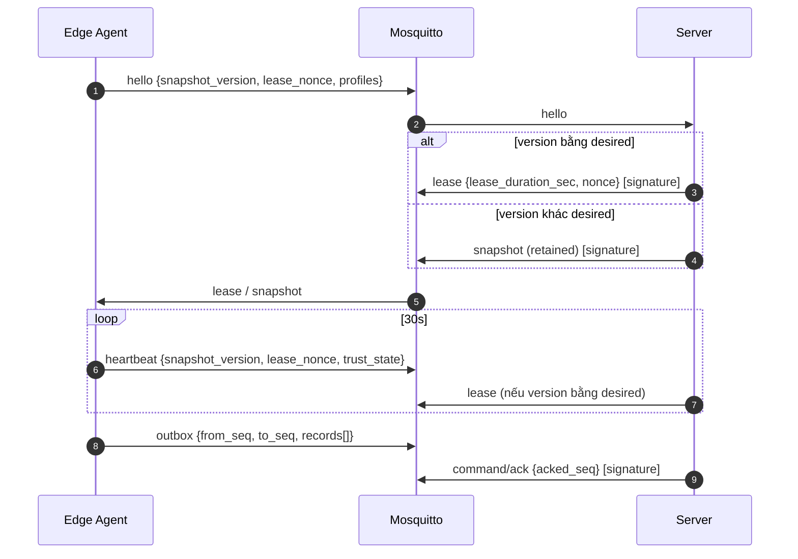

# 📡 Events: Bản Tin MQTT (Server ⇄ Edge) và Domain Event Nội Bộ

> Hai loại sự kiện trong hệ thống:
> 1. **Integration message qua MQTT 5** giữa Server và Agent: hợp đồng giao tiếp xuyên tiến trình, xuyên ngôn ngữ (Node.js ⇄ Python). Định nghĩa đầy đủ ở Mục 2–4.
> 2. **Domain event nội bộ Server** (`ScheduleUpdated`, `CardDisabled`...): đi qua `server_outbox` để kích hoạt dựng lại snapshot (XINV-005). Mục 5.
>
> Kênh truyền, ACL, QoS, chữ ký: [ADR-002](../06-architecture/decisions/ADR-002-giao-thuc-mqtt-va-dinh-danh-may-tram.md), [ADR-003](../06-architecture/decisions/ADR-003-luu-tru-cuc-bo-va-xac-thuc-snapshot.md). Tài liệu này chốt **nội dung** từng bản tin.

---

## 1. Quy Ước Chung

| Quy ước | Giá trị |
|---|---|
| Mã hóa payload | JSON UTF-8. Bản tin có chữ ký được ký trên **đúng chuỗi byte gửi đi**; bên nhận thẩm định trên byte thô trước khi parse (ADR-003 §4) |
| Thời gian | UTC epoch giây, số thực (`1793049263.96`). Riêng ngày/giờ của lịch dùng `YYYY-MM-DD` và phút trong ngày theo `Asia/Ho_Chi_Minh` (BR-012) |
| Định danh máy | `{ws}` trong topic = `mqtt_identity` = CN chứng chỉ (ví dụ `ws-01`). Không dùng UUID nội bộ của server trên kênh MQTT |
| ID thực thể | UUID dạng chuỗi (`user_id`, `card_id`, `schedule_id`, `session_id`, `entry_id`) |
| Chữ ký | MQTT 5 User Property `signature = hex(HMAC-SHA256(K_m, "<tag>-v1:" ‖ payload))`, chỉ cho bản tin **Server → Edge** |
| Phiên bản lược đồ | Trường `schema` trong payload (`snapshot-v1`, `lease-v1`...). Thêm trường mới được, không đổi nghĩa/xóa trường cũ (Expand → Contract, `migrations.md` §3.1) |
| Trường lạ | Bên nhận bỏ qua trường không biết (tương thích tiến) |

## 2. Danh Mục Bản Tin MQTT

| Bản tin | Topic | Chiều | QoS / Retain | Ký | Mục |
|---|---|---|---|---|---|
| Hello | `lab/workstation/{ws}/hello` | Edge → Server | 1 / không | — | 3.1 |
| Heartbeat | `lab/workstation/{ws}/heartbeat` | Edge → Server | 0 / không | — | 3.2 |
| Outbox batch | `lab/workstation/{ws}/outbox` | Edge → Server | 1 / không | — | 3.3 |
| Status / LWT | `lab/workstation/{ws}/status` | Edge (broker thay mặt khi đứt) → Server | 1 / **có** | — | 3.4 |
| Snapshot | `lab/workstation/{ws}/snapshot` | Server → Edge | 1 / **có** | `snapshot` | 4.1 |
| Lease | `lab/workstation/{ws}/lease` | Server → Edge | 1 / không | `lease` | 4.2 |
| Outbox ACK | `lab/workstation/{ws}/command/ack` | Server → Edge | 1 / không | `ack` | 4.3 |



---

## 3. Bản Tin Edge → Server

### 3.1. Hello
Gửi ngay sau mỗi lần kết nối (sau `SUBSCRIBE`). Server dùng để đánh dấu online, phát hiện reboot (`boot_id` đổi → Draining, XINV-008), so version để trả lease hoặc snapshot (D-016), cập nhật danh mục profile (Auto-Discovery, D-009) và vô hiệu hóa `fetch_code` của lần đăng ký vừa duyệt (D-014).

```json
{
  "schema": "hello-v1",
  "workstation_id": "ws-01",
  "boot_id": "9f2c8d14-5b1e-4c33-9a70-0d6f2e8b1c47",
  "agent_version": "1.0.0",
  "snapshot_version": 12,
  "key_version": 2,
  "lease_nonce": "7f3a9c1e5b2d4f60a8e1c3b5d7f90214",
  "pending_outbox_count": 4,
  "profiles": ["student", "labuser"],
  "local_time": 1793049263.81
}
```

| Trường | Bắt buộc | Mô tả |
|---|---|---|
| `boot_id` | ✔ | `/proc/sys/kernel/random/boot_id` |
| `snapshot_version` | ✔ | `0` khi `NoData` |
| `key_version` | ✔ | Từ `identity/` (D-017); khác server thì server ghi cảnh báo |
| `lease_nonce` | ✔ | 128-bit ngẫu nhiên hex, mới mỗi lần gửi (D-018) |
| `profiles` | ✔ | Tài khoản thuộc nhóm `labstudent`, UID ≥ 1000 có thật trên máy (INV-018) |
| `local_time` | ✔ | Để server so lệch giờ |

### 3.2. Heartbeat
Mỗi 30s và ngay sau khi nạp snapshot mới (thay cho bản tin `SnapshotApplied`). Là nguồn sự thật cho online/offline (BR-019).

```json
{
  "schema": "heartbeat-v1",
  "workstation_id": "ws-01",
  "boot_id": "9f2c8d14-5b1e-4c33-9a70-0d6f2e8b1c47",
  "snapshot_version": 12,
  "lease_nonce": "c41b0e7a92d35f8816a4e0b2c9d7f351",
  "trust_state": "Fresh",
  "local_time": 1793049293.80,
  "clock_skew_detected": false,
  "last_apply_error": null,
  "active_session_id": "a3c1f0d2-7e44-4b8e-9c1a-2f6d8e0b5a91",
  "profiles": ["student", "labuser"]
}
```

| Trường | Giá trị |
|---|---|
| `trust_state` | `NoData` \| `Fresh` \| `Expired` \| `ClockInvalid` (khớp `workstation_statuses.trust_state`) |
| `last_apply_error` | `null` hoặc mã: `signature_invalid`, `key_version_mismatch`, `older_version`, `schema_invalid` |
| `active_session_id` | Phiên `active` cục bộ hoặc `null`. Chỉ để Dashboard hiển thị; **không** dùng để đóng phiên trên server (việc đó theo XINV-008 / D-015) |

### 3.3. Outbox Batch
Tối đa 50 mục, theo thứ tự `outbox_seq` tăng dần, một lô đang chờ ACK tại một thời điểm (ADR-002 §5).

```json
{
  "schema": "outbox-v1",
  "workstation_id": "ws-01",
  "batch_id": "b-68192a",
  "from_seq": 101,
  "to_seq": 103,
  "records": [ { "...": "xem các loại dưới đây" } ]
}
```

Mọi mục có chung khung:

| Trường | Mô tả |
|---|---|
| `entry_id` | UUID do Edge sinh; khóa loại trùng (XINV-006) |
| `outbox_seq` | Số thứ tự cục bộ |
| `occurred_at` | Thời điểm xảy ra theo giờ máy |
| `event_type` | `swipe_decision` \| `session_started` \| `session_ended` \| `security_alert` |
| `payload` | Theo loại, bảng dưới |

**`swipe_decision`** (BR-007: đúng một mục cho mỗi lần quẹt) → `audit_logs`
```json
{
  "entry_id": "d84f9a10-3c2b-4e6f-8a1d-5b7c9e0f2a34", "outbox_seq": 101,
  "occurred_at": 1793048324.61, "event_type": "swipe_decision",
  "payload": {
    "outcome": "granted",
    "reason": "granted",
    "detail": null,
    "card_uid": "1F0820CF",
    "reader_raw": null,
    "user": {"id": "6f1c2a3b-...", "external_id": "SV001", "full_name": "Nguyễn Văn A"},
    "card": {"id": "0b7e4d21-...", "status": "active"},
    "target_os_username": "student",
    "matched_schedule_ids": ["3a9d5e10-..."],
    "data_version": 12
  }
}
```

| `outcome` | `reason` | `detail` (ví dụ) |
|---|---|---|
| `granted` | `granted` | `null`, `superseded`, `os_session_lost` (phiên cũ bị thay) |
| `denied` | `unknown_card`, `card_disabled`, `user_inactive`, `no_schedule`, `out_of_schedule`, `data_stale`, `workstation_busy`, `ambiguous_profile`, `profile_disabled`, `profile_not_found` | `data_stale` kèm `no_data` \| `lease_expired` \| `clock_invalid` |
| `noop` | `already_active` | `null` |
| `error` | `invalid_uid`, `reader_error`, `internal_error` | — |

Quy tắc: `card_uid = null` khi không đọc được UID (`error`); `user`, `card` là `null` khi chưa tra được (`unknown_card`, `data_stale`, `error`). Ảnh chụp máy (`workstation_snapshot`: hostname, zone) do Server điền lúc nhận từ dữ liệu của chính nó.

**`session_started`** (FR-063) → `sessions`
```json
{ "payload": {
    "session_id": "a3c1f0d2-...", "decision_entry_id": "d84f9a10-...",
    "user_id": "6f1c2a3b-...", "card_id": "0b7e4d21-...", "os_username": "student",
    "boot_id": "9f2c8d14-...", "decided_at": 1793048324.61,
    "started_at": 1793048330.12, "expires_at": 1793055600.00 } }
```

**`session_ended`** → `sessions`
```json
{ "payload": {
    "session_id": "a3c1f0d2-...", "status": "forced_logout",
    "end_reason": "schedule_expired", "end_source": "reported",
    "ended_at": 1793055600.40 } }
```
`status` ∈ `completed`, `forced_logout`, `abandoned`; `end_source` ∈ `reported`, `reconstructed`. Phiên `discarded` không được gửi (chưa từng mở trên OS).

**`security_alert`** → `workstation_alerts`
```json
{ "payload": { "kind": "edge_db_recovered", "detail": {"lost_outbox_entries": 3} } }
```
`kind` ∈ `snapshot_signature_invalid`, `edge_db_recovered`, `key_version_mismatch`.

**Xử lý phía Server (D-015):** mỗi mục áp dụng trong một savepoint riêng; mục trùng `entry_id` bỏ qua; mục không áp dụng được vào `ingest_rejects`; lô luôn được ACK đến `to_seq`. `session_ended` thay kết quả suy luận đúng một lần; `session_started` khi máy còn phiên `active` cũ thì phiên cũ được suy luận kết thúc trước.

### 3.4. Status / LWT
Agent publish `{"status":"online"}` (retained) sau Hello; broker publish Last Will `{"status":"offline","reason":"connection_lost"}` khi kết nối đứt. Chỉ là gợi ý rút ngắn thời gian phát hiện; heartbeat vẫn là nguồn sự thật (BR-019).

---

## 4. Bản Tin Server → Edge (có chữ ký)

### 4.1. Snapshot (`snapshot-v1`)
Bản đầy đủ theo từng máy, không delta (INV-012). Server lưu nguyên byte đã ký ở `snapshots.payload_raw`.

```json
{
  "schema": "snapshot-v1",
  "workstation_id": "ws-01",
  "version": 13,
  "key_version": 2,
  "uid_scheme": "hmac-sha256-v1",
  "created_at": 1793049300.00,
  "parameters": {
    "lease_duration_sec": 86400,
    "warning_before_sec": 300,
    "max_session_duration_sec": 43200
  },
  "users": [
    {"id": "6f1c2a3b-...", "external_id": "SV001", "full_name": "Nguyễn Văn A",
     "status": "active", "group_ids": ["g-1b2c..."]}
  ],
  "cards": [
    {"match_key": "9b1f…64 hex", "card_id": "0b7e4d21-...", "user_id": "6f1c2a3b-...", "status": "active"}
  ],
  "schedules": [
    {"id": "3a9d5e10-...", "subject_type": "group", "subject_id": "g-1b2c...",
     "valid_from": "2026-09-01", "valid_to": "2027-01-15",
     "days_mask": 21, "start_minute": 450, "end_minute": 690,
     "target_os_username": null}
  ],
  "profiles": [
    {"os_username": "student", "status": "enabled", "is_default": true}
  ]
}
```

| Quy tắc nhận (Edge) | Nguồn |
|---|---|
| Chữ ký sai → bỏ, `security_alert(snapshot_signature_invalid)` | ADR-003 §4 |
| `workstation_id` khác máy mình, hoặc `key_version` khác `identity/` → bỏ, `last_apply_error` | D-017 |
| `version` bằng bản đang dùng → bỏ qua lặng lẽ (retained giao lại); nhỏ hơn → bỏ, `last_apply_error = older_version` | ADR-002 §4 |
| `version` lớn hơn → thay nguyên tử mọi bảng `snapshot_*` và cờ profile, đặt `trusted_until = max(cũ, giờ máy + lease_duration_sec)`, `last_sync_local_time = max(cũ, giờ máy)`, rồi gửi heartbeat ngay | INV-011, D-018 |

`days_mask`: Thứ Hai = 1, Thứ Ba = 2, Thứ Tư = 4, Thứ Năm = 8, Thứ Sáu = 16, Thứ Bảy = 32, Chủ Nhật = 64. `match_key = hex(HMAC-SHA256(K_m, "uid-match-v1" ‖ UID chuẩn hóa))` (ADR-007).

### 4.2. Lease (`lease-v1`)
Chỉ gửi khi `snapshot_version` máy báo bằng `desired_version`, trả lời từng Hello/heartbeat.

```json
{
  "schema": "lease-v1",
  "workstation_id": "ws-01",
  "desired_version": 13,
  "server_time": 1793049323.96,
  "lease_duration_sec": 86400,
  "nonce": "c41b0e7a92d35f8816a4e0b2c9d7f351"
}
```
Edge chỉ nhận khi chữ ký đúng, `desired_version` bằng version cục bộ và `nonce` là một trong 3 `lease_nonce` gần nhất đã gửi; khi đó gia hạn như snapshot. `server_time` chỉ dùng để phát hiện lệch giờ (`clock_skew_detected` khi lệch > 60s, không chặn) (D-018).

### 4.3. Outbox ACK (`ack-v1`)
```json
{ "schema": "ack-v1", "command": "ack_outbox", "workstation_id": "ws-01", "acked_seq": 103 }
```
Edge xóa `outbox_seq <= acked_seq`; `acked_seq` nhỏ hơn mức đã xóa thì bỏ qua (INV-013).

---

## 5. Domain Event Nội Bộ Server

Không đi ra ngoài Server. Được ghi vào `server_outbox` **cùng giao dịch** với thay đổi nghiệp vụ, worker đọc bằng `FOR UPDATE SKIP LOCKED` rồi tính lại tập máy bị ảnh hưởng và dựng snapshot (XINV-005, `schedule-sync.md`).

| Event | Phát bởi | Máy bị ảnh hưởng (Distribution tính) |
|---|---|---|
| `UserUpdated`, `UserDeactivated`, `UserActivated` | Identity | Máy có Schedule mà user là subject trực tiếp hoặc qua nhóm |
| `GroupMembershipChanged` | Identity | Máy có Schedule với subject là nhóm đó |
| `CardBound`, `CardUnbound`, `CardDisabled`, `CardEnabled` | Identity | Như `UserUpdated` của chủ thẻ (cũ và mới) |
| `ScheduleCreated`, `ScheduleUpdated`, `ScheduleEnabled`, `ScheduleDisabled`, `ScheduleDeleted` | Scheduling | Máy là target hoặc thuộc zone target (cả giá trị cũ và mới khi sửa) |
| `WorkstationZoneChanged`, `ZoneDeleted` | Device | Máy đổi zone / mọi máy của zone |
| `WorkstationProfileConfigured`, `WorkstationProfilesDiscovered` | Device | Chính máy đó |
| `WorkstationEnrollmentApproved` | Device | Chính máy đó (snapshot đầu tiên hoặc sau cài lại với `key_version` mới) |
| `WorkstationDisabled` | Device | Không dựng snapshot; sinh lại CRL và khởi động lại broker (D-014) |

Khung bản ghi `server_outbox`:
```json
{
  "aggregate_type": "schedule",
  "aggregate_id": "3a9d5e10-...",
  "event_type": "ScheduleUpdated",
  "payload": {"before": {"target_zone_id": "z-1"}, "after": {"target_zone_id": "z-2"}},
  "created_at": "2026-11-11T09:30:00Z"
}
```

## 6. Bảo Đảm Giao Nhận

| Khía cạnh | Chiến lược |
|---|---|
| Thứ tự | Outbox theo `outbox_seq`, một lô chờ ACK tại một thời điểm; trong một máy giữ đúng thứ tự. Snapshot/lease không cần thứ tự nhờ quy tắc version và nonce |
| Giao nhận | At-least-once (QoS 1) cho Hello, Outbox, Snapshot, Lease, ACK; heartbeat QoS 0 vì nhịp sau bù nhịp trước |
| Idempotency | Server: `entry_id` (audit, session, alert). Edge: version snapshot, `acked_seq` lũy tiến, nonce của lease |
| Dead letter | Server: `ingest_rejects` (mục outbox không áp dụng được, vẫn ACK). Edge: không có, bản tin lỗi bị bỏ và báo qua `last_apply_error` |
| Bản tin đã gửi | Bất biến; sửa dữ liệu = phát snapshot version mới |
