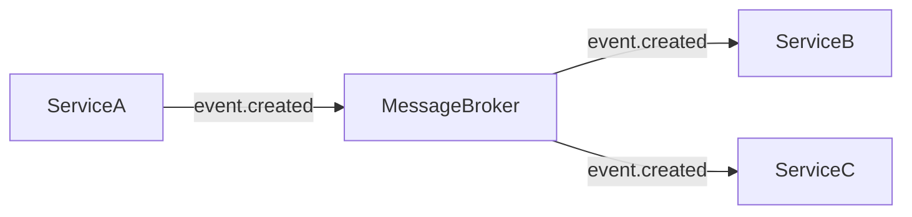

# 📡 Events (Domain Events / Integration Events)

## Event Catalog

| Event | Publisher | Subscribers | Payload | Ordering |
|-------|-----------|------------|---------|----------|
| | | | | |

## Event Format

```json
{
  "id": "uuid",
  "type": "order.created",
  "source": "order-service",
  "timestamp": "2024-01-01T00:00:00Z",
  "data": {},
  "metadata": {
    "correlationId": "uuid",
    "causationId": "uuid"
  }
}
```

## Event Flow



## Delivery Guarantees

| Aspect | Strategy |
|--------|----------|
| Ordering | |
| Delivery | At-least-once / Exactly-once |
| Idempotency | |
| Dead Letter | |

## Notes

- Events are immutable — không sửa event đã publish
- Consumers phải idempotent
