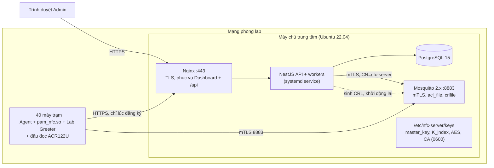

# 🚀 Deployment

> Triển khai cho quy mô pilot: một phòng máy ~40 máy trạm Ubuntu 22.04, một máy chủ trung tâm. Ưu tiên đơn giản, dựng lại được, không phụ thuộc dịch vụ đám mây.

## Environments

| Môi trường | Ở đâu | Mục đích | Cách triển khai |
|---|---|---|---|
| Development | Máy dev + VM Ubuntu 22.04 (như môi trường spike) | Phát triển Agent/Server, chạy harness S7b/S10/S11 | Chạy trực tiếp, Mosquitto/PostgreSQL cục bộ |
| Staging (demo) | 1 VM server + 2–3 VM/PC máy trạm | Kiểm thử tích hợp, demo bảo vệ | Giống production, dữ liệu giả |
| Production (pilot) | 1 máy chủ trong mạng phòng lab + ~40 máy trạm | Vận hành thật | Thủ công theo quy trình bên dưới, có checklist |

## Topology

Một máy chủ là đủ cho ~40 máy: tải là vài heartbeat/giây và vài lô outbox mỗi phút. Server sập không làm máy trạm ngừng cho quẹt thẻ trong thời hạn lease (NFR-A01), nên không cần cụm dự phòng cho MVP.

## Infrastructure

| Thành phần | Phiên bản | Cấu hình chính | Ghi chú |
|---|---|---|---|
| Máy chủ | Ubuntu 22.04 LTS, 2 vCPU, 4 GB RAM, 40 GB đĩa | NTP bật | Đặt IP tĩnh hoặc tên DNS nội bộ cố định (máy trạm cần biết địa chỉ) |
| PostgreSQL | 15 | Chỉ nghe `localhost` | Migration theo `07-data/migrations.md` |
| Mosquitto | 2.0.x | `listener 8883`, `require_certificate true`, `use_identity_as_username true`, `acl_file`, `crlfile`, `persistence true` | Tệp CRL luôn tồn tại (S9) |
| NestJS | Node.js 20 LTS | systemd service, user riêng `nfcsrv` | Đọc khóa từ `/etc/nfc-server/keys` |
| Nginx | bản Ubuntu | TLS, reverse proxy `/api`, phục vụ build Dashboard | Chứng chỉ TLS do CA nội bộ ký |
| Máy trạm | Ubuntu 22.04 Desktop, LightDM, đầu đọc ACR122U | Theo Master Image bên dưới | |

## Master Image Máy Trạm (checklist)

Gom từ D-006, D-009, D-010, D-014, ADR-004, ADR-005, ADR-006, S7b, S10, S11.

| # | Mục | Nội dung |
|---|---|---|
| 1 | Display manager | `lightdm` là mặc định; `99-lab-greeter.conf`: `greeter-session=lab-greeter`; `/usr/share/xgreeters/lab-greeter.desktop`: `Exec=/usr/local/bin/lab-greeter-wrapper.sh` (bản ghi tệp đếm crash ở `/var/lib/lightdm`) |
| 2 | PAM | `pam_nfc.so` trong chuỗi `lightdm`, trước `pam_unix` |
| 3 | Agent | Gói cài `nfc-agent` (systemd service với hardening của ADR-006, có `CAP_CHOWN`); `pcscd` bật |
| 4 | Neo tin cậy | `/etc/nfc-agent/ca.pem` + địa chỉ server trong `/etc/nfc-agent/agent.conf` |
| 5 | Profile dùng chung | Tạo `student` (và profile khác nếu cần) thuộc nhóm `labstudent`, `passwd -l`, không sudo |
| 6 | Chặn đường vòng | `sshd`: `DenyGroups labstudent`; tắt linger cho `labstudent` |
| 7 | GNOME | dconf khóa cưỡng bức: `lock-enabled=false`, `disable-lock-screen=true`, `disable-user-switching=true`; `dconf update` |
| 8 | Ổn định | Gỡ/tắt `snapd-desktop-integration` (S7b) |
| 9 | Tài khoản dự phòng | Tài khoản quản trị cục bộ có mật khẩu cho kỹ thuật viên (BR-004, D-007.2) |
| 10 | Đồng hồ | NTP bật, `Asia/Ho_Chi_Minh` |
| 11 | Phần cứng (khuyến nghị) | Mật khẩu BIOS, khóa thứ tự boot (`threat-model.md`) |
| 12 | **Làm sạch trước khi clone** | Xóa `/etc/machine-id` (để trống), xóa `/var/lib/nfc-agent/` (gồm `identity/` và `edge.db`); **giữ** `ca.pem` |

## Quy Trình Triển Khai Phòng Máy (đầu học kỳ)

| Bước | Ai | Việc | Kiểm tra |
|---|---|---|---|
| 1 | Admin | Dựng/cập nhật Server, chạy migration, kiểm `GET /system/health` | `db`, `mqtt` = `ok`, không có `crl_expiring` |
| 2 | Kỹ thuật viên | Clone Master Image ra các máy (Clonezilla/PXE), bật máy | Màn hình Lab Greeter hiện "chưa có dữ liệu" |
| 3 | Admin | Dashboard → Yêu cầu đăng ký → "Duyệt tất cả" cho Zone, tiền tố tên máy | Số yêu cầu = số máy đã clone; xử lý riêng các yêu cầu có cờ trùng |
| 4 | Admin | Cấu hình profile mặc định cho máy/zone, nhập user, nhóm, thẻ, lịch | `/schedules/validate` không có cảnh báo `missing_profile` |
| 5 | — | Máy nhận snapshot đầu tiên | Dashboard: mọi máy `online`, `in_sync`, `trust_state = Fresh` |
| 6 | Kỹ thuật viên | Quẹt thử một thẻ trong ca và một thẻ ngoài ca trên vài máy | Nhật ký có `granted` và `denied(out_of_schedule)` |

Cài lại một máy giữa kỳ: clone lại máy đó (hoặc `nfc-agent reenroll`) → Admin duyệt "cài lại" yêu cầu có cờ trùng.

## Cập Nhật Phần Mềm & Rollback

| Thành phần | Cách cập nhật | Rollback |
|---|---|---|
| Server | Dừng service → sao lưu CSDL → migration (Expand trước, `migrations.md` §3.1) → khởi động | Khôi phục bản sao lưu vừa tạo + bản build trước; máy trạm không bị ảnh hưởng nhờ lease, version tự sửa nhờ D-016 |
| Agent | Gói `.deb` qua APT nội bộ hoặc script, trong giờ không có ca | Cài lại bản `.deb` cũ; `edge.db` tương thích ngược theo `PRAGMA user_version` |
| Greeter / PAM | Cùng gói Agent; thử trên 1 máy trước | Wrapper tự rơi về greeter chuẩn nếu greeter mới crash (S10) |

## Sao Lưu

| Đối tượng | Cách | Tần suất | Giữ |
|---|---|---|---|
| PostgreSQL | `pg_dump` nén, ra đĩa/máy khác | Hằng đêm + trước mỗi lần cập nhật | 14 bản |
| Khóa (`master_key`, `K_index`, khóa AES, khóa CA) | Sao chép mã hóa, cất ngoài máy chủ | Một lần khi tạo, và khi đổi khóa AES | Vĩnh viễn |
| Cấu hình Mosquitto, Nginx | Lưu trong repo cấu hình | Khi đổi | — |
| Máy trạm | Không sao lưu; dựng lại từ Master Image + đăng ký lại | — | — |

**RPO đã chấp nhận:** hỏng CSDL server thì mất tối đa 24h nhật ký và thay đổi quản trị kể từ bản sao lưu gần nhất, vì máy trạm đã xóa nhật ký sau khi server xác nhận. Đây là sự cố hiếm và hệ thống tự đồng bộ lại snapshot/lease sau khôi phục (D-016).

## Bảng Tham Số

Một nơi duy nhất cho mọi tham số trước đây ghi "chốt sau". Giá trị chọn theo quy mô ~40 máy và lịch học thông thường; đổi qua cấu hình, không cần sửa mã. Tham số của Edge được Server gửi trong `snapshot.parameters` khi có trường tương ứng, còn lại đặt trong `agent.conf`.

| Tham số | Giá trị | Ở đâu | Lý do / ghi chú |
|---|---|---|---|
| Thời lượng lease `D` | 24h | Server → snapshot/lease | Server sập < 1 ngày không ảnh hưởng; thu hồi thẻ có hiệu lực chậm nhất 1 ngày trên máy offline. *Cần thầy xác nhận* (ADR-001) |
| `CLOCK_FLOOR_TOLERANCE` | 60s | Agent | D-018 |
| `CLOCK_SKEW_WARN_THRESHOLD` | 60s | Agent | Chỉ cảnh báo |
| Cảnh báo trước hết phiên `W` | 5 phút | Server → snapshot | Kịp lưu bài |
| Hạn phiên tối đa | 12h | Server → snapshot | Chặn lịch 24/7 sinh phiên vô hạn |
| Chu kỳ heartbeat | 30s | Agent | ADR-002 |
| Số heartbeat bỏ lỡ → offline | 3 (~90s) | Server | BR-019 |
| Ngưỡng `Stuck` (online, lệch version) | 10 phút | Server | Dashboard cờ `stuck_sync` |
| Thời gian chờ Draining sau reboot | 5 phút | Server | XINV-008; báo cáo đến muộn hơn vẫn thay được (D-015) |
| Cờ "quá hạn chưa kết thúc" | 10 phút sau `expires_at` | Server | `session-expiry.md` EF-7 |
| Chu kỳ ghi `last_alive_at` | 5 phút | Agent | `ended_at` ước lượng lệch ≤ 5 phút |
| Ghi lease xuống đĩa | khi `trusted_until` tiến ≥ 5 phút | Agent | ADR-003 §5 |
| Hạn mức outbox | 50.000 mục | Agent | Nhiều tuần offline; đầy thì chặn quẹt để không mất nhật ký |
| Lô outbox | 50 mục, 1 lô chờ ACK | Agent | ADR-002 §5 |
| Hiệu lực "cho phép đăng nhập một lần" | 30s | Agent | Từ `granted` tới khi PAM hỏi |
| Agent chờ trước khi greeter sẵn sàng | 10s | Greeter | Quá thì greeter hiện `data_stale` và đường dự phòng |
| Đẩy outbox khi tắt máy có kế hoạch | tối đa 5s | Agent | Không giữ máy tắt lâu; phần còn lại gửi lần sau |
| Teardown | 2s SIGTERM, tổng 3s, thêm tới 5s | Agent | ADR-008, S7b |
| PAM chờ Agent | 3s | `pam_nfc.so` | ADR-005 |
| Ngưỡng fallback greeter | 3 crash / 60s | Wrapper | < giới hạn 5 lần/10s của systemd (S10) |
| Backoff kết nối lại | 1s → 60s, jitter [0.8, 1.2] | Agent | ADR-002 §6 |
| MQTT Session Expiry | 1h | Agent | ADR-002 §3 |
| Cửa sổ gộp thay đổi trước khi dựng snapshot | 2s | Server | Gộp sửa hàng loạt thành một version |
| Reconcile định kỳ | 1h | Server | Lưới an toàn cho XINV-005 |
| Kích thước snapshot tối đa | 1 MB | Server | ~vài nghìn user; vượt thì báo lỗi dựng snapshot |
| Giữ snapshot cũ | 5 bản/máy | Server | `migrations.md` §4 |
| Chứng chỉ máy / CA / CRL | 3 năm / 10 năm / 10 năm, CRL sinh lại hằng ngày | Server | ADR-002, S9 |
| JWT Admin | 8h | Server | `api.md` |
| Giới hạn tần suất | xem `api.md` | Server | |

## Configuration Management

| Cấu hình | Biến / tệp | Mặc định | Mô tả |
|---|---|---|---|
| Kết nối CSDL | `DATABASE_URL` | — | PostgreSQL cục bộ |
| Broker | `MQTT_URL`, `MQTT_CERT`, `MQTT_KEY`, `MQTT_CA` | `mqtts://localhost:8883` | Chứng chỉ `CN = nfc-server` |
| Thư mục khóa | `KEYS_DIR` | `/etc/nfc-server/keys` | `0700`, chủ `nfcsrv` |
| Tệp CRL | `CRL_PATH` | `/etc/mosquitto/nfc/crl.pem` | Server ghi, Mosquitto đọc |
| Lệnh khởi động lại broker | `BROKER_RESTART_CMD` | `systemctl restart mosquitto` | Được phép qua sudoers giới hạn đúng lệnh này |
| Tham số nghiệp vụ | bảng `Bảng Tham Số` | như trên | Đọc lúc khởi động |
| Agent | `/etc/nfc-agent/agent.conf` | — | Địa chỉ server/broker, đường dẫn `ca.pem`, tham số cục bộ |

## Health Checks

| Kiểm tra | Kỳ vọng | Thời gian chờ |
|---|---|---|
| `GET /api/v1/system/health` | 200, `db`/`mqtt` = `ok`, `outbox_backlog` nhỏ, không có `crl_expiring` | 5s |
| `systemctl is-active postgresql mosquitto nfc-server nginx` | `active` | — |
| Máy trạm: `systemctl is-active nfc-agent lightdm pcscd` | `active` | — |
| Dashboard | Mọi máy `online`, `in_sync`, `Fresh` | — |
