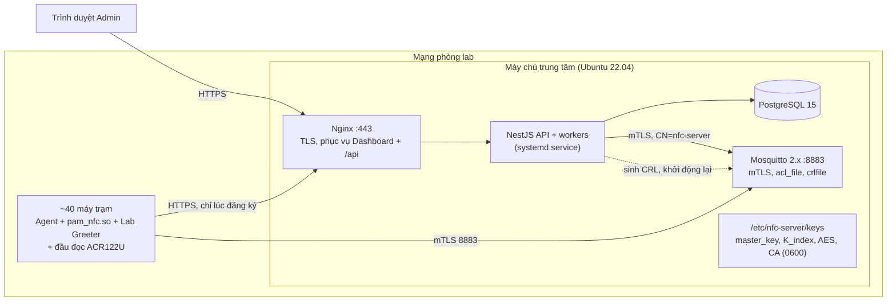

# 🚀 Deployment

> Triển khai cho quy mô pilot: một phòng máy ~40 máy trạm Ubuntu 22.04, một máy chủ trung tâm. Ưu tiên đơn giản, dựng lại được, không phụ thuộc dịch vụ đám mây.

## Environments

| Môi trường | Ở đâu | Mục đích | Cách triển khai |
|---|---|---|---|
| Development | Máy dev + VM Ubuntu 22.04 (như môi trường spike) | Phát triển Agent/Server, chạy harness S7b/S10/S11 | Chạy trực tiếp, Mosquitto/PostgreSQL cục bộ |
| Staging (demo) | 1 VM server + 2–3 VM/PC máy trạm | Kiểm thử tích hợp, demo bảo vệ | Giống production, dữ liệu giả |
| Production (pilot) | 1 máy chủ trong mạng phòng lab + ~40 máy trạm | Vận hành thật | Thủ công theo quy trình bên dưới, có checklist |

## Topology



Một máy chủ là đủ cho ~40 máy: tải là vài heartbeat/giây và vài lô outbox mỗi phút. Server sập không làm máy trạm ngừng cho quẹt thẻ trong thời hạn lease (NFR-A01), nên không cần cụm dự phòng cho MVP.

## Infrastructure

| Thành phần | Phiên bản | Cấu hình chính | Ghi chú |
|---|---|---|---|
| Máy chủ | Ubuntu 22.04 LTS, 2 vCPU, 4 GB RAM, 40 GB đĩa | NTP bật | Đặt IP tĩnh hoặc tên DNS nội bộ cố định (máy trạm cần biết địa chỉ) |
| PostgreSQL | 15 từ PGDG (`apt.postgresql.org`) | Chỉ nghe `localhost` | Migration theo `07-data/migrations.md` |
| Mosquitto (phải là bản liên kết **OpenSSL**: bản liên kết LibreSSL, ví dụ image `eclipse-mosquitto` mặc định, không nhận chứng chỉ client Ed25519, D-025) | 2.0.x | `listener 8883`, `require_certificate true`, `use_identity_as_username true`, `acl_file`, `crlfile`, `persistence true` | Tệp CRL luôn tồn tại (S9) |
| NestJS | Node.js 20.18.1 đóng trong bundle | systemd service, user riêng `nfcsrv` | Đọc khóa từ `/etc/nfc-server/keys` |
| Nginx | bản Ubuntu | TLS, reverse proxy `/api`, phục vụ build Dashboard | Chứng chỉ TLS do CA nội bộ ký |
| Máy trạm | Ubuntu 22.04 Desktop, LightDM, đầu đọc ACR122U | Theo Master Image bên dưới | |

## Master Image Máy Trạm (checklist)

Gom từ D-006, D-009, D-010, D-014, ADR-004, ADR-005, ADR-006, S7b, S10, S11.

| # | Mục | Nội dung |
|---|---|---|
| 1 | Display manager | Gói `nfc-agent` cài `/usr/share/lightdm/lightdm.conf.d/99-lab-greeter.conf`: `greeter-session=lab-greeter` và `/usr/share/xgreeters/lab-greeter.desktop`: `Exec=/usr/lib/nfc-agent/lab-greeter-wrapper.sh`; chọn `lightdm` làm mặc định (bản ghi crash ở `/var/lib/lightdm`) |
| 2 | PAM | Gói cài `/lib/x86_64-linux-gnu/security/pam_nfc.so`, thêm `auth sufficient pam_nfc.so` ngay trước `@include common-auth` trong `/etc/pam.d/lightdm`; giữ đăng nhập mật khẩu dự phòng |
| 3 | Agent | Cài gói `.deb` `nfc-agent` bên dưới: venv `/opt/nfc-agent/venv`, lệnh `/usr/bin/nfc-agent`, unit `/lib/systemd/system/nfc-agent.service` với hardening ADR-006 (`CAP_CHOWN`); kiểm tra `pcscd`, `libccid` bật |
| 3b | Đầu đọc | Gói cài cấu hình chặn driver kernel `pn533_usb`, `pn533`, `nfc` (`/etc/modprobe.d/blacklist-nfc-pn533.conf`); nếu không, kernel chiếm ACR122U và `pcscd` không thấy đầu đọc (S1) |
| 4 | Neo tin cậy | Kỹ thuật viên đặt `/etc/nfc-agent/ca.pem` và địa chỉ server trong `/etc/nfc-agent/agent.conf` theo site; mẫu từ gói ở `/usr/share/doc/nfc-agent/agent.conf.example` (gói không chứa CA hay cấu hình site) |
| 5 | Profile dùng chung | Tạo `student` (và profile khác nếu cần) thuộc nhóm `labstudent`, `passwd -l`, không sudo |
| 6 | Chặn đường vòng | `sshd`: `DenyGroups labstudent`; tắt linger cho `labstudent` |
| 7 | GNOME | dconf khóa cưỡng bức: `lock-enabled=false`, `disable-lock-screen=true`, `disable-user-switching=true`; `dconf update` |
| 8 | Ổn định | Gỡ/tắt `snapd-desktop-integration` (S7b) |
| 9 | Tài khoản dự phòng | Tài khoản quản trị cục bộ có mật khẩu cho kỹ thuật viên (BR-004, D-007.2) |
| 10 | Đồng hồ | NTP bật, `Asia/Ho_Chi_Minh` |
| 11 | Phần cứng (khuyến nghị) | Mật khẩu BIOS, khóa thứ tự boot (`threat-model.md`) |
| 12 | **Làm sạch trước khi clone** | Xóa `/etc/machine-id` (để trống), xóa `/var/lib/nfc-agent/` (gồm `identity/` và `edge.db`); **giữ** `ca.pem` |

### Đóng gói Agent

Build trên Ubuntu 22.04 amd64 có `build-essential libpam0g-dev python3-venv python3-pip dpkg-dev`:

```bash
bash edge/packaging/build-deb.sh
# Optional Debian revision: DEB_REVISION=2 bash edge/packaging/build-deb.sh
sudo apt install ./edge/dist/nfc-agent_0.1.0-1_amd64.deb
```

Phiên bản lấy từ `edge/pyproject.toml`, revision mặc định `1`; giữ bản `.deb` cũ để rollback. Gói chứa wheel Agent và runtime đã ghim, không tải pip khi cài (cần có sẵn các phụ thuộc Ubuntu để cài hoàn toàn offline). `postinst` dựng lại venv dùng system packages, tạo `/etc/nfc-agent`, chuẩn hóa dòng PAM và bật/khởi động Agent (upgrade dùng `try-restart`). Không restart LightDM; reboot để kích hoạt greeter và blacklist đầu đọc. Gỡ gói xóa dòng PAM trước khi gỡ module; cả `remove` và `purge` đều giữ `/var/lib/nfc-agent` và `/etc/nfc-agent` (D-033.7); làm sạch image chỉ theo mục 12.

### Triển khai Server

Build trên Ubuntu 22.04 amd64 có Internet và `curl`, `tar`, `xz-utils`:

```bash
bash deploy/prod/build-bundle.sh
# Revision mới cho mỗi bundle khác nội dung:
BUNDLE_REVISION=2 bash deploy/prod/build-bundle.sh
```

Script tải Node.js 20.18.1 và kiểm SHA-256 theo `SHASUMS256.txt` của bản phát hành, dùng runtime này và pnpm 10.11.0 để build. Server được cài dependencies production bằng `pnpm install --frozen-lockfile --prod` trong bản sao sạch chứa `package.json`, lockfile, `dist/`, `migrations/`; không cần workspace. Build kiểm nạp và chạy Argon2 native trên Linux. Bundle `deploy/dist/nfc-server-0.1.0-1.tar.gz` gồm runtime, Server, contracts, Dashboard và toàn bộ script/template triển khai; máy đích không cần Node hay pnpm cài sẵn.

Cài trên máy chủ Ubuntu 22.04 amd64 có systemd và Internet để tải các gói APT (chỉ dùng bundle tin cậy được build từ repo):

```bash
sudo SERVER_NAME=lab-server.local SERVER_IP=192.168.1.10 \
  bash deploy/prod/install-server.sh deploy/dist/nfc-server-0.1.0-1.tar.gz
```

`SERVER_NAME` là tên DNS máy trạm dùng, bắt buộc lần đầu; `SERVER_IP` tùy chọn để thêm IP vào SAN. Hai giá trị được giữ trong `server.env` cho các lần sau. DNS hoặc `/etc/hosts` của máy trạm phải phân giải đúng tên này. Installer cài PostgreSQL 15 từ PGDG, Nginx, Mosquitto bản Ubuntu liên kết OpenSSL và sudo; tạo user không có shell đăng nhập `nfcsrv`, role/database `nfclab`, PKI EC P-256 và các khóa ứng dụng. CA có hạn 10 năm, các chứng chỉ broker, Nginx và client Server riêng biệt có hạn 5 năm. Tệp cấu hình môi trường và PKI đã có không bị ghi đè.

| Đường dẫn | Nội dung / quyền |
|---|---|
| `/opt/nfc-server/releases/<version>/` | Bundle tự chứa, root sở hữu; giữ 3 release mới nhất sau khi health thành công |
| `/opt/nfc-server/current` | Symlink release đang chạy, chỉ đổi sau migration thành công |
| `/etc/nfc-server/server.env` | Bí mật JWT, mật khẩu CSDL và cấu hình site; `0600 nfcsrv`, chỉ tạo lần đầu |
| `/etc/nfc-server/keys/` | CA, client MQTT, khóa UID/master; thư mục `0700 nfcsrv`, khóa `0600` |
| `/etc/nfc-server/ca-public/ca.crt` | Chỉ chứng chỉ CA công khai, `0644`; Mosquitto và master image dùng bản này |
| `/var/lib/nfc-server-crl/crl.pem` | Server sinh CRL nguyên tử; thư mục riêng `0750 nfcsrv:mosquitto`, tệp `0644`; home `/var/lib/nfc-server` giữ `0750 nfcsrv:nfcsrv` |
| `/etc/mosquitto/certs/broker.{crt,key}` | Chứng chỉ broker; khóa `0640 root:mosquitto` |
| `/etc/mosquitto/conf.d/nfc.conf`, `/etc/mosquitto/nfc-acl.conf` | Listener mTLS 8883 và ACL theo CN |
| `/etc/nginx/nfc-server/tls.{crt,key}` | Chứng chỉ HTTPS riêng; khóa `0600 root` |
| `/etc/nginx/sites-available/nfc-server` | Dashboard, proxy `/api/`, chuyển HTTP sang HTTPS |
| `/etc/systemd/system/nfc-server.service`, `/etc/sudoers.d/nfc-server` | Service `nfcsrv` và quyền restart Mosquitto giới hạn đúng lệnh |
| `/var/backups/nfc-server/pre-<version>-<timestamp>.dump` | `pg_dump -Fc` trước migration nếu CSDL có bảng; chỉ root đọc |

Installer dừng Server, sao lưu CSDL rồi chạy migration từ thư mục `server/` của release mới. Migration thất bại giữ `current` cũ, chạy lại release cũ và in đường dẫn dump; không tự khôi phục CSDL. Server khởi động trước, chờ tối đa 30 giây để sinh CRL rồi restart Mosquitto, kiểm Nginx và chờ health tối đa 60 giây (CSDL/MQTT phải `ok`, CRL không gần hết hạn). Lỗi sau khi dừng service cũng thử chạy lại release cũ; kiểm log nếu cấu hình hoặc migration mới không tương thích. Sao lưu khóa riêng và CSDL ra ngoài máy chủ theo mục Sao Lưu.

Nâng cấp bằng cùng lệnh với bundle mới, không cần truyền lại `SERVER_NAME`. Dùng version/revision khác cho mỗi nội dung phát hành; release cùng version được tái sử dụng. Rollback về release còn giữ:

```bash
sudo bash /opt/nfc-server/current/deploy/rollback.sh 0.1.0-1
```

Rollback chỉ đổi symlink và khởi động lại Server. Nếu migration mới không tương thích với mã cũ, có thể cần khôi phục dump trước nâng cấp; script cảnh báo và không tự restore (ưu tiên Expand-first theo `07-data/migrations.md` §3.1).

Tạo Admin đầu tiên (mật khẩu nhập hai lần không hiển thị, truyền qua stdin):

```bash
sudo bash /opt/nfc-server/current/deploy/create-admin.sh admin "Quản trị phòng máy"
```

Sao chép `/etc/nfc-server/ca-public/ca.crt` vào master image thành `/etc/nfc-agent/ca.pem`; đặt `[server] url = https://lab-server.local` trong `/etc/nfc-agent/agent.conf`. Trình duyệt Admin cũng cần tin cậy CA nội bộ này.

## Quy Trình Triển Khai Phòng Máy (đầu học kỳ)

| Bước | Ai | Việc | Kiểm tra |
|---|---|---|---|
| 1 | Admin | Dựng/cập nhật Server, chạy migration, kiểm `GET /system/health` | `db`, `mqtt` = `ok`, không có `crl_expiring` |
| 2 | Kỹ thuật viên | Clone Master Image ra các máy (Clonezilla/PXE), bật máy | Màn hình Lab Greeter hiện "chưa có dữ liệu" |
| 3 | Admin | Dashboard → Yêu cầu đăng ký → "Duyệt tất cả" cho Zone, tiền tố tên máy | Số yêu cầu = số máy đã clone; xử lý riêng các yêu cầu có cờ trùng |
| 4 | Admin | Cấu hình profile mặc định cho máy/zone, nhập user, nhóm, thẻ, lịch | `/schedules/validate` không có cảnh báo `missing_profile` |
| 5 | — | Máy nhận snapshot đầu tiên | Dashboard: mọi máy `online`, `in_sync`, `trust_state = Fresh` |
| 6 | Kỹ thuật viên | Quẹt thử một thẻ trong ca và một thẻ ngoài ca trên vài máy | Nhật ký có `granted` và `denied(out_of_schedule)` |

Cài lại một máy giữa kỳ: clone lại máy đó (hoặc `nfc-agent reenroll`) → Admin duyệt "cài lại" yêu cầu có cờ trùng.

## Cập Nhật Phần Mềm & Rollback

| Thành phần | Cách cập nhật | Rollback |
|---|---|---|
| Server | Dừng service → sao lưu CSDL → migration (Expand trước, `migrations.md` §3.1) → khởi động | Khôi phục bản sao lưu vừa tạo + bản build trước; máy trạm không bị ảnh hưởng nhờ lease, version tự sửa nhờ D-016 |
| Agent | Gói `.deb` qua APT nội bộ hoặc script, trong giờ không có ca | Cài lại bản `.deb` cũ; `edge.db` tương thích ngược theo `PRAGMA user_version` |
| Greeter / PAM | Cùng gói Agent; thử trên 1 máy trước | Wrapper tự rơi về greeter chuẩn nếu greeter mới crash (S10) |

## Sao Lưu

| Đối tượng | Cách | Tần suất | Giữ |
|---|---|---|---|
| PostgreSQL | `pg_dump` nén, ra đĩa/máy khác | Hằng đêm + trước mỗi lần cập nhật | 14 bản |
| Khóa (`master_key`, `K_index`, khóa AES, khóa CA) | Sao chép mã hóa, cất ngoài máy chủ | Một lần khi tạo, và khi đổi khóa AES | Vĩnh viễn |
| Cấu hình Mosquitto, Nginx | Lưu trong repo cấu hình | Khi đổi | — |
| Máy trạm | Không sao lưu; dựng lại từ Master Image + đăng ký lại | — | — |

**RPO đã chấp nhận:** hỏng CSDL server thì mất tối đa 24h nhật ký và thay đổi quản trị kể từ bản sao lưu gần nhất, vì máy trạm đã xóa nhật ký sau khi server xác nhận. Đây là sự cố hiếm và hệ thống tự đồng bộ lại snapshot/lease sau khôi phục (D-016).

## Bảng Tham Số

Một nơi duy nhất cho mọi tham số trước đây ghi "chốt sau". Giá trị chọn theo quy mô ~40 máy và lịch học thông thường. Thời lượng lease, cảnh báo trước hết phiên và hạn phiên tối đa là hằng số trong mã Server (`SNAPSHOT_PARAMETERS`, gửi xuống trong `snapshot.parameters`): đổi phải sửa mã và triển khai lại, MVP không có trang Settings (D-033). Tham số chỉ của Edge là hằng số trong Agent; `agent.conf` chỉ chứa địa chỉ server và CA.

| Tham số | Giá trị | Ở đâu | Lý do / ghi chú |
|---|---|---|---|
| Thời lượng lease `D` | 24h | Server → snapshot/lease | Server sập < 1 ngày không ảnh hưởng; thu hồi thẻ có hiệu lực chậm nhất 1 ngày trên máy offline (ADR-001) |
| `CLOCK_FLOOR_TOLERANCE` | 60s | Agent | D-018 |
| `CLOCK_SKEW_WARN_THRESHOLD` | 60s | Agent | Chỉ cảnh báo |
| Cảnh báo trước hết phiên `W` | 5 phút | Server → snapshot | Kịp lưu bài |
| Hạn phiên tối đa | 12h | Server → snapshot | Chặn lịch 24/7 sinh phiên vô hạn |
| Chu kỳ heartbeat | 30s | Agent | ADR-002 |
| Số heartbeat bỏ lỡ → offline | 3 (~90s) | Server | BR-019 |
| Ngưỡng `Stuck` (online, lệch version) | 10 phút | Server | Dashboard cờ `stuck_sync` |
| Thời gian chờ Draining sau reboot | 5 phút | Server | XINV-008; báo cáo đến muộn hơn vẫn thay được (D-015) |
| Cờ "quá hạn chưa kết thúc" | 10 phút sau `expires_at` | Server | `session-expiry.md` EF-7 |
| Chu kỳ ghi `last_alive_at` | 5 phút | Agent | `ended_at` ước lượng lệch ≤ 5 phút |
| Ghi lease xuống đĩa | khi `trusted_until` tiến ≥ 5 phút | Agent | ADR-003 §5 |
| Hạn mức outbox | 50.000 mục | Agent | Nhiều tuần offline; đầy thì chặn quẹt để không mất nhật ký |
| Lô outbox | 50 mục, 1 lô chờ ACK | Agent | ADR-002 §5 |
| Hiệu lực "cho phép đăng nhập một lần" | 30s | Agent | Từ `granted` tới khi PAM hỏi |
| Agent chờ trước khi greeter sẵn sàng | 10s | Greeter | Quá thì greeter hiện `data_stale` và đường dự phòng |
| Đẩy outbox khi tắt máy có kế hoạch | tối đa 5s | Agent | Không giữ máy tắt lâu; phần còn lại gửi lần sau |
| Teardown | 2s SIGTERM, tổng 3s, thêm tới 5s | Agent | ADR-008, S7b |
| PAM chờ Agent | 3s | `pam_nfc.so` | ADR-005 |
| Ngưỡng fallback greeter | 3 crash / 60s | Wrapper | < giới hạn 5 lần/10s của systemd (S10) |
| Backoff kết nối lại | 1s → 60s, jitter [0.8, 1.2] | Agent | ADR-002 §6 |
| MQTT Session Expiry | 1h | Agent | ADR-002 §3 |
| Cửa sổ gộp thay đổi trước khi dựng snapshot | 2s | Server | Gộp sửa hàng loạt thành một version |
| Reconcile định kỳ | 1h | Server | Lưới an toàn cho XINV-005 |
| Kích thước snapshot tối đa | 1 MB | Server | ~vài nghìn user; vượt thì báo lỗi dựng snapshot |
| Giữ snapshot cũ | 5 bản/máy | Server | `migrations.md` §4 |
| Chứng chỉ máy / CA / CRL | 3 năm / 10 năm / 10 năm, CRL sinh lại hằng ngày | Server | ADR-002, S9 |
| JWT Admin | 8h, HS256, không có refresh token | Server | `api.md` |
| Mật khẩu Admin | 10–128 ký tự, băm Argon2id | Server | NFR-SEC06 |
| Khóa đăng nhập sai | 5 lần sai theo username + IP → khóa 15 phút (bộ đếm trong RAM, mất khi khởi động lại) | Server | `api.md` Rate Limiting |
| Giới hạn tần suất | xem `api.md` | Server | |

## Configuration Management

| Cấu hình | Biến / tệp | Mặc định | Mô tả |
|---|---|---|---|
| Kết nối CSDL | `DATABASE_URL` | — | PostgreSQL cục bộ |
| Khóa ký JWT Admin | `JWT_SECRET` | — | ≥ 32 ký tự ngẫu nhiên, trong `EnvironmentFile` quyền `0600`. Đổi hoặc mất khóa chỉ làm mọi Admin phải đăng nhập lại, nên không cần sao lưu |
| Cổng HTTP | `PORT` | `8000` | Chỉ nghe `127.0.0.1`, sau Nginx |
| Broker (kết nối của chính Server) | `MQTT_URL` | rỗng | `mqtts://localhost:8883` khi triển khai. Rỗng thì Server không kết nối broker (test, CI) và health báo `mqtt: "disabled"` |
| mTLS của Server tới broker | `MQTT_CA`, `MQTT_CERT`, `MQTT_KEY` | `CA_CERT_FILE`, `KEYS_DIR/nfc-server.crt`, `KEYS_DIR/nfc-server.key` | Chứng chỉ `CN = nfc-server` (ACL của broker cấp quyền theo CN) |
| Thư mục hợp đồng bản tin | `CONTRACTS_DIR` | `contracts/` cạnh `server/` | Server kiểm Hello/heartbeat theo `contracts/schemas` lúc chạy; đặt biến này khi đóng gói ra chỗ khác |
| Thư mục khóa | `KEYS_DIR` | `/etc/nfc-server/keys` | `0700`, chủ `nfcsrv` |
| Tệp khóa UID thẻ | `KEYS_DIR/uid-index.key`, `KEYS_DIR/uid-enc-<key_id>.key` | — | Mỗi tệp 32 byte ngẫu nhiên dạng 64 ký tự hex, quyền `0600` (Server từ chối khởi động nếu tệp đọc được bởi group/others). `uid-index.key` là `K_index` của blind index (không xoay trong MVP); `uid-enc-*` là khóa AES-256-GCM, mọi tệp đều được nạp để giải mã. Tạo bằng `pnpm keys:init`: chỉ tạo tệp còn thiếu, không bao giờ ghi đè. Thiếu khóa thì Server dừng ngay lúc khởi động |
| Khóa AES đang dùng để mã hóa UID | `UID_ENC_KEY_ID` | `k1` | `^[A-Za-z0-9_-]{1,32}$`. Xoay khóa: đặt id mới rồi chạy `pnpm keys:init` để tạo tệp, giữ tệp cũ để đọc bản ghi cũ |
| Khóa chủ `master_key` | `KEYS_DIR/km-master.key` | — | 32 byte dạng 64 ký tự hex, quyền `0600`, tạo bằng `pnpm keys:init` (không ghi đè). Mọi `K_m` dẫn xuất từ đây (ADR-007); thiếu tệp thì Server từ chối khởi động; mất hoặc đổi khóa thì phải đăng ký lại mọi máy |
| CA ký chứng chỉ máy trạm | `CA_CERT_FILE`, `CA_KEY_FILE` | `KEYS_DIR/ca.crt`, `KEYS_DIR/ca.key` | Khóa EC P-256, quyền `0600`. Thiếu hoặc sai thì Server từ chối khởi động (D-024.6) |
| Tệp CRL cho Mosquitto | `CRL_FILE` | `/var/lib/nfc-server-crl/crl.pem` khi triển khai | Trong mã mặc định là `KEYS_DIR/crl.pem`; installer đặt trong thư mục riêng ngoài home của service để Mosquitto đọc được. Installer chỉ chuyển dòng `CRL_FILE=/var/lib/nfc-server/crl/crl.pem` cũ sang đường dẫn mới, giữ nguyên cấu hình tùy chỉnh. Phải trùng `crlfile` của broker. Server ghi lại lúc khởi động, hằng ngày và sau mỗi lần thu hồi (ghi tệp tạm rồi đổi tên) |
| Lệnh khởi động lại broker | `BROKER_RESTART_CMD` | rỗng trong mã | Chạy sau mỗi lần thu hồi chứng chỉ (S9: `SIGHUP` không ngắt kết nối đang mở). Installer đặt `sudo -n /usr/bin/systemctl restart mosquitto` và cài sudoers giới hạn đúng lệnh cho `nfcsrv`; rỗng thì chỉ ghi CRL và log cảnh báo |
| Địa chỉ broker trả cho máy khi duyệt đăng ký | `BROKER_HOST`, `BROKER_PORT` | `localhost`, `8883` | Tên phải khớp SAN trong chứng chỉ broker |
| Worker dựng snapshot | `SNAPSHOT_WORKER` | `on` | `off` tắt vòng lặp đọc `server_outbox` (bảo trì, test); event dồn lại và hiện ở `outbox_backlog` |
| Tham số nghiệp vụ | bảng `Bảng Tham Số` | như trên | Đọc lúc khởi động |
| Agent | `/etc/nfc-agent/agent.conf` (INI) | — | `[server] url` (HTTPS của Server, chỉ dùng lúc đăng ký) và `ca_file` (mặc định `/etc/nfc-agent/ca.pem`, neo tin cậy duy nhất, D-014.3). Thiếu `url` thì máy không tự đăng ký. Địa chỉ broker không nằm ở đây: Server trả về khi duyệt và Agent lưu trong `identity/identity.json` (mẫu: `edge/packaging/agent.conf.example`) |
| Thư viện Agent | `cryptography>=3.4` (apt `python3-cryptography` 3.4.8 dùng được), `paho-mqtt>=2.0,<3` | — | Ubuntu 22.04 chỉ có `python3-paho-mqtt` 1.5 nên paho cài bằng pip vào venv `/opt/nfc-agent/venv` (venv dùng `include-system-site-packages = true`) |

## Health Checks

| Kiểm tra | Kỳ vọng | Thời gian chờ |
|---|---|---|
| `GET /api/v1/system/health` | 200, `db`/`mqtt` = `ok`, `outbox_backlog` nhỏ, không có `crl_expiring` | 5s |
| `systemctl is-active postgresql mosquitto nfc-server nginx` | `active` | — |
| Máy trạm: `systemctl is-active nfc-agent lightdm pcscd` | `active` | — |
| Dashboard | Mọi máy `online`, `in_sync`, `Fresh` | — |
