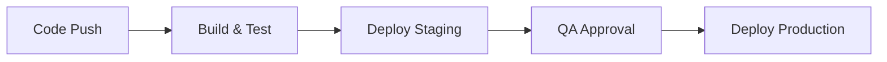

# 🚀 Deployment

## Environments

| Environment | URL | Mục đích | Deploy strategy |
|------------|-----|----------|----------------|
| Development | | Phát triển | Push to branch |
| Staging | | Testing, QA | Merge to main |
| Production | | Live | Manual approval |

## Deployment Pipeline

## Infrastructure

| Component | Provider | Configuration | Mô tả |
|-----------|----------|--------------|--------|
| | | | |

## Rollback Plan

| Step | Action | Responsible | ETA |
|------|--------|-------------|-----|
| 1 | | | |

## Configuration Management

| Config | Environment Variable | Default | Mô tả |
|--------|---------------------|---------|--------|
| | | | |

## Health Checks

| Endpoint | Expected | Timeout |
|----------|----------|--------|
| /health | 200 OK | 5s |
| /ready | 200 OK | 5s |
