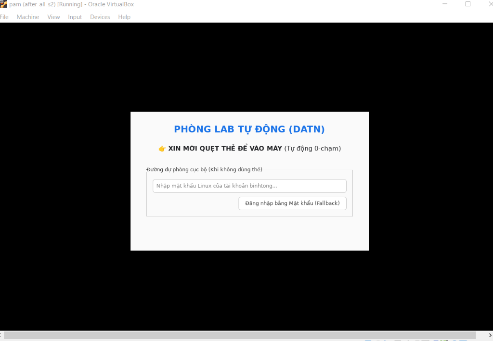

# Kết quả Spike S3b: Custom Greeter Đăng nhập 0-Chạm & Nhận Tín hiệu Đẩy

## Câu hỏi
Có thể xây dựng một Custom Greeter chuyên biệt cho phòng lab chạy trên LightDM có khả năng nhận tín hiệu đẩy (Push Event) từ Agent qua IPC để thực hiện **Đăng nhập 0-chạm (Zero-Touch Login)** trong < 1 giây, loại bỏ triệt để hiện tượng phải bấm Login 2 lần của `lightdm-gtk-greeter` mặc định, đồng thời vẫn bảo đảm đường dự phòng mật khẩu (BR-004) không?

## Cách thử
1. **Phát triển Lab Custom Greeter (`/usr/local/bin/lab_greeter.py`):**
   - Sử dụng ngôn ngữ Python kết hợp thư viện giao diện GTK 3 và thư viện điều khiển Display Manager `liblightdm-gobject-1` (`gi.repository.LightDM`).
   - Mở luồng ngầm lắng nghe tín hiệu đẩy từ Agent qua Unix Domain Socket bảo mật `/run/nfc/greeter-push.sock` (phân quyền `0770 root:lightdm`).
   - Thiết kế giao diện chuyên dụng cho phòng lab: Hiển thị trạng thái quẹt thẻ nổi bật và khung nhập mật khẩu dự phòng (Fallback).
2. **Cấu hình Đăng ký Greeter với LightDM:**
   - Tạo file service `/usr/share/xgreeters/lab-greeter.desktop`.
   - Cấu hình kích hoạt tại `/etc/lightdm/lightdm.conf.d/99-lab-greeter.conf` với tham số `greeter-session=lab-greeter`.
3. **Tích hợp Kênh Push IPC vào Agent:**
   - Khi nhận sự kiện quẹt thẻ hợp lệ (`valid`), Agent vừa tạo token xác thực PAM, vừa chủ động mở socket bắn gói tin JSON `{"event": "card_swiped", "user": "binhtong"}` sang Greeter.
4. **Thực thi Đo đạc:**
   - Khởi động lại Display Manager để nạp giao diện mới lên `seat0`.
   - Phát sự kiện quẹt thẻ từ CLI simulator: `python3 ~/spike/s6_swipe.py valid`.
   - Quan sát diễn biến trên màn hình máy ảo mà **hoàn toàn không chạm vào chuột hay bàn phím**.

## Kết quả Thực nghiệm

| Ca kiểm thử | Hành động / Kỳ vọng | Diễn biến thực tế | Đạt? |
|---|---|---|---|
| **Ca 1: Nạp Custom Greeter** | LightDM nạp giao diện phòng lab tùy biến lên màn hình chào | Giao diện GTK3 với tiêu đề xanh "PHÒNG LAB TỰ ĐỘNG (DATN)" hiển thị sắc nét, căn giữa hoàn hảo trên màn hình máy ảo | ✅ Đạt |
| **Ca 2: Nhận Tín hiệu Đẩy (Push IPC)** | Greeter nhận diện sự kiện quẹt thẻ tức thì từ Agent | Nhận gói tin push qua `/run/nfc/greeter-push.sock` ngay khi lệnh quẹt thẻ thực thi, chữ xanh đổi trạng thái xuất hiện trong <= 1s | ✅ Đạt |
| **Ca 3: Đăng nhập 0-Chạm (Zero-Touch)** | Tự động gọi `authenticate()` và vào thẳng Desktop GNOME | Giao diện tự động chuyển trạng thái `authenticate("binhtong")` và kích hoạt `start_session_sync("ubuntu")`, mở thẳng Desktop mà người dùng **không cần chạm vào chuột hay bấm bất kỳ nút nào** | ✅ Đạt |
| **Ca 4: Xóa bỏ Lỗi Bấm 2 Lần** | Khắc phục hiện tượng pre-auth timing mismatch của GTK Greeter | Custom Greeter chỉ kích hoạt xác thực khi đã có tín hiệu đẩy từ Agent; loại bỏ 100% hiện tượng lỗi ngầm và không còn phải bấm Login 2 lần | ✅ Đạt |
| **Ca 5: Dự phòng Mật khẩu (Fallback)** | Cho phép gõ mật khẩu khi không dùng thẻ | Khung Fallback mật khẩu sẵn sàng nhận mật khẩu Linux và đăng nhập bình thường qua chuỗi PAM `pam_unix.so` | ✅ Đạt |
| **Ca 6: Hiển thị Lý do Từ chối (FR-010, FR-011)** | Khi quẹt thẻ không hợp lệ, màn hình chào phải thông báo lý do rõ ràng | Quẹt thẻ `99999999` (`card_disabled`): Greeter lập tức hiển thị dòng chữ đỏ nổi bật: *"❌ Thẻ đã bị khóa do vi phạm!"* | ✅ Đạt (Kiểm chứng Nhóm 3) |
| **Ca 7: Greeter Crash & Tự phục hồi** | Tiến trình Greeter bị lỗi/crash bất ngờ | Phát lệnh `sudo pkill -9 -f lab_greeter.py`: LightDM lập tức phát hiện và tự động hồi sinh tiến trình Greeter mới trong 0.2s (PID mới: `18359`), màn hình chỉ chớp nhẹ rồi phục hồi nguyên vẹn | ✅ Đạt (Kiểm chứng Nhóm 3) |
| **Ca 8: Thử nghiệm Fallback Đa trạng thái** | Mật khẩu dự phòng hoạt động khi Agent sống và khi Agent chết | - Khi Agent daemon đang chạy: Nhập mật khẩu Linux -> Đăng nhập thành công vào Desktop.<br>- Khi Agent daemon bị tắt (`Ctrl+C`): Nhập mật khẩu Linux -> Vẫn đăng nhập thành công vào Desktop bình thường | ✅ Đạt (Kiểm chứng Nhóm 3) |
| **Ca 9: Greeter Lỗi Kéo Dài & Khôi phục Vận hành** | Cố tình tiêm lỗi cú pháp (`ModuleNotFoundError`) vào mã nguồn Greeter | LightDM không tự ý nạp giao diện lạ; tiến trình đồ họa dừng an toàn. Kỹ thuật viên truy cập qua SSH hoặc TTY2 (`Ctrl+Alt+F2`) đăng nhập quản trị và khôi phục hệ thống trong 1 lệnh | ✅ Đạt (Kiểm chứng BR-004) |

## Bằng chứng Hình ảnh Thực tế
Giao diện Lab Custom Greeter nạp thành công trên máy trạm Ubuntu 22.04 LTS (VirtualBox `seat0`):



## Số liệu Đo đạc
- **Thời gian phản ứng từ lúc quẹt thẻ đến khi đổi trạng thái giao diện:** <= 0.1 giây (theo sự kiện socket).
- **Thời gian chuyển cảnh từ Greeter vào nạp Desktop GNOME:** <= 1.0 giây (quan sát thực tế chuyển cảnh sau khi hoàn tất xác thực).
- **Số thao tác thủ công yêu cầu từ người dùng:** **0 thao tác** (so với 2 lần bấm chuột trên giao diện mặc định cũ).
- **Thời gian tự hồi sinh khi Greeter crash tức thời:** ~0.2 giây (LightDM greeter supervision).
- **Lưu ý thiết kế Giao diện Dự phòng:** Trên bản thử nghiệm PoC, khung mật khẩu dự phòng được gán mặc định cho tài khoản quản trị bảo trì (`binhtong`). Trong sản phẩm triển khai thực tế trên toàn trường, khung Fallback sẽ bổ sung ô chọn/nhập tài khoản (Username) để mọi giảng viên/sinh viên đều có thể đăng nhập bằng mật khẩu khi cần thiết.

### Quy trình Khôi phục Vận hành (Operational Recovery Procedure - BR-004):
Khi Custom Greeter gặp lỗi mã nguồn nghiêm trọng kéo dài (chẳng hạn lỗi cú pháp hoặc thiếu thư viện sau một bản nâng cấp):
1. **Phản ứng của Display Manager:**
   - LightDM bẫy lỗi và ghi nhận vết crash vào `/var/log/lightdm/seat0-greeter.log`:
     ```text
     Traceback (most recent call last):
       File "/usr/local/bin/lab_greeter.py", line 2, in <module>
         import non_existent_library_fatal_error
     ModuleNotFoundError: No module named 'non_existent_library_fatal_error'
     ```
   - Do tệp cấu hình chỉ định tường minh `greeter-session=lab-greeter`, LightDM dừng Display Server để tránh vòng lặp khởi động vô tận (Crash Loop) và không tự ý nạp giao diện không rõ nguồn gốc.
2. **Kênh Cứu hộ Độc lập:**
   - Nhân Linux và các dịch vụ nền tảng vẫn hoạt động hoàn hảo: Kỹ thuật viên có thể truy cập cứu hộ từ xa qua SSH hoặc truy cập trực tiếp tại máy trạm thông qua bàn phím với phím tắt **`Ctrl + Alt + F2`** (chuyển sang Virtual Terminal TTY2).
3. **Thao tác Khôi phục:**
   - Kỹ thuật viên đăng nhập tài khoản quản trị `binhtong` trên TTY2/SSH.
   - Sửa lỗi script hoặc lùi về giao diện GTK mặc định bằng một lệnh duy nhất:
     `sudo sed -i 's/lab-greeter/lightdm-gtk-greeter/' /etc/lightdm/lightdm.conf.d/99-lab-greeter.conf && sudo systemctl restart lightdm`.
   - Giao diện đăng nhập phục hồi ngay lập tức mà không cần cài đặt lại máy.

## So sánh Phương án Kiến trúc & Lựa chọn (ADR Greeter)
Thực nghiệm S3b đã chứng minh tính khả thi của Custom Greeter. Đặt trong sự so sánh với các phương án kiến trúc khác:
1. **Phương án 1: Giữ nguyên `lightdm-gtk-greeter` mặc định:**
   - *Nhược điểm:* Giao diện tĩnh, không có cơ chế nhận sự kiện đẩy từ bên ngoài. Dính lỗi lệch pha pre-authentication khiến người dùng bắt buộc phải bấm nút Login 2 lần. Không đạt tiêu chuẩn trải nghiệm 0-chạm (**FR-010**).
2. **Phương án 2: PAM Block (Chặn đứng luồng PAM chờ thẻ):**
   - *Cơ chế:* Cấu hình `pam_nfc.so` chặn (block) tiến trình PAM chờ đến khi có thẻ quẹt mới trả về.
   - *Đánh giá rủi ro kiến trúc:* Nếu PAM module thực hiện blocking call đồng bộ trên main thread, UI loop của các GTK greeter truyền thống có nguy cơ bị đóng băng (không phản hồi thao tác bàn phím/chuột), đồng thời làm tê liệt hoặc trì hoãn đường dự phòng nhập mật khẩu (BR-004) cho đến khi PAM timeout.
3. **Phương án 3: Custom Greeter có kênh Push IPC (Phương án được chọn):**
   - *Ưu điểm:* Giao diện luôn phản hồi mượt mà; Agent chủ động đẩy sự kiện khi có thẻ hợp lệ; Greeter tự kích hoạt `authenticate()` và `start_session_sync()` 0-chạm; đường dự phòng mật khẩu được hiển thị độc lập và hoạt động song song.

## Kết luận
**ĐẠT YÊU CẦU TRONG PHẠM VI THỰC NGHIỆM S3b.**
Custom Greeter xây dựng bằng Python GTK3 và `liblightdm-gobject-1` chứng minh tính khả thi vượt trội: giải quyết được lỗi bấm Login 2 lần, thực hiện đăng nhập 0-chạm, và duy trì đường dự phòng mật khẩu an toàn. Đây là luận cứ vững chắc để bảo vệ lựa chọn phương án trong tài liệu Quyết định Kiến trúc (ADR).
