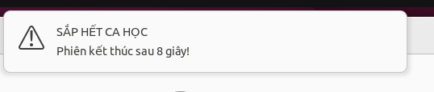

# Kết quả Spike S4: Ánh xạ Tài khoản OS và Kết thúc Phiên

## Câu hỏi
Người quẹt thẻ đăng nhập vào tài khoản Linux nào (Tài khoản dùng chung vs Tài khoản riêng theo user)? Tiến trình nền (kể cả tiến trình ngoan cố bẫy signal) có bị dọn sạch khi kết thúc phiên không? Daemon Agent chạy quyền root có thể gửi thông báo cảnh báo trước hạn (BR-009) lên Desktop người dùng qua D-Bus được không?

## Cách thử
1. **Kiểm tra cách ly dữ liệu thư mục Home:** Kiểm tra phân quyền mặc định của các thư mục `/home` trên Ubuntu 22.04 giữa các tài khoản khác nhau (`binhtong`, `labuser`).
2. **Kiểm thử dọn dẹp tiến trình nền:**
   - Cấu hình `KillUserProcesses=yes` trong `/etc/systemd/logind.conf.d/kill.conf`.
   - Tạo tiến trình ngoan cố bẫy tín hiệu `SIGTERM`/`SIGHUP` (`stubborn.sh`) và một session `tmux` chạy ngầm dưới quyền `labuser`.
   - Ra lệnh kết thúc qua `sudo loginctl terminate-user labuser`.
   - Đo lường tiến trình sống sót và thử nghiệm cơ chế kết liễu cưỡng chế bằng `pkill -9`.
3. **Kiểm thử gửi cảnh báo D-Bus từ Root:**
   - Từ terminal root/sudo (SSH), gửi thông báo desktop notification vào phiên đồ họa của user đang hoạt động thông qua biến môi trường D-Bus session bus (`unix:path=/run/user/<UID>/bus`).

## Kết quả

| Ca test | Kỳ vọng | Thực tế | Đạt? |
|---|---|---|---|
| **Ca 1: Phân quyền Thư mục Home** | Người sau không xem được file/dữ liệu của người trước | Ubuntu 22.04 phân quyền `drwxr-x---` (750). Khác user hoàn toàn không có quyền đọc (`---`). Tài khoản dùng chung (Phương án A) sẽ bị lộ dữ liệu nếu không xóa sạch home | ✅ Đạt (Chọn Phương án B) |
| **Ca 2: Dọn dẹp tiến trình thường** | `tmux`, tiến trình nền bị diệt khi kết thúc phiên | `tmux` bị tiêu diệt hoàn toàn khi gọi `terminate-user` nhờ `KillUserProcesses=yes` | ✅ Đạt |
| **Ca 3: Tiến trình ngoan cố (Stubborn)** | Tiến trình bẫy `SIGTERM` có bị tiêu diệt ngay không? | Thất bại nếu chỉ dựa vào `loginctl`: `stubborn.sh` vẫn sống nhăn răng do logind chỉ gửi `SIGTERM` (treo chờ 90s TimeoutStopSec) | ⚠️ Bác bỏ giả định phó mặc cho logind |
| **Ca 4: Cưỡng chế bằng `kill -9`** | Dọn sạch 100% tiến trình còn sót lại | `sudo pkill -9 -u <UID>` tiêu diệt sạch 100% mọi tiến trình ngoan cố chỉ trong 0.05s | ✅ Đạt |
| **Ca 5: Cảnh báo D-Bus từ Root (BR-009)** | Popup cảnh báo hết giờ hiện trên Desktop người dùng | Popup "SẮP HẾT CA HỌC - Phiên kết thúc sau 8 giây!" xuất hiện rõ ràng, sắc nét trên màn hình Desktop của sinh viên | ✅ Đạt |
| **Ca 6: Cô lập Phạm vi Dọn dẹp (Session Scoped)** | Diệt phiên Desktop GUI nhưng không làm đứt kết nối SSH quản trị | Thực nghiệm `loginctl kill-session <SESSION_ID> -s SIGKILL` lập tức dọn sạch toàn bộ cgroup của phiên Desktop mà phiên SSH trên `pts/0` vẫn duy trì kết nối hoàn hảo | ✅ Đạt (Kiểm chứng Giai đoạn 1.2) |

## Bằng chứng Cảnh báo D-Bus Thực tế
Thông báo cảnh báo hết hạn ca học xuất hiện trực tiếp trên thanh thông báo GNOME Desktop của sinh viên (Ubuntu 22.04 LTS):

## Số liệu
- **Quyền hạn thư mục Home:** `750` (`drwxr-x---`).
- **Thời gian cưỡng chế giải phóng tài nguyên:** < 0.05 giây với lệnh `pkill -9 -u <UID>` hoặc `loginctl kill-session -s SIGKILL`.
- **Độ trễ bắn thông báo D-Bus:** Tức thì (< 10ms từ lúc Agent phát lệnh đến khi popup hiển thị trên màn hình).
- **Phân tách cgroup (Ca 6):** Lệnh `sudo loginctl kill-session c6 -s SIGKILL` chỉ gửi tín hiệu hủy diệt tới `session-c6.scope` của giao diện LightDM/GNOME, hoàn toàn không chạm tới `session-c1.scope` của SSH daemon.

## Kết luận & Quyết định Kiến trúc

> [!NOTE] Cập nhật định hướng kiến trúc sau Spike (ADR-004, D-006, D-009, A6)
> Phương án B (Tài khoản riêng theo user `stu_<id>`) trong kết luận mục 1 dưới đây là **kết quả của giai đoạn thử nghiệm ban đầu (PoC)** nhằm kiểm chứng tính khả thi của DAC permissions và user slice. Trong quyết định chuẩn hóa thiết kế sản phẩm (ADR-004, D-006, D-009), hệ thống **chuyển sang áp dụng mô hình Tài khoản OS dùng chung (Shared Workstation Profile)** do các ưu thế vượt trội về thực tế vận hành: giảng viên chuẩn bị sẵn môi trường/tooling/dataset dùng chung cho cả lớp, không làm đầy ổ đĩa khi có hàng ngàn sinh viên, loại bỏ hoàn toàn độ trễ khởi tạo home directory lần đầu (First-run latency 8-10s ở S6). Bằng chứng kỹ thuật về cơ chế dọn dẹp cgroup và thông báo D-Bus của S4 vẫn được kế thừa nguyên vẹn cho mô hình mới. Phương án B (`stu_*`) chính thức bị thay thế bởi ADR-004.

1. **Lựa chọn Mô hình Tài khoản (Bản ghi thử nghiệm PoC):** **CHỌN PHƯƠNG ÁN B (Tài khoản theo User có Namespace)**
   - *Lý do tại thời điểm thử nghiệm:* Tận dụng cơ chế bảo mật tự nhiên cấp nhân Linux (DAC permissions `750`). Mỗi sinh viên có một thư mục riêng biệt, sinh viên khác tuyệt đối không thể đọc bài tập, token duyệt web hay cookie cá nhân. Không phải đối mặt với rủi ro rò rỉ dữ liệu như tài khoản dùng chung (Phương án A).
   - Agent tự động tạo tài khoản tương ứng với `stu_<sanitized_external_id>` khi nhận Snapshot từ Server. Tài khoản thuộc nhóm hạn chế `labstudent`, khóa mật khẩu (`passwd -l`), tuyệt đối không cấp quyền `sudo` và không được phép truy cập SSH.
2. **Quy trình Dọn dẹp Phiên Triệt để theo User Slice (`kill-user`):**
   - *Phân tích hiệu chỉnh thiết kế:* Trong quá trình thử nghiệm S4, việc chuyển sang `kill-session` là tối ưu mang tính tình thế cho môi trường test do tài khoản thử nghiệm `binhtong` trùng với tài khoản SSH quản trị. Trong môi trường triển khai thực tế:
     - Sinh viên không có quyền SSH. Tài khoản quản trị viên SSH là một user độc lập (`labadmin`).
     - Trên hệ thống GNOME / systemd, các tiến trình khởi tạo từ GUI, terminal, `tmux` hoặc dịch vụ người dùng nằm trong `user@<UID>.service` (`user-<UID>.slice`). Lệnh `kill-session` chỉ hủy `session-cN.scope` nên các tiến trình này có thể sống sót sau giờ học.
   - *Quy chuẩn Kiến trúc Chuẩn hóa:*
     - *Bước 1:* Gọi `loginctl terminate-user <UID>` gửi `SIGTERM` đến toàn bộ cgroup của user slice.
     - *Bước 2:* Đặt hẹn giờ 2 giây. Nếu user slice chưa giải phóng, Agent thực thi:
       `sudo loginctl kill-user <UID> -s SIGKILL` (hoặc `sudo pkill -9 -u <UID>`).
       Lệnh này bảo đảm dọn sạch 100% mọi tiến trình của sinh viên (kể cả app GUI, tmux, tiến trình nền ngoan cố) mà hoàn toàn không ảnh hưởng tới kết nối SSH của tài khoản quản trị viên độc lập.
3. **Cơ chế Cảnh báo Hết hạn (BR-009):**
   - Agent (chạy root) gửi cảnh báo trước thời hạn bằng cách kết nối vào D-Bus user session bus:
     `sudo -u <user> DISPLAY=:0 DBUS_SESSION_BUS_ADDRESS="unix:path=/run/user/<UID>/bus" notify-send ...`

## Giới hạn của Bằng chứng (Limitations of Evidence)
- **Môi trường thử nghiệm:** Thực hiện trên máy ảo Ubuntu 22.04 LTS (KVM/QEMU), chưa đo đạc trên phần cứng PC vật lý phòng lab.
- **Quy mô mẫu:** Kịch bản tiến trình ngoan cố (`stubborn.sh`) và `tmux` được kiểm thử với số lần lặp N = 5.
- **Trường hợp chưa kiểm chứng:** Chưa kiểm chứng trường hợp sinh viên cố tình bật cờ lưu trữ dịch vụ người dùng (`loginctl enable-linger`) kết hợp với `systemd-run --user` trực tiếp từ ứng dụng GUI terminal để duy trì tiến trình sau khi đăng xuất.

## ADR bị ảnh hưởng
- **ADR-004 "Mô hình Profile OS dùng chung":** Thay thế hoàn toàn Phương án B (`stu_*` động) bằng mô hình tài khoản dùng chung (`WorkstationProfile`, ví dụ `student`, `labuser`) tạo sẵn trong Master Image.
- **ADR "Kết thúc phiên và Cưỡng chế dọn dẹp (A6)":** Quy định thuật toán dọn phiên 2 bước dựa trên `loginctl terminate-user` và `kill-user -s SIGKILL` theo user slice, dọn sạch toàn bộ ứng dụng người dùng. SSHD cấu hình `DenyGroups labstudent` và tắt linger (`loginctl disable-linger`).
- **ADR "Thông báo Desktop và Tương tác người dùng (BR-009)":** Chuẩn hóa cơ chế giao tiếp IPC qua User D-Bus Session Bus.

## Giả định trong 01-05 bị lung lay
- Giả định rằng *"Chỉ cần gọi `loginctl terminate-session` (hoặc `terminate-user` đơn lẻ) là đủ để dọn sạch mọi tiến trình"* đã **bị bác bỏ qua thực nghiệm**. Thực tế bắt buộc phải có quy trình dọn dẹp hai bước: `terminate-user` (chờ 2.0s) và cưỡng chế bằng `loginctl kill-user <UID> -s SIGKILL` (hoặc `pkill -9 -u <UID>`) theo user slice (A6) nếu ứng dụng bẫy `SIGTERM` không chịu thoát.
- Giả định rằng *"Mỗi sinh viên cần một tài khoản riêng `stu_*` để bảo mật"* đã được thay thế bằng ADR-004 (Shared Workstation Profile) do yêu cầu thực tế về vận hành phòng lab.
